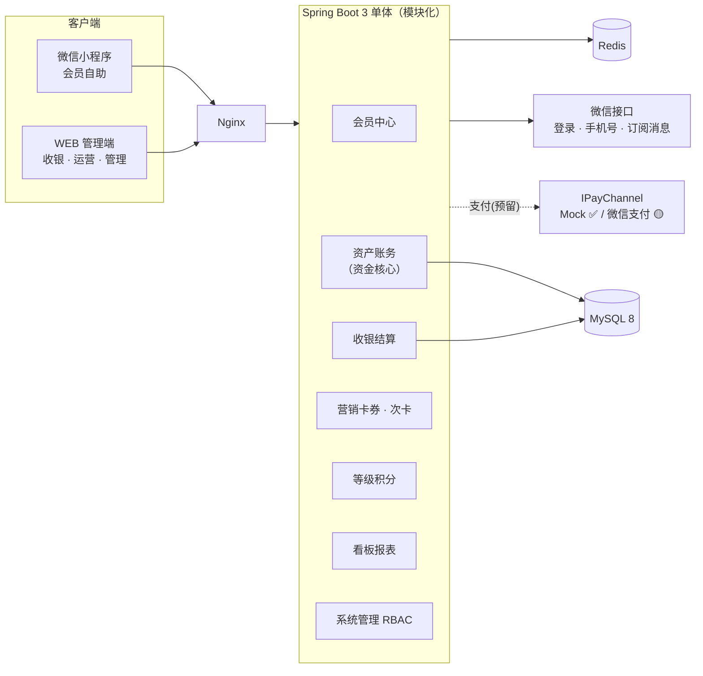

# 会员管理系统（Member System）· 设计方案

> 面向**单品牌多门店**实体经营场景的会员管理系统：**微信小程序端**服务会员自助，**WEB 管理端**服务收银与运营。
>
> 技术栈：**Vue 3**（uni-app + Element Plus） ｜ **Spring Boot 3 / Java 21** ｜ **MySQL 8** ｜ Redis
>
> 当前阶段：**🟢 后端 + WEB 管理端 + 微信小程序端 + 次卡 + 等级引擎 + 看板 + 推荐/生日/消息 + 微信支付骨架 + 员工与账号分离 + 操作留痕/性能索引/看板缓存/多实例与限流 + Redis 可切换已完成，564 项端到端自检全绿（Caffeine 与 Redis 两种缓存后端各跑一遍）**
>
> 👉 **看最新实施结果请读 [docs/14-优化实施记录.md](./docs/14-优化实施记录.md)**（审计留痕 / 幂等收口 / 性能索引 / 看板缓存 / 前端分包 / ShedLock 多实例 / 限流；含两个实测发现的隐藏缺陷与一次「断言静默消失」复盘）
> 👉 Redis 切换与多实例部署见 [docs/15-Redis切换与多实例.md](./docs/15-Redis切换与多实例.md)（怎么切、切完暴露的 5 个隐藏缺陷、上生产前还要补什么）
> 👉 优化方案（改什么、为什么、不建议做什么）见 [docs/13-优化方案.md](./docs/13-优化方案.md)
> 👉 第四轮（员工成为独立实体 / 门店管理 / 业绩归属修正）见 [docs/12-实施记录-第四轮.md](./docs/12-实施记录-第四轮.md)
> 👉 第三轮（挂单导出 / WEB 补齐 / 推荐生日 / 消息 / 微信支付骨架）见 [docs/11-实施记录-第三轮.md](./docs/11-实施记录-第三轮.md)
> 👉 第二轮（小程序端 / 次卡 / 等级评定 / 看板报表）见 [docs/10-实施记录-第二轮.md](./docs/10-实施记录-第二轮.md)
> 👉 第一轮（后端基础 + 收银结算 + 支付预留 + WEB 端）见 [docs/09-实施记录.md](./docs/09-实施记录.md)

---

## 一、这套设计解决了什么

| 能力 | 说明 |
|---|---|
| **四账分离的会员资产** | 本金余额 / 赠送余额 / 积分 / 成长值分账管理，赠送不可退、消费先扣赠送、赠送抵扣不计积分——从模型上堵住"充1000送1000套现/刷等级"的风险 |
| **账实相符的收银闭环** | 每一笔资产变动都写不可变流水（含 before/after 快照）；三层幂等（Redis 幂等键 + 唯一索引 + 行锁乐观锁）；T+1 自动对账，余额恒等于流水合计 |
| **可配的等级与积分引擎** | 等级门槛、折扣率、积分倍率、积分有效期、抵扣比例全部落表配置；规则支持可视化构造器 + 保存前模拟测算 |
| **完整的营销工具箱** | 券模板（满减/折扣/代金/兑换）、定向与条件批量发券、券锁定与并发安全核销、**推荐有礼（邀请码签名 + 十条防刷 + 三道补偿）**、**生日礼（一年一次唯一索引 + 部分失败可修复 + 闰日降级）**、次卡/服务卡、**消息中心（站内信兜底，微信订阅消息额度记账）** |
| **不依赖线上支付即可营业** | 按需求先做线下收银记账（现金 / 线下扫码 / 储值余额 / 组合支付）；**小程序支付接口已完整预留**：`PayChannel` 抽象 + 支付单/回调日志表 + 22 个接口 + 小程序支付页 + 掉单补偿与支付对账，本期用 `MockPayChannel` 跑通全链路；**`WechatPayChannel`（APIv3 签名/验签/回调解密/平台证书自动下载/本地自检）已实现并就绪检测通过**，补齐商户参数即可真实收款，业务代码与数据库零改动 |
| 双端协同 | 小程序端：资产/账单/卡券/60 秒动态核销码/积分商城/推荐；WEB 端：收银台（Pad 适配）、会员 360°、发券向导、看板、**员工与门店**、RBAC 权限与审计 |
| **员工与账号分离** | `m_staff`（业务主体：业绩归他、工牌是他）与 `m_sys_user`（访问凭证：能登录、有角色）通过可选的 `staff_id` 关联。**离职只改员工状态、不动账号**；停用账号也不动员工档案；二者不一致时界面直接给出告警。业绩按 `m_order.staff_id` 归属，代班不串人、离职后历史业绩仍可查 |

---

## 二、文档导航

| # | 文档 | 内容 | 读者 |
|---|---|---|---|
| 00 | [需求与总体方案](./docs/00-需求与总体方案.md) | 项目定位、业务模型（四类资产/等级/卡/券/收银）、角色与 20 个用例、14 个功能模块、非功能需求、里程碑、**不做清单** | 全员 |
| 01 | [系统架构设计](./docs/01-系统架构设计.md) | 技术选型与理由、总体架构图、后端分层与模块依赖、部署架构、9 项关键机制（双端鉴权/幂等并发/资产统一入口/事件驱动/等级引擎/积分/券/对账/缓存）、安全设计、**ADR** | 开发 |
| 02 | [数据库设计](./docs/02-数据库设计.md) | 设计规范、**47 张表清单**、5 张 ER 图、资金核心表字段级说明、支付单与回调日志、索引设计、初始化字典与系统参数 | 开发/DBA |
| 03 | [接口设计](./docs/03-接口设计.md) | 通用规范、统一响应体、**错误码体系（含 7xxxx 支付段）**、约 **197 个 REST 接口**清单 + 关键请求/响应示例（含收银结算、试算、发券、核销、对账、**支付下单/回调**） | 前后端 |
| 04 | [前端页面与路由设计](./docs/04-前端页面与路由设计.md) | WEB 端布局/菜单/**完整路由表**/核心页面详细设计（收银台三区布局、会员列表、发券向导、等级规则构造器、支付单与支付对账页）/工程结构；小程序端 tabBar 与 25+ 页面（含**在线充值/支付结果/待支付**）、关键页交互、分包策略 | 前端/产品 |
| 05 | [核心业务流程](./docs/05-核心业务流程.md) | 20 个流程的实现说明书：建档/合并/充值/撤销/消费结算（含金额计算链与余额扣减算法）/退单冲正/**在线支付退款**/等级评定/积分 FIFO 与过期/券核销校验链/次卡核销/推荐/生日礼/交接班与对账/**小程序在线支付全链路与十条幂等防线**/异常补偿 + **20 条验收测试清单** | 开发/测试 |
| 06 | [工程结构与实施计划](./docs/06-工程结构与实施计划.md) | Monorepo 结构、后端分包与命名规范、**12 条编码铁律**、前端工程约定、本地环境搭建与一键启动、**P0~P7 + P8 支付接入**实施顺序与验收标准（约 39 + 3~4 人日）、**13 项风险登记册** | 开发/PM |
| 07 | [待确认项与评审清单](./docs/07-协议与待确认项.md) | A~E 五类待决策项（含默认取法）、逐项打勾的评审检查清单、已确认决策回顾、评审记录表 | 需求方 |
| 08 | [支付接口预留与启用方案](./docs/08-支付接口预留与启用方案.md) | 支付预留的三层接口、全链路时序、十条幂等与安全防线、**P8 启用清单（资质/配置/代码/验证）**、FAQ | 开发/运维 |
| 09 | [**实施记录（P0~P2）**](./docs/09-实施记录.md) | **已落地的代码清单**、环境适配说明、**40 项端到端自检结果**、**8 个已修复缺陷（含 4 个资金级）**、与原设计的偏差取舍、运行与自检命令、下一阶段建议 | 全员 |
| 10 | [**实施记录（第二轮）**](./docs/10-实施记录-第二轮.md) | 小程序端 11 页面、次卡售卡核销、**等级评定引擎**、**看板报表 9 类**、**102 项自检结果**、本轮 5 个缺陷修复、**PowerShell UTF-8 陷阱与 npm NODE_ENV 陷阱** | 全员 |
| 11 | [**实施记录（第三轮）**](./docs/11-实施记录-第三轮.md) | **挂单/取单**、**会员导入导出**、**WEB 补齐 9 页**（券模板/发券向导/等级规则/RBAC/图表/推荐/生日/消息/导入）、**推荐有礼**、**生日礼**、**消息中心与订阅消息**、**微信支付 APIv3 骨架**、**294 项自检结果**、本轮 5 个新坑（含 BlockAttack 拦截 upsert、私钥缓存键缺陷） | 全员 |
| 12 | [**实施记录（第四轮）**](./docs/12-实施记录-第四轮.md) | **员工成为独立实体**（`modules/staff` 全套 + 离职复职 + 账号关联）、**门店管理**、**业绩归属从「账号」改回「员工」**、WEB 补齐「门店与员工」三个死链菜单、**396 项自检结果**、本轮 3 个坑（缺 `fill` 注解、`store_id` NOT NULL、BOM 再次咬人但被守卫拦下） | 全员 |
| 13 | [**优化方案**](./docs/13-优化方案.md) | 基于实测体检的 **P0~P3 共 17 项优化**：资金幂等漏洞、审计空白、索引缺失、生日全表扫、N+1、看板缓存空转、ShedLock 未启用、无限流、前端分包、类型债；含**四批执行顺序**、每批验收方式、**6 条「不建议做的事」**、4 个待确认取舍 | 开发/PM |
| 14 | [**优化实施记录**](./docs/14-优化实施记录.md) | 四批全部落地：操作留痕（**默认全记 + 22 条显式豁免**）、资产调整幂等闭环、V8 索引与生成列、N+1 批量化、看板读缓存与按前缀失效、前端 3.1→2.36 MB、**ShedLock 14 个任务 + 从 JVM 外部抢锁的验证法**、缓存就绪检测、限流（34 个端点）；**实测发现的隐藏缺陷**（Caffeine 计数器 TTL 被忽略、方法级 `@RateLimit` 绑定为 null、切 Redis 后的 5 个问题）与**一次「断言静默消失」复盘**；**564 项自检结果** | 全员 |
| 15 | [**Redis 切换与多实例**](./docs/15-Redis切换与多实例.md) | 为什么 Redis 是**正确性前提**而非性能优化、五步切换手册（含「环境变量会被 profile 覆盖」这个坑）、**切换后实测暴露的 5 个隐藏缺陷**（看板 500 / 微信支付就绪失败 / 证书缓存类型错 / 登录态缓存永不命中 / 缓存写失败冒泡）、三种守卫（启动告警 + 就绪接口 + 自检断言）、两种后端的行为对齐点、上生产前还要补什么 | 开发/运维 |
| — | [backend/src/main/resources/db/migration/](./backend/src/main/resources/db/migration/) | **Flyway V1~V9**：47 张表 + 菜单权限种子 + 会员导入菜单 + 推荐/生日/消息 + 微信支付参数 + 员工门店权限 + 审计索引 + 性能索引/生成列 + ShedLock 表与限流参数 | 开发/DBA |

---

## 三、系统全景



---

## 四、核心数据模型（Flyway V1 建 47 张业务表，V4 新增 2 张 → 现 49 张业务表 + `shedlock` 锁表 + `flyway_schema_history`，共 51 张）

```
会员 m_member ──1:1── m_member_account（本金/赠送/积分/成长值 + 乐观锁）
     │                      │
     │                      ├── m_balance_flow   余额流水（before/after 快照，只增不改）
     │                      ├── m_point_flow     积分流水
     │                      ├── m_point_batch    积分批次（FIFO 过期）
     │                      └── m_growth_flow    成长值流水
     ├── m_order（消费/充值/售卡/兑换/挂单）── m_order_item / m_order_payment / m_order_refund
     │        └── m_payment_order（在线支付单）── m_payment_notify_log（回调原文与验签记录）
     ├── m_member_coupon（券实例）── m_coupon_tpl（模板） / m_coupon_use_log（核销）
     ├── m_member_card（次卡）── m_member_card_item / m_card_verify_log
     ├── m_referral / m_referral_reward（推荐有礼：关系 + 双方奖励发放记录）
     ├── m_birthday_gift_log（生日礼，(member_id, gift_year) 唯一 —— 一年只送一次的真相来源）
     └── m_message_tpl / m_message_record / m_message_subscribe（消息模板 / 发送记录 / 订阅额度）
```

**不变量（每日对账任务强制校验）**
```
balance       == Σ m_balance_flow(本金).change_amount
gift_balance  == Σ m_balance_flow(赠送).change_amount
points        == Σ m_point_batch.remain_points
growth        == Σ m_growth_flow.change_growth
order.paid_amount == Σ m_order_payment.amount
```

---

## 五、技术栈一览

| 层 | 选型 |
|---|---|
| 小程序端 | uni-app（Vue 3 + Vite + TS）+ uview-plus + Pinia |
| WEB 管理端 | Vue 3.4 + Vite 5 + TypeScript + Element Plus + Pinia + ECharts + Axios |
| 后端 | Java 21 + Spring Boot 3.2 + Spring Security(JWT) + MyBatis-Plus + Flyway + springdoc-openapi + MapStruct + Hutool/EasyExcel |
| 数据库/缓存 | MySQL 8.0.35（InnoDB/utf8mb4）+ Redis 7 |
| 支付（预留） | `IPayChannel` 抽象（MockPayChannel 已实现 / WechatPayChannel 待接微信支付 APIv3 / AlipayChannel 占位） |
| 任务/一致性 | Spring @Scheduled + ShedLock + Spring Event(afterCommit) + T+1 对账 |
| 部署 | Docker Compose（mysql/redis/backend/nginx）+ Nginx 反代 |

---

## 六、设计亮点（评审时建议重点看这几处）

1. **本金与赠送余额分离**（[02 §4.2](./docs/02-数据库设计.md)）——退款只退本金，储值负债报表只统计本金，杜绝套现。
2. **金额计算链与余额扣减算法**（[05 §3.1/§3.3](./docs/05-核心业务流程.md)）——顺序固定、服务端重算不信任前端、SQL 层 `WHERE balance >= ?` 双重防超扣。
3. **三层幂等 + 行锁**（[01 §5.2](./docs/01-系统架构设计.md)）——Redis 幂等键 → 数据库唯一索引 → `SELECT FOR UPDATE` + 乐观锁版本号。
4. **券的锁定-核销两段式**（[05 §7.4](./docs/05-核心业务流程.md)）——解决多收银台并发用同一张券。
5. **积分双表（流水 + 批次）**（[02 §4.4](./docs/02-数据库设计.md)）——同时支持"积分怎么来的"与"多少分快过期"，FIFO 过期语义清晰。
6. **资产变动唯一入口 `AccountService`**（[01 §5.3](./docs/01-系统架构设计.md)）——所有模块必须经它变动资产，流水与余额天然同事务一致。
7. **收费主链路与营销解耦**（[01 §3.3/§5.4](./docs/01-系统架构设计.md)）——收银只做结算，积分/等级/消息/推荐通过 `afterCommit` 事件异步联动，失败可重试。
8. **对账中心可检出差异**（[05 §11.2](./docs/05-核心业务流程.md)）——10 项校验 + 差异告警 + 调账留痕。
9. **支付做成可插拔的"订单执行器"**（[01 §6](./docs/01-系统架构设计.md)、[08 支付预留方案](./docs/08-支付接口预留与启用方案.md)、[11 §7](./docs/11-实施记录-第三轮.md)）——`PayChannel` 抽象 + 支付单 + 回调日志 + 十条幂等防线；Mock 渠道跑通全流程，`WechatPayChannel`（APIv3 请求签名 / 回调验签 / AES-256-GCM 解密 / 平台证书自动下载轮换 / 就绪检测 / **私钥自签自验的本地自检**）已实现，补齐商户参数即可真实收款，**业务代码与数据库零改动**；线上充值到账与收银员手工充值**共用同一个入账入口**，不会出现两套账。
10. **消息体系的三条不变量**（[11 §6](./docs/11-实施记录-第三轮.md)）——幂等（唯一索引）/ 不丢内容（订阅消息不可用时降级站内信）/ 不阻断主链路（静默发送）。微信「一次性订阅」的额度按模板维度记账并用条件 UPDATE 预扣，杜绝"授权 1 次发出去 3 条"的越权触达。
11. **推荐与生日礼的失败面被显式覆盖**（[11 §4/§5](./docs/11-实施记录-第三轮.md)）——结算用条件 UPDATE 抢占、发奖与结算分事务、三道补偿任务（兜底结算 / 奖励重试 / 奖励对账补建）；生日礼用 `(会员, 年份)` 唯一索引做"一年一次"的真相来源，部分失败可修复。

---

## 七、下一步（当前进度）

### 已完成 ✅（P0~P2 + 小程序端 + 次卡 + 等级 + 看板 + 推荐/生日/消息 + 微信支付骨架）

| 阶段 | 交付 | 验证 |
|---|---|---|
| P0 | 后端骨架、47 表 Flyway 迁移、菜单权限种子、JWT 双端鉴权、缓存抽象 | 登录/菜单/权限 ✅ |
| P1 | 会员中心（建档/多条件列表/360°/标签/状态/调级）、资产账务（统一入口/充值/撤销/调整/流水/对账） | 12 项 ✅ |
| P1 | **次卡售卡与核销**（权益项、冻结、延期、按剩余次数折算退卡） | 含在 28 项 ✅ |
| P1 | **挂单/取单/弃单/超时清理**（购物车快照 + 条件 UPDATE 抢占取单权） | 27 项 ✅ |
| P1 | **会员导入导出**（模板下载 / 部分成功 / 错误明细可下载 / 按筛选导出） | 含在 27 项 ✅ |
| P2 | 收银结算（试算/组合支付/积分抵扣/券/幂等）、订单与退单审批、交接班汇总 | 28 项 ✅ |
| P2 | **等级评定引擎** + **等级规则可视化编辑**（字段/操作符白名单 + 模拟测算 + 批量重算） | 49 项 ✅ |
| P2 | **看板报表**（经营总览/趋势/留存/RFM/沉睡会员/排行/负债）+ **ECharts 图表页** | 含在 49 项 ✅ |
| P2 | **券模板管理 + 发券向导**（会员/条件/全量三态，先预估后发放，可查任务进度） | 含在 49 项 ✅ |
| P2 | **RBAC**（用户/角色/菜单树授权）+ 操作日志 + **登录日志（含 4 类失败原因）** | 含在 49 项 ✅ |
| P2 | **推荐有礼**（邀请码 HMAC 签名 / 十条防刷校验链 / 首单结算 / 月度上限 / 三道补偿任务） | 115 项 ✅ |
| P2 | **生日礼**（(会员,年份) 唯一索引 / 部分失败可修复 / 闰日降级 / 生日年份占位兼容） | 含在 115 项 ✅ |
| P3 | **消息中心**（模板/记录/指数退避重试/站内信兜底降级/微信订阅额度记账） | 含在 115 项 ✅ |
| P3 | **微信支付 APIv3 骨架**（请求签名/回调解密/平台证书自动下载/就绪检测/本地自签自验） | 含在 115 项 ✅ |
| P3 | 支付预留层（`PayChannel` + Mock 渠道 + 回调 + 掉单补偿/超时关单/券锁定释放） | 含小程序端 33 项 ✅ |
| P2 | **员工管理**：员工独立实体、离职/复职、关联登录账号，**「员工离职」与「账号停用」成为两条独立生命周期** | 102 项 ✅ |
| P2 | **门店管理**：CRUD、停业/营业、店长、删除前引用盘点守卫 | 含在 102 项 ✅ |
| P2 | **业绩归属修正**：报表从按 `cashier_id`（账号）改为按 `m_order.staff_id`（员工），结算时未传归属自动回落到账号绑定员工 | 含在 102 项 ✅ |
| M14 | **微信小程序端**（14 页面 + tabBar：首页/核销码/充值/账单/卡券/我的/钱包/等级/门店/绑手机/推荐/生日/消息） | 33 项 ✅ |
| WEB | 管理端 **22 个页面**（+ 门店管理/员工管理/业绩排行） | 构建 + 类型检查 ✅ |

### 待开发 ⏳

| 优先级 | 任务 | 前置条件 |
|---|---|---|
| P3 | 微信支付**真机联调**（渠道代码已就绪，缺商户参数） | 商户号 + 商户证书 + APIv3 密钥 + 公网 HTTPS 回调 |
| P3 | 订阅消息**真实下发**（模块已就绪，缺模板 ID） | 公众平台申请模板 + 配置 `wx_template_id` / `wx_data_map` |
| P3 | 小程序 AppID/Secret 真机登录（当前 Mock 登录可跑通全流程） | 替换 `wx.miniapp.appid` / `wx.miniapp.secret` |
| P4 | **会员合并**（`m_member_merge_log` 表已建，缺业务实现） | — |
| P4 | 多实例部署前置：切 Redis 缓存 + ShedLock + 流水归档 | — |
| P4 | 短信渠道（实现 `MessageChannel` 接口即可，约半天） | 短信服务商账号 |

### 待你确认 / 提供 🔑

- 微信小程序 **AppID / AppSecret** —— 配置后订阅消息渠道自动就绪（当前降级为站内信）；
- **订阅消息模板 ID** —— 在公众平台申请后填入「营销中心 → 消息中心 → 模板 → 微信模板ID」；
- 微信支付 **商户号 / 商户证书序列号 / APIv3 密钥 / 商户私钥** —— 填入「系统管理 → 系统参数 → pay-wechat」，
  然后用「支付中心 → 渠道诊断」的**本地自检**确认就绪（自检同时校验私钥能否自签自验）；
- 更早遗留的评审项：Q1~Q10、A16~A20、D7~D10、F1~F6（见 [07-协议与待确认项](./docs/07-协议与待确认项.md)）。

---

## 八、快速开始（本机已实测）

> 环境适配：本机**未装 Docker / Maven**，但**已装 MySQL 8.4**。因此改用「便携 Maven + 本机 MySQL」，
> Redis 通过 `CacheService` 抽象降级为本地 Caffeine（单机可跑，生产切配置即可）。

```powershell
# 1) 安装便携 Maven（已装可跳过，会下载到 tools/，不污染系统）
powershell -ExecutionPolicy Bypass -File scripts\install-maven.ps1

# 2) 构建后端
cd backend
..\tools\apache-maven-3.9.9\bin\mvn.cmd -DskipTests package

# 3) 重置数据库（可选；Flyway 首次启动会自动建 47 表 + 初始化数据）
powershell -ExecutionPolicy Bypass -File ..\scripts\reset-db.ps1 -Yes

# 4) 启动后端（Ctrl+C 停止）
java -jar target\member-system.jar --spring.profiles.active=local
#    健康检查 http://127.0.0.1:8080/actuator/health
#    接口文档 http://127.0.0.1:8080/swagger-ui.html

# 5) 一键回归（推荐）：重置库 → 启动后端 → 依次跑十二套自检 → 汇总（含断言数哨兵）
powershell -ExecutionPolicy Bypass -File scripts\run-all-tests.ps1
#    或单跑某一套（后端需已启动）：
powershell -ExecutionPolicy Bypass -File scripts\smoke-test-ascii.ps1    # 基础功能 12 项
powershell -ExecutionPolicy Bypass -File scripts\money-chain-test.ps1    # 资金链路 29 项
powershell -ExecutionPolicy Bypass -File scripts\mp-flow-test.ps1        # 小程序端 33 项
powershell -ExecutionPolicy Bypass -File scripts\round2-test.ps1         # 次卡/等级/看板 29 项
powershell -ExecutionPolicy Bypass -File scripts\round3-test.ps1         # 挂单/导入导出 27 项
powershell -ExecutionPolicy Bypass -File scripts\round4-test.ps1         # WEB 后端端点 49 项
powershell -ExecutionPolicy Bypass -File scripts\round5-test.ps1         # 推荐/生日/消息/微信支付 115 项
powershell -ExecutionPolicy Bypass -File scripts\round6-test.ps1         # 员工/门店/业绩归属 102 项
powershell -ExecutionPolicy Bypass -File scripts\round7-test.ps1         # 操作留痕/资产调整幂等 57 项
powershell -ExecutionPolicy Bypass -File scripts\round8-test.ps1         # 性能索引/生成列/N+1 40 项
powershell -ExecutionPolicy Bypass -File scripts\round9-test.ps1         # 看板缓存/前端分包/类型 27 项
powershell -ExecutionPolicy Bypass -File scripts\round10-test.ps1        # ShedLock/缓存就绪/限流 44 项

# 5b) 可选：整套跑在 Redis 上（验证多实例前提；需先 scripts\start-redis.ps1）
powershell -ExecutionPolicy Bypass -File scripts\start-redis.ps1          # 起便携 Redis（tools/，已被 gitignore）
powershell -ExecutionPolicy Bypass -File scripts\run-all-tests.ps1 -CacheType redis
powershell -ExecutionPolicy Bypass -File scripts\start-redis.ps1 -Stop    # 用完停掉

# 6) 启动 WEB 管理端
cd web-admin
npm install --include=dev     # 注意：若环境变量 NODE_ENV=production，必须加 --include=dev
npm run dev                   # http://127.0.0.1:5173

# 7) 构建小程序端（用微信开发者工具导入 dist\build\mp-weixin）
cd mp-member
npm install --include=dev
npm run build:mp-weixin
```

**默认账号**：`admin` / `Admin@123`（BCrypt 存储，生产环境请立即修改）

**注意**：若 shell 中 `NODE_ENV=production`，npm 会跳过 devDependencies 导致 `vite: not found`，
请用 `npm install --include=dev` 或在安装前 `$env:NODE_ENV="development"`。

---

## 九、目录结构

```
member-system/
├─ README.md                 ← 本文件
├─ .gitignore
├─ docs/                     ← 设计文档 00~08 + 实施记录 09~12 + 优化方案 13 + 优化实施记录 14 + Redis 切换手册 15
├─ sql/                      ← Flyway 迁移的**只读镜像**（权威副本在 backend/src/main/resources/db/migration/，见 sql/README.md）
├─ backend/                  ← Spring Boot 3 后端（P0~P2 + 小程序端 + 推荐/生日/消息 + 微信支付骨架 + 员工门店 + 审计/限流/分布式锁）
│   ├─ pom.xml
│   └─ src/main/
│       ├─ java/com/company/member/
│       │   ├─ common/       ← 响应体/异常/幂等/**审计切面**/**限流切面**/缓存/工具/配置
│       │   ├─ security/     ← JWT + RBAC + 数据权限
│       │   ├─ mp/           ← 小程序端服务与控制器
│       │   ├─ modules/      ← member/account/cashier/card/product/marketing/
│       │   │                   referral/birthday/message/payment/report/
│       │   │                   staff/store/system
│       │   └─ job/          ← 券与积分过期、次卡、等级、支付、推荐、生日、消息任务（全部带 @SchedulerLock）
│       └─ resources/
│           ├─ application.yml      ← 多 profile（local/test/prod）
│           └─ db/migration/        ← ★ Flyway V1~V9（唯一可编辑的迁移脚本目录）
├─ web-admin/                ← Vue3 + TS + Element Plus 管理端（22 个页面）
│   ├─ package.json / vite.config.ts / tsconfig.json
│   └─ src/{api,store,router,layout,views,styles}
├─ mp-member/                ← uni-app 小程序端（14 个页面）
│   ├─ package.json / vite.config.ts
│   └─ src/{api,config,pages,utils}
├─ scripts/                  ← 运维与自检脚本（见 scripts/README.md）
│   ├─ run-all-tests.ps1     ← ★ 一键回归入口（十二套 564 项 + 断言数哨兵；-CacheType redis 可整套跑在 Redis 上）
│   ├─ {smoke,money-chain,mp-flow,round2~10}-test.ps1
│   ├─ {install-maven,start-backend,start-redis,reset-db}.ps1
│   └─ tools/                ← 开发期工具（编码守卫 ensure-bom、留痕复核 audit-coverage、DDL 校验、BCrypt、测试数据生成）
├─ logs/                     ← 运行日志与测试产物（已被 .gitignore 忽略）
└─ tools/                    ← 便携工具（已被 .gitignore 忽略）：Maven（install-maven.ps1）+ Redis（start-redis.ps1）
```
