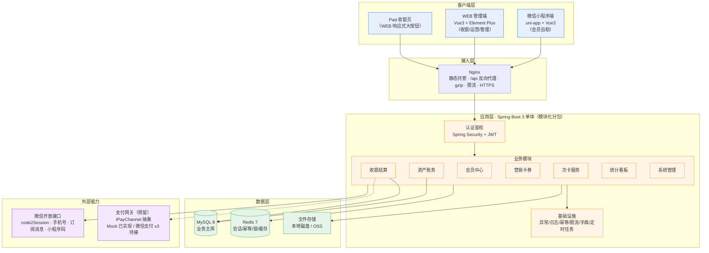
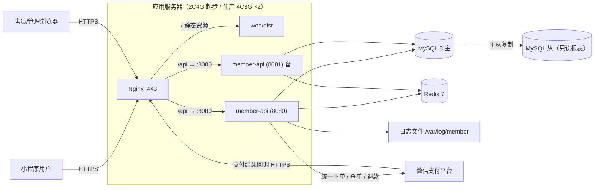
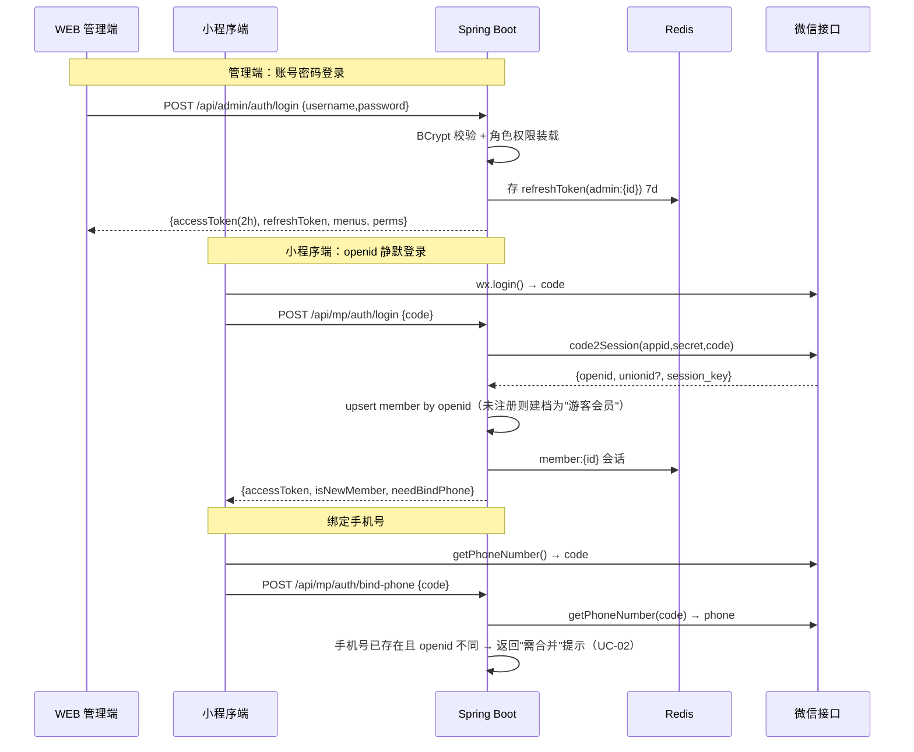
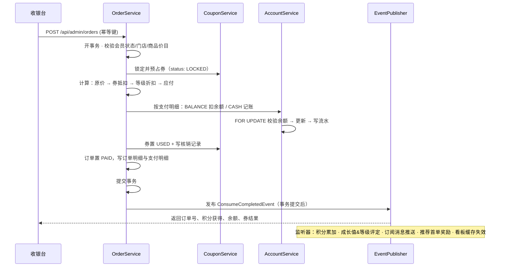
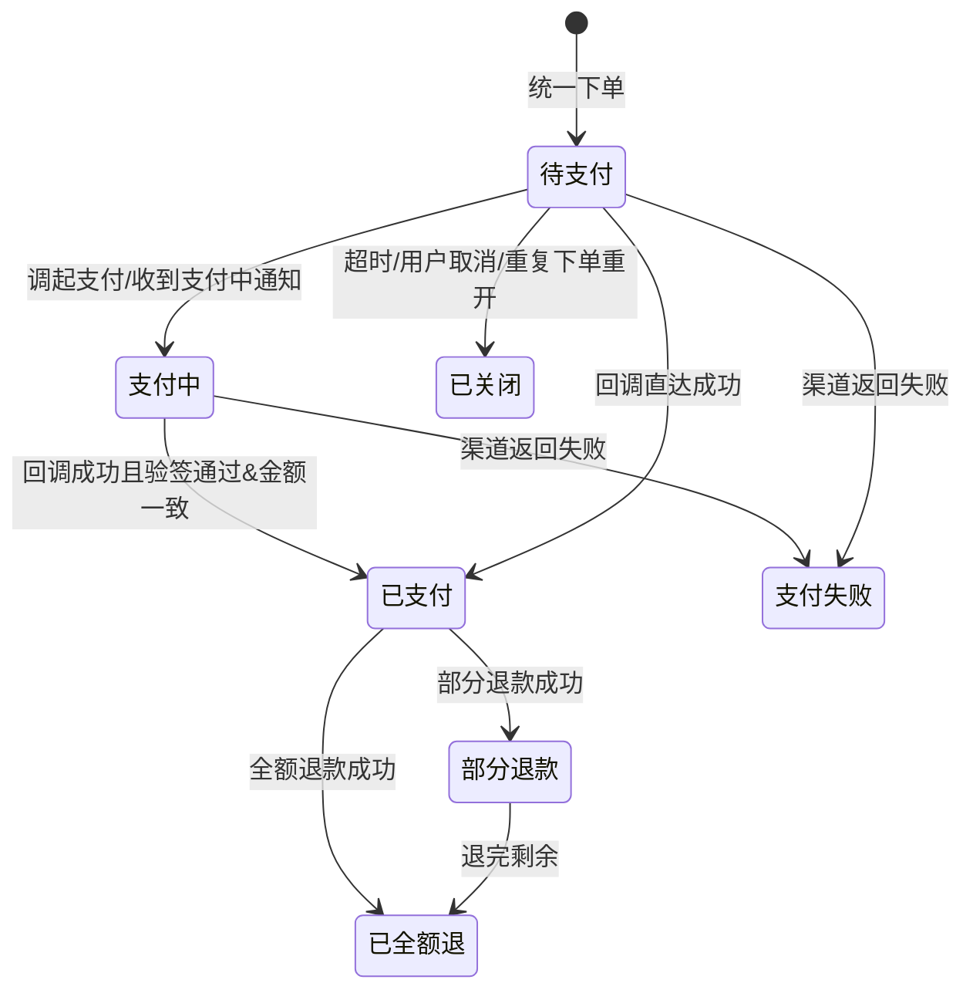
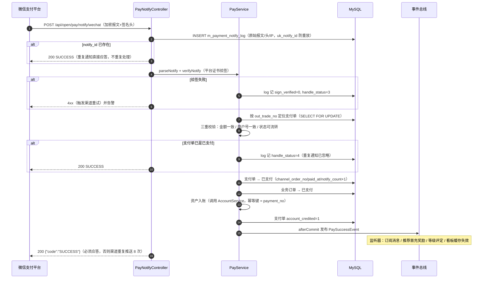

# 会员管理系统 · 系统架构设计

> 配套文档：[00-需求与总体方案](./00-需求与总体方案.md) ｜ 版本 v1.0

---

## 1. 技术选型（含理由与替代方案）

### 1.1 后端

| 层面 | 选型 | 版本 | 理由 |
|---|---|---|---|
| 语言/运行时 | Java | 21 (LTS) | 本机已装 21.0.11；虚拟线程可用，IO 密集接口吞吐更好 |
| 框架 | Spring Boot | 3.2.x | 生态成熟；Jakarta EE 命名空间 |
| Web | Spring MVC + Validation | — | REST + `@Validated` 参数校验 |
| 安全 | Spring Security + JWT (jjwt 0.12) | — | 双端鉴权（管理端账号密码 / 小程序 openid），无状态 |
| ORM | **MyBatis-Plus 3.5.x** | — | 国内企业主流、SQL 可控、分页/逻辑删除/自动填充开箱即用；资金类 SQL 手写更放心 |
| 数据库 | MySQL | 8.0.35+ | 事务、行锁、`DECIMAL`、窗口函数（看板统计）、CTE |
| 连接池 | HikariCP | 内置 | — |
| 缓存 | Redis | 7.x | 登录态、验证码、幂等键、防重锁、字典缓存、看板结果缓存、分布式锁 |
| 数据库版本管理 | **Flyway** | 10.x | DDL 可追溯、可回滚（前滚式），多人协作不打架 |
| 定时任务 | Spring `@Scheduled` + ShedLock | — | 多实例部署防重复执行；积分过期、等级评定、生日礼、对账、归档 |
| 接口文档 | springdoc-openapi | 2.x | Swagger UI 自动生成，供前端联调 |
| 对象映射 | MapStruct | 1.5.x | Entity ↔ DTO 编译期生成，零反射 |
| 工具 | Hutool、Lombok、EasyExcel | — | 工具集、样板代码消除、导入导出 |
| 日志 | Logback + MDC traceId | — | 全链路 traceId 串联 |
| 构建 | Maven 3.9（建议用 `mvnw` 包装器，免装 Maven） | — | 本机未安装 Maven |
| 测试 | JUnit 5 + Mockito + Testcontainers(MySQL) | — | 资金逻辑必须有单测；Testcontainers 保证 SQL 真实 |

**为什么不用 Spring Data JPA**：会员系统的核心是"复杂条件查询 + 手写资金 SQL + 批量统计"，MyBatis-Plus 的可控性优于 JPA 的隐式行为，且 `FOR UPDATE` 加锁语义更直观。

**为什么不用 Spring Cloud 微服务**：单业务域、团队规模小、数据强一致要求高。单体 + 模块化分包（Modulith 风格）足够，后续需要拆分时按包边界切即可。

### 1.2 前端 · WEB 管理端

| 层面 | 选型 | 理由 |
|---|---|---|
| 框架 | **Vue 3.4** + `<script setup>` + TypeScript | 用户指定 Vue；TS 保证接口字段不出错 |
| 构建 | Vite 5 | 秒级热更新 |
| UI | **Element Plus 2.x** | 后台管理组件最全（表格/表单/弹窗/上传/树） |
| 状态 | Pinia + pinia-plugin-persistedstate | 登录态、用户信息、字典缓存持久化 |
| 路由 | Vue Router 4（动态路由 + 后端菜单权限） | 权限菜单由后端下发 |
| 请求 | Axios 封装（拦截器：token 注入、401 刷新、错误码统一提示、重复请求取消） | — |
| 图表 | ECharts 5 | 看板 |
| 表格 | Element Plus Table（主）+ 虚拟滚动（vxe-table 备选，会员大列表） | — |
| 工具 | VueUse、dayjs、decimal.js（前端金额计算）、unocss（原子样式，可选） | 金额禁用浮点 |
| 打印 | 小票：`vue-plugin-hiprint` 或浏览器 `window.print()` + 小票 CSS | 收银小票 |
| 规范 | ESLint + Prettier + Stylelint + husky + commitlint | — |

### 1.3 前端 · 微信小程序端

| 层面 | 选型 | 理由 |
|---|---|---|
| 框架 | **uni-app（Vue 3 + Vite + TS）** | 用 Vue 语法写小程序，与 WEB 端技术栈统一，未来可发 H5/App |
| UI | **uni-ui / uview-plus** | 小程序生态成熟组件 |
| 状态 | Pinia | 与 WEB 端一致 |
| 请求 | `uni.request` 封装（拦截器、loading、错误提示、token 刷新） | — |
| 图表 | uCharts（qiun-data-charts） | 消费趋势 |
| 二维码 | `uqrcode` / 后端生成核销码（推荐后端生成，防伪） | 核销码 |
| 编译目标 | 微信小程序（主）；H5（备用，便于本地快速调试） | — |

> **备选方案**：原生小程序 + TypeScript（性能最优但开发效率低、与 WEB 端无法复用逻辑）。本期选 uni-app；若你团队已熟悉原生开发，可在评审时替换，不影响后端与接口设计。

### 1.4 运维与交付

| 项 | 选型 |
|---|---|
| 反向代理 | Nginx（静态托管 + `/api` 反代 + gzip + 限流） |
| 容器化 | Dockerfile + docker-compose（mysql/redis/backend/nginx 一键起） |
| CI/CD | GitHub Actions / Jenkins：`mvn verify` → 镜像 → 部署 |
| 监控 | Spring Boot Actuator + Prometheus + Grafana（可选）；日志文件 + 异常告警 |
| 备份 | MySQL 每日全量 + binlog 增量；文件（券码/导出）走 OSS 或本地磁盘定期备份 |

---

## 2. 总体架构图



---

## 3. 后端分层与模块化分包

### 3.1 分层职责

```
Controller  →  只做参数校验、权限注解、DTO 转换，禁止业务逻辑
Service     →  业务编排、事务边界（@Transactional 只在此层）、领域校验
Manager     →  （可选）跨模块组合、外部接口封装（微信、支付）
Mapper      →  数据访问（MyBatis-Plus Mapper + XML 复杂 SQL）
Entity/PO   →  数据库映射对象，禁止直接返回给前端
DTO/VO      →  入参 DTO（带校验注解）/ 出参 VO
Convert     →  MapStruct 转换器
```

**铁律**：
1. 金额与资产变动只能在 `AccService`（资产账务服务）内发生，其他模块必须调用它，禁止直接 update 账户表。
2. 账户表更新必须走 `SELECT ... FOR UPDATE` + 写流水，且在同一事务内。
3. 所有对外接口返回统一 `R<T>` 包装；错误抛 `BizException(errorCode)`，由全局异常处理器翻译。

### 3.2 包结构

```
com.company.member
├── MemberApplication.java
├── common/                    # 通用能力
│   ├── result/                # R<T>, PageResult<T>, ErrorCode
│   ├── exception/             # BizException, GlobalExceptionHandler
│   ├── enums/                 # 业务枚举（流水类型、券状态、订单状态…）
│   ├── constant/              # 常量、Redis Key 规范
│   ├── util/                  # 金额、日期、脱敏、ID 生成、二维码工具
│   ├── annotation/            # @OpLog(操作日志), @Idempotent(幂等), @DataScope(数据权限)
│   ├── aspect/                # 上述注解的切面实现
│   ├── config/                # Mybatis/Redis/Web/Cors/Swagger/Security 配置
│   └── interceptor/           # traceId、租户(预留)、限流
├── security/                  # JWT、UserDetails、登录、token 刷新、双端认证
├── modules/
│   ├── member/                # 会员：档案、标签、等级、合并、导入导出
│   ├── account/               # 资产账务：账户、流水、充值、调整、对账
│   ├── cashier/               # 收银：订单、支付明细、退单、挂单、交班
│   ├── product/               # 商品/服务、充值方案、价目
│   ├── marketing/             # 券模板、会员券、核销、推荐、生日礼、活动
│   ├── card/                  # 次卡/服务卡：产品、售卡、核销
│   ├── store/                 # 门店、员工、班次
│   ├── report/                # 看板、报表、导出
│   ├── message/               # 订阅消息、站内信、模板管理
│   ├── payment/               # 支付中心（预留：小程序在线支付）
│   │   ├── channel/           # IPayChannel, PayChannelRegistry, PrepayResult,
│   │   │                      # MockPayChannel(已实现), WechatPayChannel(待实现), AlipayChannel(占位)
│   │   ├── PayService         # 统一下单/查单/关单/退款/回调（handlePaid 为统一幂等入口）
│   │   ├── PayNotifyController# /api/open/pay/notify/{channel}（免鉴权 + 验签）
│   │   └── PayReconcileService# 支付对账
│   └── system/                # 用户/角色/菜单/字典/参数/日志/任务
└── job/                       # 定时任务（积分过期、等级评定、生日礼、日对账、归档、
                               #          支付掉单补偿 PaySyncJob / 超时关单 PayCloseJob / 支付对账）
```

### 3.3 模块依赖规则（禁止循环）

```
system ──┐
store  ──┼──▶ member ──▶ account ──▶ (common)
product ─┤        ▲         ▲
marketing┘        │         │
card ─────────────┴─────────┘
cashier ──▶ member + account + marketing + card + product
report  ──▶ 只读查询（允许直连各模块 Mapper 的只读 SQL）
message ◀── 被各模块通过事件调用（Spring Event 解耦）
```

跨模块通信统一用 **Spring 事件（`ApplicationEventPublisher`）**：如 `ConsumeCompletedEvent` → 积分模块、等级模块、消息模块分别监听，保证收银主流程不被营销逻辑拖慢，且失败可重试。

---

## 4. 部署架构



> **支付回调可达性要求**（预留在 P8 启用）：`pay.notify-url` 必须是**公网 HTTPS 且不带参数的固定地址**（如 `https://domain.com/api/open/pay/notify/wechat`），不能走小程序分包路径；本地开发用 Mock 渠道或内网穿透（ngrok/frp）联调。

**环境划分**：`local`（H2/MySQL 本地 + Redis 本地）→ `dev`（开发服务器，自动部署）→ `test`（测试/验收）→ `prod`（生产，双实例 + 主从）。

**配置管理**：`application-{env}.yml` + 环境变量覆盖敏感项（DB 密码、微信 appid/secret、JWT secret）。**密钥禁止入库出仓**。

### docker-compose 一键起（开发环境）

| 服务 | 镜像 | 端口 |
|---|---|---|
| mysql | mysql:8.0 | 3306 |
| redis | redis:7-alpine | 6379 |
| backend | 本项目 build | 8080 |
| nginx | nginx:alpine | 80/443 |

---

## 5. 关键技术机制设计

### 5.1 双端认证鉴权



- 请求头：`Authorization: Bearer <accessToken>`
- 权限模型：`用户 → 角色 → 菜单/按钮权限码`，接口用 `@PreAuthorize("@ps.has('member:edit')")`
- 数据范围：角色配 `data_scope`（全部 / 本店 / 本人），MyBatis 拦截器自动拼 `store_id IN (...)` 条件
- 会话失效：登出、改密、禁用账号 → Redis 黑名单 + 版本号（`token_version`）实现即时踢人

### 5.2 幂等与并发控制（资金安全核心）

**三层防护**：

1. **接口幂等键**：请求头 `X-Idempotency-Key`（前端生成 UUID）。`@Idempotent` 切面用 Redis `SET NX EX 300` 占位；已存在则返回首次结果（缓存 5 分钟）。
2. **数据库唯一约束**：`m_balance_flow(order_no, biz_type)`、`m_order.order_no` 唯一，兜底重复写。
3. **行级悲观锁**：账户变动 SQL
   ```sql
   SELECT id, balance, gift_balance, version FROM m_member_account
    WHERE member_id = ? FOR UPDATE;   -- 事务内，锁住再算再更新
   UPDATE m_member_account
      SET balance = balance - #{amt}, version = version + 1, update_time = NOW()
    WHERE id = ? AND version = #{version};   -- 乐观双保险
   ```

**余额不可为负**：`UPDATE ... WHERE balance + gift_balance >= #{amt}`，`affectedRows = 0` 即余额不足，抛业务异常回滚。

**分布式锁**：同一会员的并发充值/消费用 `Redisson` 或 Redis `SET NX` 按 `lock:member:{id}` 串行化，锁超时 5s，防死锁。

### 5.3 资产变动统一入口（AccountService）

所有资产变动收敛为一个方法族，保证「流水 + 余额 + 审计」原子一致：

```java
public interface AccountService {
    /** 统一变动入口：余额/赠送/积分/成长值 任意组合，同一事务 */
    AccountChangeResult change(AccountChangeCmd cmd);

    /** 充值：本金 + 赠送 + 送券，返回充值单 */
    RechargeResult recharge(RechargeCmd cmd);

    /** 消费扣减：按支付明细逐笔扣减/记账 */
    ConsumeResult consume(ConsumeCmd cmd);

    /** 退单冲正：原单反向，退本金、扣回积分与赠送 */
    RefundResult refund(RefundCmd cmd);

    /** 调整（需原因 + 权限 + 审计） */
    AdjustResult adjust(AdjustCmd cmd);

    /** 校验：余额重算对账（定时任务调用） */
    ReconcileReport reconcile(Long memberId);
}
```

`AccountChangeCmd` 字段：`memberId, bizType, bizNo(业务单号), balanceDelta, giftDelta, pointsDelta, growthDelta, remark, operatorId, storeId, idempotencyKey, occurTime`。

### 5.4 收银结算事务边界



- **券先锁定后使用**（`LOCKED` → `USED` / 回滚 `UNUSED`），防止并发重复用券。
- **事件在事务提交后发送**（`TransactionSynchronization#afterCommit`），避免回滚后误发消息。
- **失败补偿**：消息推送失败入 `m_message_record(status=FAIL)`，定时任务重试 3 次。

### 5.5 等级规则引擎

规则存 `m_level_rule`（或 `m_level.rule_json`），表达式引擎用 **Aviator / SpEL**：

```json
{
  "levelId": 3,
  "levelName": "金卡",
  "condition": {
    "logic": "AND",
    "items": [
      {"field": "growth",       "op": ">=", "value": 2000},
      {"field": "payAmount12m", "op": ">=", "value": 1500}
    ]
  },
  "benefits": {"discount": 0.9, "pointsRate": 1.5, "birthdayCouponTplId": 12,
               "freeUpgrade": false, "cardDiscount": 0.85},
  "validMonths": 12,
  "keepRule": {"field": "payAmount12m", "op": ">=", "value": 1200}
}
```

评定流程：消费事件 → 刷新会员统计缓存（`m_member_stat` 定时/异步更新）→ 逐级从高到低匹配 → 首个满足即目标等级 → 与当前等级比较 → 升级写 `m_member_level_log` + 发消息。

### 5.6 积分体系

| 环节 | 规则 |
|---|---|
| 获取 | `积分 = floor(实付金额 × 等级积分倍率 × 品类倍率)`；退款/整单退 → 扣回 |
| 抵扣 | `抵扣金额 = 积分 / 兑换比例`，受「单笔最高抵扣比例」与「最低保留积分」限制 |
| 过期 | **FIFO 批次**：每次获得写 `m_point_batch(remain, expire_time)`；定时任务每日扫描到期批次扣减并写过期流水 |
| 查询 | 账户表给实时余额（快），批次表给明细与到期提醒（准）；每日对账任务校验 `批次余量之和 == 账户积分` |

### 5.7 券的发放与核销

- **发券**：模板 → 生成券实例（`m_member_coupon`，含唯一 `coupon_no` 与校验码）→ 支持定向/批量/自助领/活动触发。批量发券走**异步任务 + 分片**，进度可查。
- **核销校验链**：状态 `UNUSED` → 未过期 → 适用门店 → 适用商品 → 最低消费 → 不可叠加规则 → 占用锁定 → 置 `USED`。
- **核销方式**：收银台选券（主动）/ 扫会员核销码（被动）/ 输券码（兜底）。
- **过期**：定时任务置 `EXPIRED`；到期前 7/3/1 天推送提醒。

### 5.8 会员识别与核销码

- 会员核销码 = **动态码**：后端按 `HMAC(memberId + 时间窗(60s))` 生成 6 位数字或二维码内容，收银端扫码后调接口校验（时间窗 ±2 分钟容错），防截图盗刷；同时保留静态会员码（仅身份识别，不能直接扣款）。
- 收银台会员识别方式：手机号（后 4 位模糊）、卡号、扫动态/静态码、姓名模糊搜索。

### 5.9 数据一致性校验（T+1 对账任务）

| 校验项 | 规则 | 差异处理 |
|---|---|---|
| 余额 vs 流水 | `账户余额 == Σ(本金流水)` | 输出差异清单 + 告警，人工确认后生成调账单 |
| 赠送余额 vs 流水 | 同上 | 同上 |
| 积分 vs 批次 | `账户积分 == Σ(批次余量)` | 同上 |
| 券状态 | `USED 券必有核销记录`；`未过期券状态应为 UNUSED` | 自动修正 + 日志 |
| 订单 vs 支付明细 | `订单应付 == Σ支付明细金额` | 告警 |
| 门店日结 | `营收 = Σ现金 + Σ扫码 + Σ余额扣减` | 差异进交班单备注 |

### 5.10 缓存与性能策略

| 数据 | 策略 | 失效 |
|---|---|---|
| 数据字典 / 等级 / 券模板 | Redis 永久缓存 + 本地 Caffeine 二级 | 配置修改时主动删 key |
| 会员资产快照 | Redis Hash `member:asset:{id}`，TTL 5min | 资产变动后删除 |
| 门店/员工列表 | Redis TTL 30min | 变更删 key |
| 看板统计 | 预聚合 `m_stat_daily` + Redis TTL 10min | 定时任务凌晨重算 + 实时部分叠加 |
| 热点查询 | 会员列表/流水滚动分页（游标 `id < lastId`），禁用深分页 `LIMIT 100000,20` | — |
| 大表 | 流水表按月分区或按 `occur_time` 归档到历史表（保留 2 年热数据） | — |

---

## 6. 支付中心设计（预留：小程序在线支付）

> 设计目标：**业务代码一行不改就能从 Mock 切到真实微信支付**。支付被视为"订单的外部执行器"，业务只关心"这笔钱到没到"，不关心怎么收。

### 6.1 支付渠道抽象（`IPayChannel`）

```java
public interface IPayChannel {
    /** 渠道标识：MOCK / WECHAT / ALIPAY */
    String channelCode();

    /** 是否已就绪（商户参数齐全且验签材料可加载），未就绪则不出现在可选渠道中 */
    boolean isReady();

    /** 统一下单：返回给前端调起支付所需的参数（不落库，由 PayService 落支付单） */
    PrepayResult prepay(PayOrder payOrder, PrepayRequest request);

    /** 主动查询支付结果（掉单补偿 / 前端轮询兜底） */
    PayQueryResult query(String paymentNo, String channelOrderNo);

    /** 关单（超时未支付） */
    void close(String paymentNo, String channelOrderNo);

    /** 退款（原路退回），支持部分退款 */
    RefundResult refund(PayRefundCommand command);

    /** 退款查询 */
    RefundQueryResult queryRefund(String refundNo, String channelOrderNo);

    /** 解析回调报文 → 统一事件（含解密） */
    PayNotifyEvent parseNotify(String rawBody, Map<String, String> headers);

    /** 回调验签（APIv3 用平台证书验 Wechatpay-Signature） */
    boolean verifyNotify(PayNotifyEvent event, Map<String, String> headers);
}
```

**实现与注册**

| 实现 | 状态 | 说明 |
|---|---|---|
| `MockPayChannel` | ✅ 本期实现 | `prepay` 返回假 `prepayId`，前端走"模拟支付"弹窗；提供 `POST /api/mock/pay/success` 手动置成功，或按 `pay.mock-auto-success-seconds` 定时自动置成功 |
| `WechatPayChannel` | 🟡 预留 | 微信支付 APIv3：JSAPI 下单、`/v3/pay/transactions/id/{id}` 查单、`/v3/pay/transactions/out-trade-no/{no}/close` 关单、`/v3/refund/domestic/refunds` 退款、平台证书自动下载与验签 |
| `AlipayChannel` | ⬜ 占位 | 接口已定义，未实现 |

注册方式：Spring 把 `IPayChannel` 的所有实现注入 `Map<String, IPayChannel>`，`PayChannelRegistry` 按 `pay.channels` 配置过滤可用渠道；**未实现的渠道代码不编译进来，`isReady()` 也不返回 true**，因此不存在"配错就崩"的风险。

### 6.2 支付单状态机



> **只有 `已支付` 才能触发业务入账**；`已关闭`/`支付失败` 不产生任何资产变动；`已支付` 之后不可再关闭。

### 6.3 支付回调处理链（安全与幂等）



**五道防线**

| # | 防线 | 作用 |
|---|---|---|
| 1 | `m_payment_notify_log.uk_notify_id` 唯一 | 渠道重复推送（微信最多重推 8 次）只落一条日志，直接应答 |
| 2 | 平台证书验签 + 报文解密 | 防伪造回调（**绝不信任未验签的报文**） |
| 3 | 金额/商户号/状态三重校验 | 防篡改金额、防串单 |
| 4 | `AccountService` 入账幂等键 = `payment_no` + 支付单 `account_credited` 标记 | **回调重放不会重复充值** |
| 5 | 主动查单补偿任务 | 回调丢失时（网络/部署）每 30 秒查一次，最多 5 次，仍失败则告警转人工 |

### 6.4 掉单补偿与超时关单

| 任务 | 频率 | 逻辑 |
|---|---|---|
| `PaySyncJob` | 每 30 秒 | 扫 `status IN (1,2) AND created_at > NOW()-2h` 的支付单，调 `query()`；返回成功则走与回调相同的处理链（复用 `PayService.handlePaid`，天然幂等） |
| `PayCloseJob` | 每 1 分钟 | `status IN (1,2) AND expire_time < NOW()` → `close()` + 支付单置已关闭 + 业务订单置已取消（释放券锁、释放挂单） |
| `PayReconcileJob` | 每日 06:00 | 与渠道账单/查单结果逐笔比对：支付单金额、状态、退款金额；差异写 `m_op_log(module=reconcile, op_type=PAY_RECONCILE)` 并告警 |

### 6.5 与资产账务的衔接（关键约定）

```
支付渠道到账  ──▶  支付单(已支付)  ──▶  业务订单(已支付)  ──▶  AccountService 入账
                                                                    │
线下收银记账 ────────────────────────────────────────────────────────┘
                          （同一入口，同一套流水与对账规则）
```

- **入账逻辑只有一份**：线上支付成功后调用的 `AccountService.recharge(...)` 与收银员手工充值调用的是**同一个方法**，只是 `payMethod` 与 `paymentNo` 不同。
- **支付单 vs 余额流水**：支付单是"外部资金流"，余额流水是"会员资产流"。一笔 500 元在线充值会产生：1 条支付单（500）+ 1 条本金流水（+500）+ 1 条赠送流水（+50）。
- **对账关系**：`支付单(已支付) 且 account_credited=1` 必须有对应的充值订单与流水；反之充值订单的来源为在线支付时必须有已支付的支付单。这条规则纳入 §5.9 的 T+1 对账任务。
- **退款顺序**：先在渠道发起退款 → 渠道退款成功（回调或查单确认）→ 再执行资产冲正（扣回本金/赠送/积分/券）。**先退钱后冲账**，避免"账已冲但钱没退成功"。

### 6.6 支付相关配置（`m_sys_config`，密钥走环境变量）

| key | 说明 |
|---|---|
| `pay.enabled` | 总开关，`true` 时小程序才展示"在线充值" |
| `pay.mock-enabled` | 开发期 `true`，接真实渠道后置 `false` |
| `pay.channels` / `pay.default-channel` | 启用渠道与默认渠道 |
| `pay.timeout-minutes` | 支付单超时（默认 15 分钟） |
| `pay.notify-url` | 回调地址（公网 HTTPS，固定不带参数） |
| `pay.auto-sync-seconds` / `pay.max-query-times` | 掉单补偿节奏 |

**环境变量（不入库、不出仓）**：`WXPAY_MCHID`、`WXPAY_APPID`、`WXPAY_API_V3_KEY`、`WXPAY_PRIVATE_KEY_PATH`、`WXPAY_CERT_SERIAL_NO`、`WXPAY_PLATFORM_CERT_PATH`（或开启平台证书自动下载）。

---

## 7. 安全设计

| 风险 | 措施 |
|---|---|
| 越权访问 | 接口级权限码 + 数据范围过滤 + 关键接口二次校验归属（如订单必须属于该门店） |
| 暴力破解 | 登录失败 5 次锁定 15 分钟（Redis 计数）；图形验证码（可选） |
| Token 泄露 | access 短效（2h）+ refresh 轮换 + 登出黑名单 + 单端登录开关 |
| SQL 注入 | MyBatis `#{}` 参数化；禁止字符串拼 SQL；排序字段白名单 |
| XSS | 富文本入出均转义；前端 v-html 禁用；CSP 头 |
| 敏感信息 | 手机号/身份证脱敏（`138****8888`）；导出需权限 + 二次确认 + 记录操作日志；日志不打印完整手机号 |
| 重放攻击 | 幂等键 + 时间戳 + nonce（小程序端接口） |
| 文件上传 | 类型白名单 + 大小限制 + 重命名存储 + 禁止目录穿越 |
| 数据库 | 应用账号最小权限（禁 DDL/DROP）；生产关闭 `show-sql` |
| 审计 | `@OpLog` 注解覆盖：资产变动、退单、权限变更、导出、配置修改 |

---

## 8. 可观测性与运维

- **日志**：`logs/member-api.log`（滚动 100MB × 30 天）+ `logs/error.log`；控制台彩色（dev）；MDC 注入 `traceId/userId/storeId`。
- **健康检查**：`/actuator/health`（DB/Redis 连通性）、`/actuator/metrics`。
- **告警**：异常率 > 1%、接口 P95 > 1s、对账差异 > 0、定时任务失败 → 企业微信/邮件（可后置）。
- **备份**：MySQL 全量每日 02:00 + binlog 每 5 分钟；恢复演练每季度一次。
- **优雅停机**：`server.shutdown=graceful`，避免收银中途断连。

---

## 9. 架构决策记录（ADR 摘要）

| # | 决策 | 备选 | 结论与代价 |
|---|---|---|---|
| ADR-1 | 单体模块化分包 | 微服务 | 选单体：事务简单、部署轻。代价：模块边界靠规范约束 |
| ADR-2 | MyBatis-Plus | JPA / 纯 MyBatis | 选 MP：可控 + 提效。代价：复杂 SQL 仍需 XML |
| ADR-3 | MySQL 单库 + 逻辑预留分表 | 分库分表中间件 | 选单库：数据量未到瓶颈。代价：流水表需归档策略 |
| ADR-4 | uni-app 写小程序 | 原生小程序 | 选 uni-app：技术栈统一、可出 H5。代价：极端性能与原生能力受限 |
| ADR-5 | 事件驱动做营销联动 | 同步串行调用 | 选事件：主流程快、松耦合。代价：需处理最终一致与重试 |
| ADR-6 | 本金/赠送余额分离 | 单余额字段 | 选分离：资金风险可控、退款清晰。代价：字段与逻辑略增 |
| ADR-7 | 支付渠道抽象 + Mock 实现（预留真实渠道） | 直接接微信支付 / 完全不设计支付 | 选抽象：本期无商户资质也能跑通全流程，未来接真实渠道业务代码零改动。代价：多一层接口与支付单表 |
| ADR-8 | 支付单独立成表（不复用订单表字段） | 在订单表上堆支付字段 | 选独立表：一个订单可多次支付尝试（超时重下）、支付与业务解耦、回调只操作支付单。代价：多一张表与一次关联查询 |
| ADR-9 | 支付成功采用**回调驱动 + 主动查单兜底** | 纯回调 / 纯轮询 | 选两者结合：回调实时性好，查单解决掉单。代价：需保证两条路径共用同一幂等处理入口 |
