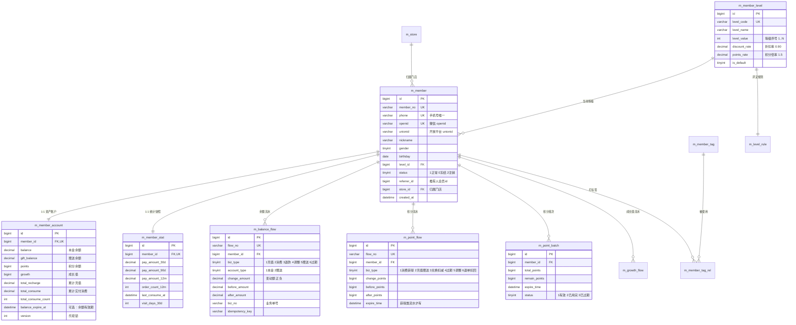
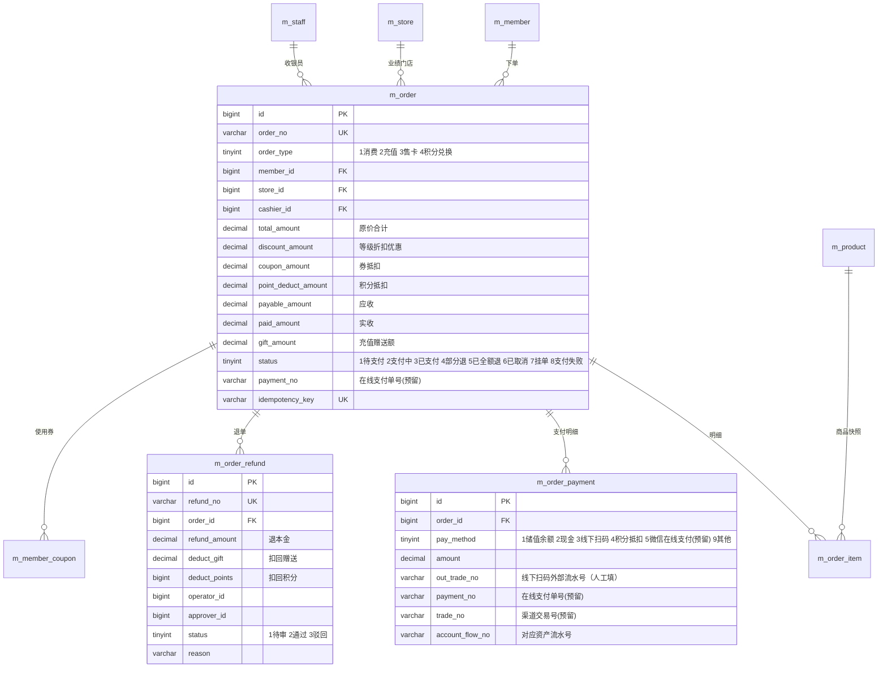
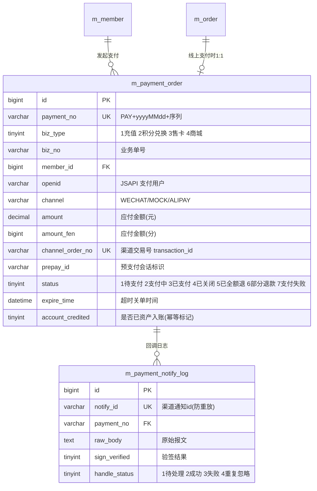
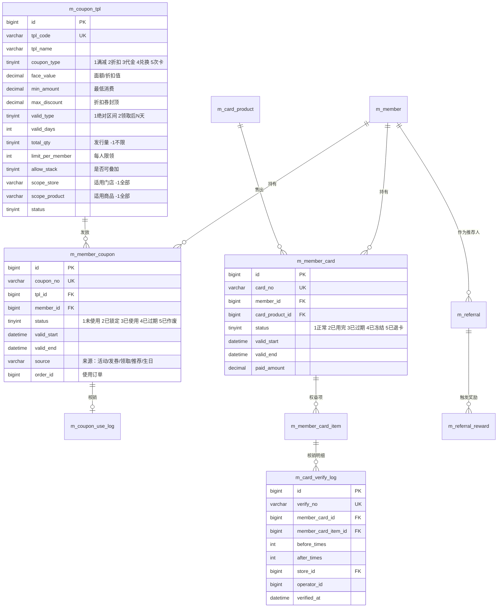
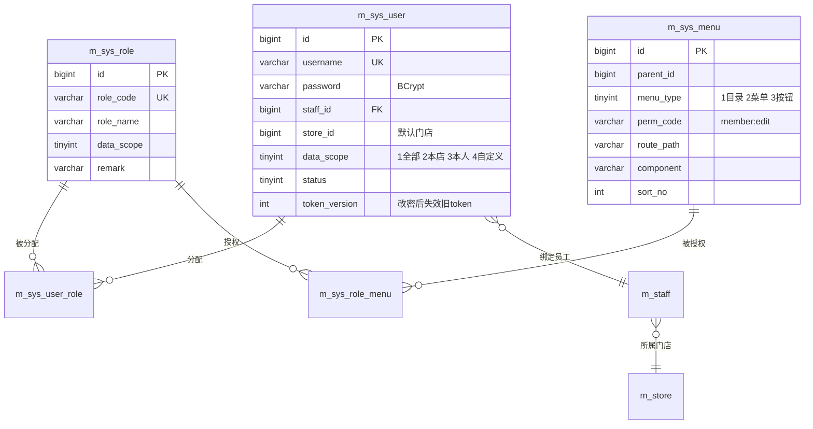

# 会员管理系统 · 数据库设计

> 配套文档：[00-需求与总体方案](./00-需求与总体方案.md) ｜ [01-系统架构设计](./01-系统架构设计.md) ｜ 版本 v1.0
>
> 目标数据库：**MySQL 8.0.35+**，引擎 InnoDB，字符集 `utf8mb4` / 排序规则 `utf8mb4_general_ci`
>
> 交付物：本文档 + **可直接执行的 DDL 脚本** [`sql/V1__init_schema.sql`](../sql/V1__init_schema.sql)（Flyway `V1` 迁移脚本）

---

## 1. 设计规范

| 项 | 规范 |
|---|---|
| 表名 | `m_` + 业务域 + 名词，蛇形小写，如 `m_member_account` |
| 主键 | `id BIGINT UNSIGNED AUTO_INCREMENT`，业务表另设唯一业务号（`order_no`/`member_no`/`flow_no`） |
| 时间 | `created_at` / `updated_at` `DATETIME`，**由应用层显式赋值**（避免 `ON UPDATE` 隐式行为影响审计） |
| 金额 | `DECIMAL(12,2)`；积分/成长值 `BIGINT`（积分可为负，用于冲正） |
| 枚举 | `TINYINT` + 唯一数据字典（`m_dict_item`），禁止用魔法字符串 |
| 布尔 | `TINYINT(1)`，0 否 1 是 |
| 逻辑删除 | 仅业务主数据（会员/商品/券模板等）用 `deleted TINYINT(1) DEFAULT 0`；**流水与订单永不删除** |
| 乐观锁 | 账户与核心主数据加 `version INT` |
| 索引 | 外键字段必建索引；高频条件建组合索引；唯一约束兜底幂等 |
| 命名统一 | 金额字段一律 `_amount`，数量一律 `_qty`/`_count`，比率一律 `_rate`，快照一律 `_snapshot`/`_before`/`_after` |
| 多租户 | 关键表预留 `tenant_id BIGINT DEFAULT 0`（本期恒为 0，为 SaaS 化预留） |

---

## 2. 表清单（47 张）

| # | 表名 | 中文名 | 模块 | 预估量级 |
|---|---|---|---|---|
| 1 | `m_store` | 门店 | 门店 | 百 |
| 2 | `m_staff` | 员工 | 门店 | 千 |
| 3 | `m_member` | 会员主档 | 会员 | 100 万 |
| 4 | `m_member_tag` | 会员标签 | 会员 | 百 |
| 5 | `m_member_tag_rel` | 会员-标签关系 | 会员 | 百万 |
| 6 | `m_member_note` | 会员跟进备注 | 会员 | 百万 |
| 7 | `m_member_merge_log` | 会员合并日志 | 会员 | 千 |
| 8 | `m_member_import_task` | 会员导入任务 | 会员 | 千 |
| 9 | `m_member_stat` | 会员统计快照 | 会员 | 100 万 |
| 10 | **`m_member_account`** | **会员资产账户** | 资产 | 100 万 |
| 11 | **`m_balance_flow`** | **余额流水** | 资产 | 5000 万 |
| 12 | **`m_point_flow`** | **积分流水** | 资产 | 5000 万 |
| 13 | **`m_point_batch`** | **积分批次（FIFO 过期）** | 资产 | 5000 万 |
| 14 | `m_growth_flow` | 成长值流水 | 资产 | 2000 万 |
| 15 | `m_member_level` | 等级定义 | 等级 | 10 |
| 16 | `m_level_rule` | 等级评定规则 | 等级 | 10 |
| 17 | `m_recharge_plan` | 充值方案 | 收银 | 百 |
| 18 | **`m_order`** | **订单主表** | 收银 | 1000 万 |
| 19 | `m_order_item` | 订单明细 | 收银 | 3000 万 |
| 20 | `m_order_payment` | 订单支付明细 | 收银 | 1500 万 |
| 21 | `m_order_refund` | 退款/退单记录 | 收银 | 十万 |
| 22 | **`m_payment_order`** | **支付单（预留在线支付）** | 支付 | 百万 |
| 23 | `m_payment_notify_log` | 支付回调日志 | 支付 | 百万 |
| 24 | `m_product` | 商品/服务 | 商品 | 万 |
| 25 | `m_product_category` | 商品分类 | 商品 | 百 |
| 26 | `m_coupon_tpl` | 券模板 | 营销 | 千 |
| 27 | **`m_member_coupon`** | **会员券实例** | 营销 | 1000 万 |
| 28 | `m_coupon_use_log` | 券核销记录 | 营销 | 1000 万 |
| 29 | `m_referral` | 推荐关系 | 营销 | 十万 |
| 30 | `m_referral_reward` | 推荐奖励结算 | 营销 | 十万 |
| 31 | `m_card_product` | 次卡/服务卡产品 | 卡券 | 千 |
| 32 | **`m_member_card`** | **会员次卡** | 卡券 | 百万 |
| 33 | `m_member_card_item` | 次卡权益项 | 卡券 | 百万 |
| 34 | `m_card_verify_log` | 次卡核销记录 | 卡券 | 千万 |
| 35 | `m_stat_daily` | 日统计（预聚合） | 报表 | 万 |
| 36 | `m_sys_user` | 系统用户 | 系统 | 百 |
| 37 | `m_sys_role` | 角色 | 系统 | 十 |
| 38 | `m_sys_role_menu` | 角色-菜单 | 系统 | 千 |
| 39 | `m_sys_menu` | 菜单/权限 | 系统 | 百 |
| 40 | `m_sys_user_role` | 用户-角色 | 系统 | 百 |
| 41 | `m_dict_type` | 字典类型 | 系统 | 百 |
| 42 | `m_dict_item` | 字典项 | 系统 | 千 |
| 43 | `m_sys_config` | 系统参数 | 系统 | 百 |
| 44 | `m_op_log` | 操作日志 | 系统 | 1000 万 |
| 45 | `m_login_log` | 登录日志 | 系统 | 百万 |
| 46 | `m_message_tpl` | 消息模板 | 消息 | 十 |
| 47 | `m_message_record` | 消息发送记录 | 消息 | 千万 |

> 全库共 **47 张表**（业务与资金 35 张 + 系统/字典/日志/消息 12 张）。

> 金额相关表（加粗）为**资金核心表**，DDL 变更需走评审，禁止随意加字段。

---

## 3. 核心 ER 图

### 3.1 会员资产与等级



### 3.2 收银订单闭环



### 3.3 支付中心（预留：小程序在线支付）



**设计要点**

| 要点 | 说明 |
|---|---|
| 为什么独立成表 | 一个订单可多次支付尝试（超时关单后重下）；支付单生命周期与业务订单解耦；回调只操作支付单，业务入账由 `PayService.handlePaid` 统一触发 |
| 为什么存 `amount_fen` | 微信支付 APIv3 要求金额为**整数分**，落库时同时保存元与分，避免每次换算产生舍入争议 |
| `uk_biz(biz_type, biz_no)` | 同一业务单只允许一个支付单，天然防重复下单 |
| `uk_channel_order` | 渠道交易号唯一，防同一笔渠道交易被匹配到两个支付单 |
| `uk_idem` | 前端幂等键，防用户连点两次下单 |
| `account_credited` | 充值类支付单的入账标记，回调重放时先查此位，**保证不重复充值** |
| 谁不产生支付单 | 储值余额支付、现金、线下扫码记账**不产生支付单**（直接落 `m_order_payment`），避免把内部记账伪装成外部支付 |
| `m_payment_notify_log` | 全量记录回调原文（含验签结果与处理耗时），既是审计证据，也是排查"钱到了账没到"的第一现场 |

### 3.4 营销卡券


### 3.5 系统权限（RBAC）



---

## 4. 字段级设计（关键表详解）

> 完整字段与类型见 DDL：[`sql/V1__init_schema.sql`](../sql/V1__init_schema.sql)。此处只对**有业务含义的字段**做逐条说明。

### 4.1 `m_member` 会员主档

| 字段 | 类型 | 说明 |
|---|---|---|
| `member_no` | varchar(32) UK | 会员号，规则 `M` + yyyyMMdd + 6 位序列，如 `M20260914000123` |
| `phone` | varchar(20) UK | 手机号，**会员唯一识别**；可空（纯微信游客） |
| `openid` / `unionid` | varchar(64) | 微信标识；unionid 有则用于跨应用识别 |
| `nickname` / `avatar` | varchar | 微信昵称头像（可被会员修改） |
| `real_name` | varchar(50) | 真实姓名（开卡/发票需要） |
| `gender` | tinyint | 0 未知 1 男 2 女 |
| `birthday` | date | 生日（**生日礼触发依据**，只存月日也存此字段，年份可默认 1900） |
| `level_id` | bigint | 当前等级 |
| `level_expire_at` | datetime | 等级有效期（有效期制启用时） |
| `status` | tinyint | 1 正常 2 冻结 3 注销 |
| `source` | tinyint | 来源：1 门店建档 2 小程序注册 3 导入 4 推荐 |
| `referrer_id` | bigint | 推荐人会员 id（仅记录一级） |
| `store_id` | bigint | 归属门店（首次建档门店） |
| `remark` | varchar(255) | 备注 |
| `deleted` | tinyint | 逻辑删除（注销后仍保留，配合 status） |

**唯一约束策略**：`uk_phone (phone)`、`uk_openid (openid)`。同一自然人出现两个手机号时**不自动合并**，走 UC-02 人工合并流程。

### 4.2 `m_member_account` 会员资产账户（资金核心）

| 字段 | 类型 | 说明 |
|---|---|---|
| `balance` | decimal(12,2) | **本金余额**——可退、可提（受配置限制） |
| `gift_balance` | decimal(12,2) | **赠送余额**——不可退、不可提现，消费时按 `account.deduct_priority` 参数决定先扣谁（默认先扣赠送） |
| `points` | bigint | 积分余额（可为负：退单扣回时若积分已用则记负，后续获得优先补负） |
| `growth` | bigint | 成长值（只增不减，除非年度清零任务） |
| `frozen_amount` | decimal(12,2) | 冻结金额（挂单/预授权预留，本期一般 0） |
| `total_recharge` / `total_consume` | decimal(12,2) | 累计充值 / 累计实付消费（含余额付+现金付，**不含赠送抵扣**） |
| `total_consume_count` | int | 累计消费笔数 |
| `version` | int | 乐观锁，每次变动 +1 |

**不变量（对账任务校验）**：
```
balance      == Σ m_balance_flow(account_type=1).change_amount
gift_balance == Σ m_balance_flow(account_type=2).change_amount
points       == Σ m_point_batch.remain_points  且  == Σ m_point_flow.change_points
growth       == Σ m_growth_flow.change_growth
```

### 4.3 `m_balance_flow` 余额流水（资金核心，只增不改）

| 字段 | 类型 | 说明 |
|---|---|---|
| `flow_no` | varchar(32) UK | 流水号 `BF` + 时间戳 + 序列 |
| `biz_type` | tinyint | 1 充值 2 消费 3 退款 4 调整 5 赠送 6 过期 7 转入 8 转出 9 合并 |
| `account_type` | tinyint | 1 本金 2 赠送 |
| `change_amount` | decimal(12,2) | 变动额，正加负减 |
| `before_amount` / `after_amount` | decimal(12,2) | 变动前后快照（审计与对账依据） |
| `biz_no` | varchar(32) | 关联业务单号（订单号/充值单号） |
| `biz_id` | bigint | 关联业务主键 |
| `store_id` / `operator_id` | bigint | 发生门店 / 操作人 |
| `idempotency_key` | varchar(64) | 幂等键，`uk_idem (idempotency_key, biz_type)` 兜底防重 |
| `remark` | varchar(255) | 备注（调整类必填） |
| `occur_time` | datetime | 业务发生时间（非写入时间，用于跨班次归集） |

### 4.4 `m_point_flow` / `m_point_batch` 积分双表

**为什么两张表**：`m_point_flow` 是**流水账**（回答"积分怎么来的怎么没的"），`m_point_batch` 是**库存账**（回答"有多少分快过期了"）。过期采用 FIFO：

```sql
-- 消费/兑换扣减积分时，按到期时间从早到晚扣批次
SELECT id, remain_points FROM m_point_batch
 WHERE member_id = ? AND status = 1 AND remain_points > 0
 ORDER BY expire_time ASC, id ASC FOR UPDATE;
```

`m_point_batch.status`：1 有效 2 已用完 3 已过期（定时任务处理并写 `biz_type=4` 的过期流水）。

### 4.5 `m_order` 订单主表（金额字段语义）

| 字段 | 语义 | 计算 |
|---|---|---|
| `total_amount` | 商品原价合计 | `Σ m_order_item.total_amount` |
| `discount_amount` | 等级会员折扣优惠 | `Σ (原价 × (1 − 折扣率))` |
| `coupon_amount` | 券抵扣 | 核销券的抵扣额 |
| `point_deduct_amount` | 积分抵扣 | `抵扣积分 / 兑换比例` |
| `payable_amount` | 应收 | `total − discount − coupon − point_deduct`（≥ 0） |
| `paid_amount` | 实收 | `Σ m_order_payment.amount`（余额付 + 现金 + 线下扫码） |
| `gift_amount` | 充值单专用：本次赠送额 | — |
| `points_gained` | 本单获得积分（快照，便于账单展示） | `floor(实付 × 倍率)` |
| `growth_gained` | 本单获得成长值 | 同实付换算 |
| `status` | 1 待支付 2 支付中（在线支付） 3 已支付 4 已部分退 5 已全额退 6 已取消 7 挂单 8 支付失败 | — |
| `payment_no` / `channel_order_no` | 在线支付单号 / 渠道交易号（预留，线下记账为空） | — |
| `expire_time` | 在线支付超时时间（预留，关单任务依据） | — |

**订单号前缀约定**：`O` 消费、`R` 充值、`C` 售卡、`X` 积分兑换；支付单 `PAY`、退款单 `RF`、退卡/次卡核销 `V`、券码 `CP`、流水 `BF`（余额）/`PF`（积分）/`GF`（成长值）。统一用「前缀 + yyyyMMdd + 序列」便于人工识别与日志检索。

> **注意**：`payable_amount` 必须等于 `Σ m_order_payment.amount`（充值单除外，充值单 payable = 实付本金）。这是对账任务的校验项之一。

### 4.6 `m_member_coupon` 会员券实例

| 字段 | 说明 |
|---|---|
| `coupon_no` | 券码，`CP` + 16 位随机（不含易混字符），用于输码核销 |
| `status` | 1 未使用 2 已锁定（收银中） 3 已使用 4 已过期 5 已作废 |
| `valid_start` / `valid_end` | 有效期（领取时由模板计算并**固化**，模板后改不影响已发券） |
| `source` | 来源：`ACTIVITY` / `GRANT`（定向发券）/ `CLAIM`（会员自领）/ `REFERRAL` / `BIRTHDAY` / `RECHARGE` |
| `tpl_snapshot` | JSON：发券时的模板关键字段快照，防模板修改导致历史券规则漂移 |
| `order_id` | 已使用时的订单 id（未使用为 NULL） |
| `gift_to_member_id` | 转赠对象（转赠功能预留） |

### 4.7 `m_payment_order` / `m_payment_notify_log` 支付中心（预留）

**支付单字段要点**

| 字段 | 说明 |
|---|---|
| `payment_no` | `PAY` + yyyyMMdd + 序列，回调与对账的唯一锚点 |
| `biz_type` + `biz_no` | 关联业务：1 充值（充值单号 `R...`）、2 积分兑换、3 售卡、4 商城（预留）；`uk_biz` 保证一个业务单只有一个支付单 |
| `channel` / `mch_id` / `channel_appid` | 渠道与商户主体；多商户号场景下用于区分结算主体（预留） |
| `amount` / `amount_fen` | 元与分双存，渠道报文用分比对，杜绝换算误差 |
| `channel_order_no` / `prepay_id` | 微信 `transaction_id` / `prepay_id`；前者唯一索引防串单 |
| `status` | 1 待支付 2 支付中 3 已支付 4 已关闭 5 已全额退 6 部分退款 7 支付失败（状态机见 [01 §6.2](./01-系统架构设计.md)） |
| `expire_time` | 下单 + `pay.timeout-minutes`（默认 15 分钟），由 `PayCloseJob` 关单 |
| `account_credited` / `credited_at` | **入账幂等标记**：回调重放、查单补偿都会先判此位，保证充值只入账一次 |
| `refund_amount` / `refund_no` / `refunded_at` | 退款累计与最近一次退款单号（明细在 `m_order_refund`） |
| `notify_count` / `last_notify_at` | 回调次数与最近时间，异常时可看出渠道是否在重推 |

**回调日志字段要点**

| 字段 | 说明 |
|---|---|
| `notify_id` | 渠道通知唯一 id（微信为 `id`），**唯一索引**——重复推送只落一条，直接应答成功 |
| `raw_body` | 渠道原始报文（解密后明文），审计与排障的第一证据 |
| `sign_verified` / `verify_mode` | 验签结果与模式；`0` 必须告警 |
| `handle_status` | 1 待处理 2 处理成功 3 处理失败 4 重复通知已忽略 |
| `handle_ms` | 处理耗时，用于排查"回调超时被渠道重推" |

> **排障口诀**：钱到了账没到 → 先看 `m_payment_notify_log.raw_body` 与 `sign_verified`，再看 `m_payment_order.status` 与 `account_credited`，最后看 `m_balance_flow`。三者对齐即定位完成。

### 4.8 `m_stat_daily` 预聚合统计

| 维度 | 指标列 |
|---|---|
| `stat_date` + `store_id` | `new_member_cnt`, `active_member_cnt`, `recharge_amount`, `recharge_cnt`, `consume_amount`, `consume_cnt`, `refund_amount`, `points_issued`, `points_used`, `balance_end`（期末储值本金余额 = 储值负债）, `gift_balance_end`, `coupon_issued_cnt`, `coupon_used_cnt`, `card_sold_cnt`, `card_verified_cnt`, `cash_amount`, `offline_amount`, `balance_pay_amount`, `online_pay_amount`（在线支付收款，预留） |

每日 02:00 定时任务重算 T-1（**幂等**：先按日期删除再插入），看板查 T 日及更早走此表，当日数据实时聚合叠加。

---

## 5. 索引设计

| 表 | 索引名 | 字段 | 用途 |
|---|---|---|---|
| `m_member` | `uk_phone` / `uk_openid` | 唯一 | 登录与识别 |
| | `idx_store_status` | `(store_id, status, id)` | 门店会员列表分页 |
| | `idx_level` | `(level_id)` | 按等级筛选 |
| | `idx_birthday` | `(birthday)` | 生日礼扫描（存月日可用 `idx_md` 生成列） |
| | `idx_referrer` | `(referrer_id)` | 推荐关系 |
| | `idx_created` | `(created_at)` | 增长看板 |
| `m_member_account` | `uk_member` | `(member_id)` | 1:1 |
| `m_balance_flow` | `uk_flow_no` / `uk_idem` | 唯一 | 幂等兜底 |
| | `idx_member_time` | `(member_id, occur_time DESC)` | 会员账单（**最热查询**） |
| | `idx_biz` | `(biz_no)` | 按订单反查流水 |
| | `idx_store_time` | `(store_id, occur_time)` | 门店流水/交班对账 |
| `m_point_flow` | `idx_member_time` / `idx_biz` | 同上 | — |
| `m_point_batch` | `idx_member_status_expire` | `(member_id, status, expire_time)` | FIFO 扣减 + 到期扫描 |
| | `idx_expire` | `(status, expire_time)` | 全局过期任务 |
| `m_order` | `uk_order_no` | 唯一 | — |
| | `idx_member_time` | `(member_id, created_at DESC)` | 会员订单 |
| | `idx_store_time_status` | `(store_id, created_at, status)` | 门店订单/日结 |
| | `idx_cashier_time` | `(cashier_id, created_at)` | 员工业绩 |
| `m_order_item` | `idx_order` | `(order_id)` | — |
| | `idx_product` | `(product_id)` | 商品销量 |
| `m_member_coupon` | `uk_coupon_no` | 唯一 | 券码核销 |
| | `idx_member_status_end` | `(member_id, status, valid_end)` | 我的卡包 |
| | `idx_status_end` | `(status, valid_end)` | 过期任务 |
| | `idx_tpl` | `(tpl_id)` | 券效果统计 |
| `m_member_card_item` | `idx_card_status` | `(member_card_id, status)` | 核销取项 |
| `m_payment_order` | `uk_payment_no` / `uk_biz` / `uk_idem` / `uk_channel_order` | 唯一 | 支付单唯一性与防重下单 |
| | `idx_status_expire` | `(status, expire_time)` | 超时关单 / 掉单补查 |
| | `idx_member_status` | `(member_id, status)` | 会员支付记录 |
| `m_payment_notify_log` | `uk_notify_id` | 唯一 | **回调防重放（关键）** |
| | `idx_out_trade_no` | `(out_trade_no)` | 按渠道商户单号定位支付单 |
| | `idx_status_time` | `(handle_status, created_at)` | 失败回调排查 |
| `m_op_log` | `idx_user_time` / `idx_biz` | `(user_id, created_at)` / `(biz_type, biz_id)` | 审计追溯 |
| `m_message_record` | `idx_status_retry` | `(status, retry_count, next_retry_at)` | 失败重发 |

**大表策略**：`m_balance_flow` / `m_point_flow` / `m_order` 预估年增千万级，方案：① 按月 `RANGE` 分区（`occur_time`）或 ② 归档任务把 2 年前数据搬到 `_his` 表。**本期先建索引 + 归档任务，不分区**（分区对唯一索引有约束，会与幂等唯一键冲突）。

---

## 6. 数据字典初始化（DDL 内 seed 数据）

| 字典类型 | 字典项 |
|---|---|
| `member_status` | 1 正常 / 2 冻结 / 3 注销 |
| `member_source` | 1 门店建档 / 2 小程序注册 / 3 批量导入 / 4 推荐注册 |
| `gender` | 0 未知 / 1 男 / 2 女 |
| `balance_biz_type` | 1 充值 / 2 消费 / 3 退款 / 4 调整 / 5 赠送 / 6 过期 / 9 合并 |
| `point_biz_type` | 1 消费获得 / 2 充值赠送 / 3 兑换扣减 / 4 过期 / 5 调整 / 6 退单扣回 |
| `order_type` | 1 消费 / 2 充值 / 3 售卡 / 4 积分兑换 |
| `order_status` | 1 待支付 / 2 已支付 / 3 已全额退 / 4 部分退 / 5 已取消 / 6 挂单 |
| `pay_method` | 1 储值余额 / 2 现金 / 3 线下扫码 / 4 积分抵扣 / 9 其他 |
| `coupon_type` | 1 满减 / 2 折扣 / 3 代金 / 4 兑换 / 5 次卡 |
| `coupon_status` | 1 未使用 / 2 已锁定 / 3 已使用 / 4 已过期 / 5 已作废 |
| `card_status` | 1 正常 / 2 已用完 / 3 已过期 / 4 已冻结 / 5 已退卡 |
| `refund_status` | 1 待审 / 2 通过 / 3 驳回 |
| `payment_status` | 1 待支付 / 2 支付中 / 3 已支付 / 4 已关闭 / 5 已全额退 / 6 部分退款 / 7 支付失败 |
| `payment_channel` | `MOCK` 模拟支付（开发） / `WECHAT` 微信支付 / `ALIPAY` 支付宝（预留） |

**系统参数（`m_sys_config` 初始值）**

| key | 默认值 | 含义 |
|---|---|---|
| `account.deduct_priority` | `GIFT_FIRST` | 余额扣减顺序（GIFT_FIRST / PRINCIPAL_FIRST） |
| `account.gift_refundable` | `false` | 赠送余额是否可退（恒 false） |
| `account.max_balance` | `0` | 单会员余额上限（0 不限） |
| `account.gift_ratio_limit` | `1.00` | 赠送额不得超过本金 × 该比例（防配置错误） |
| `points.exchange_rate` | `100` | 多少积分抵 1 元 |
| `points.max_deduct_ratio` | `0.30` | 单笔积分最多抵扣订单比例 |
| `points.expire_months` | `12` | 积分有效期（月），0 表示不过期 |
| `points.min_keep` | `0` | 账户最低保留积分 |
| `growth.per_yuan` | `1` | 每 1 元实付得多少成长值 |
| `points.per_yuan` | `1` | 每 1 元实付得多少积分（再乘等级倍率） |
| `level.downgrade_enabled` | `false` | 是否启用降级 |
| `level.valid_months` | `0` | 等级有效期（0=永久） |
| `order.auto_approve_refund` | `false` | 退单是否免审 |
| `order.large_recharge_need_approve` | `5000` | 大额充值需审批阈值 |
| `coupon.notify_days_before_expire` | `7,3,1` | 券到期提醒提前天数 |
| `wx.subscribe.enabled` | `true` | 订阅消息开关 |
| `report.dashboard_cache_seconds` | `600` | 看板缓存秒数 |
| `pay.enabled` | `false` | 在线支付总开关（true 时小程序展示"在线充值"） |
| `pay.mock-enabled` | `true` | 使用模拟支付渠道（开发期 true，接入微信支付后置 false） |
| `pay.channels` / `pay.default-channel` | `WECHAT` / `WECHAT` | 启用渠道与默认渠道 |
| `pay.timeout-minutes` | `15` | 支付单超时关单分钟数 |
| `pay.notify-url` | （空） | 支付回调地址，需公网 HTTPS 固定地址 |
| `pay.auto-sync-seconds` / `pay.max-query-times` | `30` / `5` | 掉单主动查单间隔与最大次数 |
| `pay.mock-auto-success-seconds` | `5` | 模拟支付自动成功秒数（开发期） |

**支付密钥（不入库，走环境变量）**：`WXPAY_MCHID`、`WXPAY_APPID`、`WXPAY_API_V3_KEY`、`WXPAY_PRIVATE_KEY_PATH`、`WXPAY_CERT_SERIAL_NO`、`WXPAY_PLATFORM_CERT_PATH`。

---

## 7. 建库与初始化步骤

```bash
# 1. 建库（DDL 脚本内含 CREATE DATABASE IF NOT EXISTS）
mysql -uroot -p < sql/V1__init_schema.sql

# 2. 应用连接配置（application-dev.yml）
# spring.datasource.url=jdbc:mysql://127.0.0.1:3306/member_system?useUnicode=true&characterEncoding=utf8&serverTimezone=Asia/Shanghai&useSSL=false&allowPublicKeyRetrieval=true
# spring.flyway.baseline-on-migrate=true

# 3. 默认账号（脚本内初始化，首次登录强制改密）
# 用户名 admin / 密码 Admin@123（BCrypt 加密存储）
```

---

## 8. DDL 变更规约

1. 所有结构变更走 Flyway 新版本脚本：`V2__add_xxx.sql`，**禁止修改已发布的 V1**。
2. 资金核心表（`m_member_account` / `m_balance_flow` / `m_point_flow` / `m_point_batch` / `m_order`）加字段必须：
   - 可空或带默认值（避免锁表与回填）
   - 在评审记录中写明对**对账逻辑**的影响
3. 生产执行大表 DDL 使用 `pt-online-schema-change` 或 `ALTER ... ALGORITHM=INPLACE`，避开营业高峰。
4. 每次上线前跑一次对账任务，确认无差异再发版。
