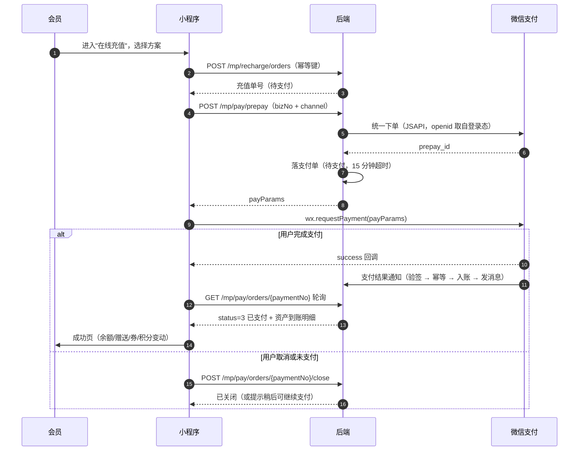

# 会员管理系统 · 接口设计（API 清单）

> 配套文档：[01-系统架构设计](./01-系统架构设计.md) ｜ [02-数据库设计](./02-数据库设计.md) ｜ 版本 v1.0
>
> 在线文档：本地启动后 `http://localhost:8080/swagger-ui.html`（springdoc-openapi 自动生成，本清单为其设计依据）

---

## 1. 通用规范

### 1.1 路径与版本

| 端 | 前缀 | 鉴权方式 |
|---|---|---|
| WEB 管理端（含收银台） | `/api/admin/**` | `Authorization: Bearer <JWT>`（管理端用户） |
| 微信小程序端 | `/api/mp/**` | `Authorization: Bearer <JWT>`（会员） |
| 开放/回调 | `/api/open/**` | **免登录**：渠道验签（微信支付 APIv3 平台证书验签）；预留：支付回调等 |
| 开发调试 | `/api/mock/**` | 仅当 `pay.mock-enabled=true` 且非生产环境时注册，生产启动即报错拒绝 |
| 探活 | `/actuator/health` | 无 |

- 全小写 + 中划线/驼峰统一的资源命名：`/api/admin/members/{id}/accounts`
- 列表查询用 `GET` + Query 参数；写操作用 `POST/PUT/DELETE`
- 批量与导出用 `POST`（参数体较大）

### 1.2 统一响应体

```json
{
  "code": 0,
  "msg": "success",
  "data": { },
  "traceId": "8f2c1a9e4b7d4e0f"
}
```

分页响应：

```json
{
  "code": 0,
  "msg": "success",
  "data": {
    "list": [],
    "total": 1280,
    "pageNum": 1,
    "pageSize": 20
  },
  "traceId": "..."
}
```

### 1.3 错误码规范

| 段 | 含义 | 示例 |
|---|---|---|
| `0` | 成功 | — |
| `1xxxx` | 通用/框架 | `10001` 参数校验失败、`10002` 未登录、`10003` 无权限、`10004` 数据不存在、`10005` 请求过于频繁 |
| `2xxxx` | 会员 | `20001` 手机号已存在、`20002` 会员已冻结、`20003` 会员已注销、`20004` 需先绑定手机号 |
| `3xxxx` | 资产 | `30001` 余额不足、`30002` 积分不足、`30003` 金额非法（负数）、`30004` 账户不存在、`30005` 余额与流水不一致、`30006` 超出余额上限、`30007` 并发修改冲突（乐观锁） |
| `4xxxx` | 收银订单 | `40001` 订单不存在、`40002` 订单已支付（重复提交）、`40003` 订单状态不允许退款、`40004` 退款金额超限、`40005` 挂单不存在 |
| `5xxxx` | 营销卡券 | `50001` 券不可用、`50002` 券已过期、`50003` 券不满足使用门槛、`50004` 券不适用该门店/商品、`50005` 券已被使用、`50006` 次卡次数不足、`50007` 次卡已过期或冻结 |
| `6xxxx` | 微信/外部 | `60001` 微信 code 无效、`60002` 手机号解密失败、`60003` 订阅消息发送失败、`60004` 请求微信超时 |
| `7xxxx` | **支付（预留）** | `70001` 支付渠道未启用/未就绪、`70002` 支付单不存在、`70003` 支付单状态不允许该操作、`70004` 支付金额与订单金额不一致、`70005` 支付单已超时关闭、`70006` 重复支付（订单已支付）、`70007` 支付回调验签失败、`70008` 渠道下单失败、`70009` 渠道退款失败、`70010` 退款金额超过可退金额、`70011` 该订单不支持在线退款（线下支付）、`70012` 未绑定手机号不可发起支付 |
| `9xxxx` | 系统 | `90001` 系统异常、`90002` 数据库异常、`90003` 幂等冲突 |

### 1.4 必带头部

| 头 | 必填 | 说明 |
|---|---|---|
| `Authorization` | 是（登录后） | `Bearer <accessToken>` |
| `X-Idempotency-Key` | **写资金类接口必填** | UUID，5 分钟内重复请求返回首次结果 |
| `X-Store-Id` | 收银类必填 | 当前门店 id（也校验用户数据权限） |
| `X-Client` | 建议 | `web` / `mp`（用于差异化响应，如是否脱敏） |
| `X-Request-Id` | 可选 | 前端链路 id，服务端写入 traceId |

---

## 2. 管理端 · 认证与会话（`/api/admin/auth`）

| # | 方法 | 路径 | 说明 | 权限码 |
|---|---|---|---|---|
| 1 | POST | `/login` | 账号密码登录 | 公开 |
| 2 | POST | `/refresh` | 刷新 accessToken | 公开（校验 refreshToken） |
| 3 | POST | `/logout` | 退出登录（token 进黑名单） | 登录 |
| 4 | GET | `/me` | 当前用户信息 + 角色 + 权限码 + 数据范围 | 登录 |
| 5 | GET | `/menus` | 当前用户菜单树（前端动态路由） | 登录 |
| 6 | POST | `/change-password` | 修改密码（成功后 token 失效，需重登） | 登录 |
| 7 | GET | `/captcha` | 图形验证码（连续失败后要求） | 公开 |

**示例**

```http
POST /api/admin/auth/login
Content-Type: application/json

{ "username": "admin", "password": "Admin@123" }
```

```json
{
  "code": 0,
  "data": {
    "accessToken": "eyJhbGciOi...",
    "refreshToken": "eyJhbGciOi...",
    "expiresIn": 7200,
    "userInfo": {
      "userId": 1, "username": "admin", "realName": "超级管理员",
      "storeId": 1, "storeName": "总部旗舰店", "dataScope": 1,
      "roles": ["SUPER_ADMIN"],
      "perms": ["member:list", "member:edit", "order:refund", "report:view"]
    },
    "mustChangePassword": true
  }
}
```

---

## 3. 管理端 · 会员中心（`/api/admin/members`）

| # | 方法 | 路径 | 说明 | 权限码 |
|---|---|---|---|---|
| 1 | GET | `` | 会员分页列表（支持多条件） | `member:list` |
| 2 | GET | `/{id}` | 会员详情（含资产、等级、标签） | `member:query` |
| 3 | GET | `/{id}/overview` | **会员 360° 视图**：资产 + 统计 + 近 5 单 + 券数 + 卡数 | `member:query` |
| 4 | POST | `` | 新建会员（手机号唯一校验） | `member:add` |
| 5 | PUT | `/{id}` | 修改会员资料 | `member:edit` |
| 6 | DELETE | `/{id}` | 注销会员（余额须为 0） | `member:remove` |
| 7 | PUT | `/{id}/status` | 冻结 / 解冻 | `member:edit` |
| 8 | POST | `/{id}/level` | 手工调整等级（写日志） | `member:level` |
| 9 | POST | `/{id}/tags` | 设置标签（全量覆盖） | `member:tag` |
| 10 | POST | `/{id}/notes` | 新增跟进备注 | `member:edit` |
| 11 | GET | `/{id}/timeline` | 会员动线（注册/充值/消费/核销/等级变更 时间轴） | `member:query` |
| 12 | POST | `/merge` | 会员合并（主/被合并 id） | `member:merge` |
| 13 | POST | `/import` | Excel 导入（返回任务号） | `member:import` |
| 14 | GET | `/import/{taskNo}` | 导入进度与错误明细 | `member:import` |
| 15 | POST | `/export` | 导出会员（异步，返回任务号） | `member:export` |
| 16 | GET | `/search-for-cashier` | **收银台会员检索**（手机号后 4 位 / 卡号 / 姓名 / 会员号，返回前 10 条精简信息） | `order:add` |
| 17 | POST | `/identify-by-code` | **扫码识别会员**（动态码/静态码） | `order:add` |
| 18 | GET | `/{id}/verify-code` | 获取会员动态核销码（60s 有效，供会员出示） | `member:query` |

**列表查询参数（#1）**

| 参数 | 类型 | 说明 |
|---|---|---|
| `keyword` | string | 模糊匹配会员号/手机号/昵称/姓名 |
| `phone` | string | 精确/后 4 位 |
| `levelId` | long | 等级筛选 |
| `tagIds` | string | 标签，逗号分隔（AND） |
| `status` | int | 状态筛选 |
| `source` | int | 来源筛选 |
| `storeId` | long | 门店（受数据权限约束） |
| `birthdayMonth` | int | 生日月份（生日营销筛选） |
| `minBalance` / `maxBalance` | decimal | 余额区间 |
| `minPoints` / `maxPoints` | long | 积分区间 |
| `lastConsumeStart` / `lastConsumeEnd` | date | 最近消费时间区间（沉睡会员筛选） |
| `createdStart` / `createdEnd` | date | 入会时间区间 |
| `sortField` / `sortOrder` | string | 排序字段白名单：`created_at`/`balance`/`points`/`total_consume`/`last_consume_at` |
| `pageNum` / `pageSize` | int | 分页（默认 1/20，最大 200） |

**请求示例：新建会员（#4）**

```json
{
  "phone": "13800001234",
  "realName": "张三",
  "nickname": "小三儿",
  "gender": 1,
  "birthday": "1995-06-18",
  "storeId": 1,
  "source": 1,
  "referrerPhone": "13900005678",
  "tagIds": [1, 3],
  "remark": "朋友介绍，偏好精洗"
}
```

**响应示例：会员 360° 视图（#3）**

```json
{
  "code": 0,
  "data": {
    "member": {
      "id": 1001, "memberNo": "M20260914000123", "phone": "138****1234",
      "nickname": "小三儿", "gender": 1, "birthday": "1995-06-18",
      "levelId": 3, "levelName": "金卡会员", "levelExpireAt": null,
      "status": 1, "source": 1, "storeId": 1, "storeName": "总部旗舰店",
      "referrerId": 998, "createdAt": "2026-03-01 10:22:31",
      "tags": [{"id": 1, "tagName": "高频客户"}, {"id": 3, "tagName": "价格敏感"}]
    },
    "account": {
      "balance": 850.00, "giftBalance": 120.00, "points": 3200, "growth": 4200,
      "frozenAmount": 0.00,
      "totalRecharge": 2000.00, "totalConsume": 1450.00,
      "totalConsumeCount": 18, "balanceExpireAt": null
    },
    "stat": {
      "firstConsumeAt": "2026-03-02 15:10:00",
      "lastConsumeAt": "2026-09-10 18:40:00",
      "payAmount30d": 320.00, "payAmount90d": 860.00, "payAmount12m": 1450.00,
      "orderCount12m": 18, "visitDays30d": 4, "avgOrderAmount": 80.56
    },
    "couponSummary": {"unused": 3, "expiringIn7d": 1, "used": 12},
    "cardSummary": {"normal": 1, "totalRemainTimes": 7},
    "recentOrders": [
      {"orderNo": "O20260910184012001", "orderType": 1, "payableAmount": 88.00,
       "paidAmount": 88.00, "status": 2, "storeName": "总部旗舰店",
       "createdAt": "2026-09-10 18:40:00"}
    ]
  }
}
```

---

## 4. 管理端 · 资产与账务（`/api/admin/accounts`）

| # | 方法 | 路径 | 说明 | 权限码 |
|---|---|---|---|---|
| 1 | GET | `/{memberId}` | 资产账户详情 | `account:query` |
| 2 | GET | `/{memberId}/balance-flows` | 余额流水分页（`accountType`/`bizType`/时间筛选） | `account:query` |
| 3 | GET | `/{memberId}/point-flows` | 积分流水分页 | `account:query` |
| 4 | GET | `/{memberId}/growth-flows` | 成长值流水 | `account:query` |
| 5 | GET | `/{memberId}/point-batches` | 积分批次（含到期时间） | `account:query` |
| 6 | POST | `/recharge` | **充值**（含赠送、送券、升级） | `account:recharge` |
| 7 | POST | `/recharge/revoke` | 充值撤销（当日、无消费） | `account:revoke` |
| 8 | POST | `/adjust` | **资产调整**（余额/赠送/积分/成长值，必填原因） | `account:adjust` |
| 9 | GET | `/recharge-plans` | 充值方案列表（收银台取用） | `account:recharge` |
| 10 | POST | `/recharge-plans` | 新增充值方案 | `account:plan` |
| 11 | PUT | `/recharge-plans/{id}` | 修改充值方案 | `account:plan` |
| 12 | DELETE | `/recharge-plans/{id}` | 删除充值方案 | `account:plan` |
| 13 | GET | `/flows` | 全量流水查询（跨会员，财务视角，多条件 + 导出） | `account:flow:list` |
| 14 | GET | `/reconcile` | 对账差异报表（余额/积分与流水比对） | `account:reconcile` |
| 15 | GET | `/liability` | 储值负债与积分负债汇总 | `account:reconcile` |

**请求示例：充值（#6）**

```http
POST /api/admin/accounts/recharge
X-Idempotency-Key: 7c1f0e2a-9b3d-4a55-8f10-2e6b7c9d0011
X-Store-Id: 1
```

```json
{
  "memberId": 1001,
  "planId": 2,
  "rechargeAmount": 500.00,
  "giftAmount": 50.00,
  "giftPoints": 200,
  "payMethod": 3,
  "outTradeNo": "4200001234202609140011",
  "giftCoupons": [{"tplId": 2, "qty": 1}],
  "remark": "国庆活动充值"
}
```

```json
{
  "code": 0,
  "data": {
    "orderNo": "R20260914103025001",
    "rechargeAmount": 500.00,
    "giftAmount": 50.00,
    "giftPoints": 200,
    "grantedCoupons": [{"couponNo": "CP8F3A2B91C4D5E6F", "tplName": "满 100 减 20"}],
    "account": {"balance": 1350.00, "giftBalance": 170.00, "points": 3400},
    "levelUpgraded": false
  }
}
```

**请求示例：资产调整（#8）**

```json
{
  "memberId": 1001,
  "balanceDelta": 0,
  "giftDelta": 0,
  "pointsDelta": 500,
  "growthDelta": 0,
  "reason": "客诉补偿：上次服务等待超时，赠送 500 积分",
  "attachImages": ["https://cdn.xx.com/proof/1.jpg"]
}
```

> 规则：调整必填 `reason`；单笔 |金额| ≥ 系统阈值（默认 500 元 / 5000 积分）需店长及以上角色，且写 `m_op_log`。

---

## 5. 管理端 · 收银台（`/api/admin/orders`）

### 5.1 收银主流程

| # | 方法 | 路径 | 说明 | 权限码 |
|---|---|---|---|---|
| 1 | POST | `/preview` | **试算**：入参商品+券+积分，返回各项优惠与应付（不落库） | `order:add` |
| 2 | POST | `` | **开单结算**（核心接口，幂等） | `order:add` |
| 3 | POST | `/hold` | 挂单 | `order:add` |
| 4 | GET | `/hold/list` | 挂单列表（本店/本人） | `order:add` |
| 5 | POST | `/hold/{id}/resume` | 取单（转回待支付） | `order:add` |
| 6 | DELETE | `/hold/{id}` | 取消挂单 | `order:add` |
| 7 | GET | `` | 订单分页查询（多条件） | `order:list` |
| 8 | GET | `/{orderNo}` | 订单详情（含明细/支付/优惠/券） | `order:query` |
| 9 | POST | `/{orderNo}/refund` | 申请退单（生成退款单，待审） | `order:refund:apply` |
| 10 | POST | `/refunds/{refundNo}/approve` | 审批退单（通过/驳回） | `order:refund:approve` |
| 11 | GET | `/refunds` | 退款单列表 | `order:refund:list` |
| 12 | POST | `/{orderNo}/print` | 打印小票（返回小票渲染数据） | `order:query` |
| 13 | POST | `/{orderNo}/cancel` | 取消未支付订单 | `order:add` |
| 14 | GET | `/shift/summary` | 交接班汇总（按班次/时间范围） | `shift:summary` |
| 15 | POST | `/shift/close` | 交班结账（生成交班单） | `shift:close` |
| 16 | GET | `/shift/list` | 交班记录列表 | `shift:summary` |

### 5.2 试算请求与响应（#1）

```json
{
  "memberId": 1001,
  "storeId": 1,
  "orderType": 1,
  "items": [
    {"itemType": 2, "productId": 2, "qty": 1},
    {"itemType": 1, "productId": 5, "qty": 2}
  ],
  "couponNos": ["CP8F3A2B91C4D5E6F"],
  "usePoints": 1000
}
```

```json
{
  "code": 0,
  "data": {
    "totalAmount": 147.80,
    "discountAmount": 7.39,
    "couponAmount": 20.00,
    "pointDeductAmount": 10.00,
    "payableAmount": 110.41,
    "pointDeductPoints": 1000,
    "maxUsablePoints": 3200,
    "maxDeductAmountByRule": 33.12,
    "items": [
      {"productName": "精洗套餐", "price": 88.00, "qty": 1, "totalAmount": 88.00,
       "discountAmount": 4.40, "actualAmount": 83.60, "joinDiscount": true},
      {"productName": "玻璃水", "price": 29.90, "qty": 2, "totalAmount": 59.80,
       "discountAmount": 2.99, "actualAmount": 56.81, "joinDiscount": true}
    ],
    "couponResult": [
      {"couponNo": "CP8F3A2B91C4D5E6F", "tplName": "满 100 减 20",
       "usable": true, "discountAmount": 20.00}
    ],
    "unavailableCoupons": [
      {"couponNo": "CP11223344556677", "tplName": "88 折折扣券",
       "reason": "与已选券不可叠加（互斥组 DISCOUNT）"}
    ],
    "memberSnapshot": {
      "levelName": "金卡会员", "discountRate": 0.95, "pointsRate": 1.5,
      "balance": 850.00, "giftBalance": 120.00, "points": 3200
    },
    "estimatePointsGain": 165,
    "estimateGrowthGain": 110
  }
}
```

### 5.3 开单结算请求（#2，核心）

```http
POST /api/admin/orders
X-Idempotency-Key: 3a9c22f1-77bb-4c0e-9a1f-0d5e6f778899
X-Store-Id: 1
```

```json
{
  "memberId": 1001,
  "orderType": 1,
  "items": [
    {"itemType": 2, "productId": 2, "qty": 1},
    {"itemType": 1, "productId": 5, "qty": 2}
  ],
  "couponNos": ["CP8F3A2B91C4D5E6F"],
  "usePoints": 1000,
  "payments": [
    {"payMethod": 1, "amount": 110.41, "accountType": 1},
    {"payMethod": 2, "amount": 0.00}
  ],
  "staffId": 3,
  "shiftNo": "SH20260914A01",
  "remark": "老客户，赠玻璃水一瓶"
}
```

```json
{
  "code": 0,
  "data": {
    "orderNo": "O20260914104233123",
    "status": 2,
    "totalAmount": 147.80,
    "discountAmount": 7.39,
    "couponAmount": 20.00,
    "pointDeductAmount": 10.00,
    "payableAmount": 110.41,
    "paidAmount": 110.41,
    "pointsGained": 165,
    "growthGained": 110,
    "levelUpgraded": true,
    "newLevelName": "铂金会员",
    "account": {"balance": 739.59, "giftBalance": 120.00, "points": 2365},
    "couponUsed": [{"couponNo": "CP8F3A2B91C4D5E6F", "discountAmount": 20.00}],
    "printData": {"qrCode": "https://...", "tipText": "感谢惠顾"}
  }
}
```

### 5.4 组合支付与校验规则

| 规则 | 说明 |
|---|---|
| `Σ payments.amount == payableAmount` | 服务端强校验，不等则 `10001` |
| 余额支付 | 校验账户状态、余额（本金+赠送按 `deduct_priority` 扣减）、`affectedRows` 兜底 |
| 现金/线下扫码 | 不校验余额，仅记账；`payMethod=3` 时 `outTradeNo` 建议填写 |
| 找零 | 前端传入 `receivedAmount`，`changeAmount` 由前端计算展示，**不落库** |
| 积分抵扣 | `usePoints ≤ min(账户积分, floor(payable×max_deduct_ratio×exchange_rate))` |
| 券 | 校验状态/有效期/门店/商品/门槛/互斥；核销后可撤销（联动退款单） |

### 5.5 退单规则（#9）

| 场景 | 处理 |
|---|---|
| 全额退 | 订单 → `3 已全额退`；余额退回原账户类型；券按 `coupon_handle` 处理；积分/成长值扣回；写负向流水 |
| 部分退 | 订单 → `4 部分退`；按比例分摊退款金额与扣回积分 |
| 现金/线下扫码支付的退单 | 只写退款记录（**不自动退钱**），需线下操作并在备注注明；财务据此对账 |
| 券退回 | 未过期 → `UNUSED`（`valid_end` 不变）；已过期 → `EXPIRED` 并记日志 |
| 审批 | 默认必审（`order.auto_approve_refund=false`）；审批前不产生任何资产变动 |
| 幂等 | `X-Idempotency-Key` + `m_order_refund.idempotency_key` 唯一 |

### 5.6 交接班（#14/#15）

```http
GET /api/admin/orders/shift/summary?shiftNo=SH20260914A01&storeId=1
```

```json
{
  "code": 0,
  "data": {
    "shiftNo": "SH20260914A01",
    "storeId": 1, "storeName": "总部旗舰店",
    "cashierId": 5, "cashierName": "李收银",
    "startTime": "2026-09-14 08:00:00", "endTime": "2026-09-14 20:00:00",
    "orderCount": 46,
    "consumeAmount": 5230.40, "refundAmount": 88.00,
    "cashAmount": 1820.00, "offlineAmount": 2460.40,
    "balancePayAmount": 950.00,
    "rechargeAmount": 3000.00, "rechargeGiftAmount": 300.00,
    "cardSoldCount": 3, "cardSoldAmount": 1297.00,
    "cardVerifyCount": 12,
    "couponUsedCount": 18, "couponDiscountAmount": 320.00,
    "newMemberCount": 6,
    "payMethodDetail": [
      {"payMethod": 2, "methodName": "现金", "amount": 1820.00, "count": 21},
      {"payMethod": 3, "methodName": "线下扫码", "amount": 2460.40, "count": 19},
      {"payMethod": 1, "methodName": "储值余额", "amount": 950.00, "count": 6}
    ]
  }
}
```

---

## 6. 管理端 · 商品与次卡（`/api/admin/products`、`/api/admin/cards`）

| # | 方法 | 路径 | 说明 | 权限码 |
|---|---|---|---|---|
| 1 | GET | `/products` | 商品分页（名称/分类/条码/状态） | `product:list` |
| 2 | GET | `/products/{id}` | 商品详情 | `product:query` |
| 3 | POST | `/products` | 新增商品 | `product:add` |
| 4 | PUT | `/products/{id}` | 修改商品 | `product:edit` |
| 5 | DELETE | `/products/{id}` | 删除商品（逻辑） | `product:remove` |
| 6 | PUT | `/products/{id}/status` | 上下架 | `product:edit` |
| 7 | GET | `/products/categories` | 分类树 | `product:query` |
| 8 | POST | `/products/categories` | 新增分类 | `product:edit` |
| 9 | GET | `/cards/products` | 次卡产品分页 | `card:list` |
| 10 | POST | `/cards/products` | 新增次卡产品（含权益项配置） | `card:add` |
| 11 | PUT | `/cards/products/{id}` | 修改次卡产品 | `card:edit` |
| 12 | GET | `/cards/members` | 会员持卡分页（卡号/会员/状态/剩余次数） | `card:list` |
| 13 | GET | `/cards/members/{cardNo}` | 次卡详情（含权益项与核销记录） | `card:query` |
| 14 | POST | `/cards/sell` | **售卡**（生成订单 + 卡 + 权益项，幂等） | `card:sell` |
| 15 | POST | `/cards/{cardNo}/verify` | **次卡核销**（权益项 + 次数，幂等） | `card:verify` |
| 16 | POST | `/cards/{cardNo}/freeze` | 冻结 / 解冻 | `card:edit` |
| 17 | POST | `/cards/{cardNo}/extend` | 延期（需原因） | `card:edit` |
| 18 | POST | `/cards/{cardNo}/refund` | 退卡（按规则折算，生成退款单） | `card:refund` |
| 19 | GET | `/cards/verify-logs` | 核销记录查询 | `card:list` |

**次卡核销请求（#15）**

```json
{
  "cardNo": "C20260301000012",
  "itemId": 55,
  "verifyTimes": 1,
  "storeId": 1,
  "remark": "标准洗车一次"
}
```

```json
{
  "code": 0,
  "data": {
    "verifyNo": "V20260914110500123",
    "cardNo": "C20260301000012",
    "itemName": "标准洗车",
    "beforeTimes": 7, "afterTimes": 6,
    "cardStatus": 1,
    "verifiedAt": "2026-09-14 11:05:00"
  }
}
```

---

## 7. 管理端 · 营销卡券（`/api/admin/marketing`）

| # | 方法 | 路径 | 说明 | 权限码 |
|---|---|---|---|---|
| 1 | GET | `/coupon-tpls` | 券模板分页 | `coupon:tpl:list` |
| 2 | GET | `/coupon-tpls/{id}` | 券模板详情 | `coupon:tpl:query` |
| 3 | POST | `/coupon-tpls` | 新增券模板 | `coupon:tpl:add` |
| 4 | PUT | `/coupon-tpls/{id}` | 修改券模板（不影响已发券） | `coupon:tpl:edit` |
| 5 | PUT | `/coupon-tpls/{id}/status` | 启用/停用 | `coupon:tpl:edit` |
| 6 | POST | `/coupons/grant` | **定向/批量发券**（按会员 id 列表 / 按筛选条件 / 全量） | `coupon:grant` |
| 7 | GET | `/coupons/grant/{taskNo}` | 批量发券进度 | `coupon:grant` |
| 8 | GET | `/coupons` | 会员券查询（多条件，含状态/模板/有效期） | `coupon:list` |
| 9 | POST | `/coupons/{couponNo}/void` | 作废券（需原因） | `coupon:void` |
| 10 | POST | `/coupons/verify` | **核销券**（券码/扫码，幂等） | `coupon:verify` |
| 11 | POST | `/coupons/{couponNo}/lock` | 锁定券（收银中占用，TTL 5 分钟） | `order:add` |
| 12 | POST | `/coupons/{couponNo}/unlock` | 释放锁定 | `order:add` |
| 13 | GET | `/coupons/use-logs` | 核销记录查询 | `coupon:list` |
| 14 | GET | `/coupons/statistics` | 券效果统计（发放/领取/核销率/带动金额） | `coupon:stat` |
| 15 | GET | `/referral/config` | 推荐有礼规则查询 | `referral:config` |
| 16 | PUT | `/referral/config` | 推荐有礼规则配置（触发条件、双方奖励） | `referral:config` |
| 17 | GET | `/referrals` | 推荐关系与奖励记录查询 | `referral:list` |
| 18 | POST | `/referral/reward/manual` | 手工补发奖励（异常情况） | `referral:reward` |
| 19 | GET | `/activities/birthday/config` | 生日礼配置查询 | `activity:config` |
| 20 | PUT | `/activities/birthday/config` | 生日礼配置（提前天数、券包、积分、消息开关） | `activity:config` |

**批量发券请求（#6）**

```json
{
  "tplId": 2,
  "targetType": "CONDITION",
  "condition": {
    "levelIds": [2, 3],
    "lastConsumeStart": "2026-06-01",
    "lastConsumeEnd": "2026-08-31",
    "minTotalConsume": 500
  },
  "memberIds": [],
  "qtyPerMember": 1,
  "notify": true,
  "reason": "沉睡会员唤醒活动"
}
```

```json
{
  "code": 0,
  "data": {
    "taskNo": "GT20260914120001",
    "targetCount": 328,
    "status": "PROCESSING",
    "estimatedSeconds": 12
  }
}
```

**核销券请求（#10）**

```json
{
  "couponNo": "CP8F3A2B91C4D5E6F",
  "orderNo": "O20260914104233123",
  "orderAmount": 147.80,
  "storeId": 1,
  "useType": 2
}
```

```json
{
  "code": 0,
  "data": {
    "couponNo": "CP8F3A2B91C4D5E6F",
    "tplName": "满 100 减 20",
    "discountAmount": 20.00,
    "status": 3,
    "usedAt": "2026-09-14 12:10:33"
  }
}
```

**推荐有礼配置（#16）**

```json
{
  "enabled": true,
  "triggerType": "FIRST_CONSUME",
  "triggerThreshold": 50.00,
  "referrerRewardType": "COUPON",
  "referrerRewardValue": 0,
  "referrerCouponTplId": 5,
  "referrerPoints": 100,
  "inviteeRewardType": "COUPON",
  "inviteeCouponTplId": 1,
  "inviteePoints": 50,
  "maxRewardPerReferrer": 20,
  "validDays": 60
}
```

---

## 8. 管理端 · 等级与积分（`/api/admin/levels`、`/api/admin/points`）

| # | 方法 | 路径 | 说明 | 权限码 |
|---|---|---|---|---|
| 1 | GET | `/levels` | 等级列表（含权益） | `level:list` |
| 2 | POST | `/levels` | 新增等级 | `level:add` |
| 3 | PUT | `/levels/{id}` | 修改等级（折扣/倍率/生日礼） | `level:edit` |
| 4 | DELETE | `/levels/{id}` | 删除等级（有会员占用则拒绝） | `level:remove` |
| 5 | GET | `/levels/{id}/rule` | 等级评定规则 | `level:query` |
| 6 | PUT | `/levels/{id}/rule` | 保存评定规则（JSON 条件） | `level:edit` |
| 7 | POST | `/levels/recalculate` | **手动触发等级重算**（全量/按会员，异步） | `level:evaluate` |
| 8 | GET | `/levels/change-logs` | 等级变更日志 | `level:list` |
| 9 | GET | `/points/rules` | 积分规则查询 | `points:config` |
| 10 | PUT | `/points/rules` | 保存积分规则（换算率/抵扣比例/有效期） | `points:config` |
| 11 | GET | `/points/goods` | 积分商城商品 | `points:list` |
| 12 | POST | `/points/goods` | 新增积分兑换品 | `points:add` |
| 13 | POST | `/points/exchange` | **积分兑换**（线下核销，扣积分 + 出库记录） | `points:exchange` |
| 14 | GET | `/points/exchange-orders` | 兑换记录 | `points:list` |
| 15 | POST | `/points/expire-job` | 手动触发积分过期任务（指定日期，谨慎） | `points:expire` |

**等级评定规则保存（#6）**

```json
{
  "logicType": "AND",
  "items": [
    {"field": "growth", "op": ">=", "value": 3000},
    {"field": "payAmount12m", "op": ">=", "value": 1500}
  ],
  "keepRule": {"field": "payAmount12m", "op": ">=", "value": 1200},
  "validMonths": 12
}
```

> 字段白名单：`growth`、`totalRecharge`、`totalConsume`、`payAmount30d`、`payAmount90d`、`payAmount12m`、`orderCount12m`、`visitDays30d`。操作符：`>=`、`>`、`<=`、`<`、`==`、`between`。

---

## 9. 管理端 · 看板与报表（`/api/admin/report`）

| # | 方法 | 路径 | 说明 | 权限码 |
|---|---|---|---|---|
| 1 | GET | `/dashboard/overview` | 首页核心指标卡（今日/本月/累计） | `report:view` |
| 2 | GET | `/dashboard/member-trend` | 会员增长趋势（新增/活跃/累计） | `report:view` |
| 3 | GET | `/dashboard/consume-trend` | 消费趋势（金额/笔数/客单价） | `report:view` |
| 4 | GET | `/dashboard/recharge-trend` | 充值趋势（本金/赠送） | `report:view` |
| 5 | GET | `/dashboard/pay-method-pie` | 支付方式占比 | `report:view` |
| 6 | GET | `/dashboard/level-distribution` | 会员等级分布 | `report:view` |
| 7 | GET | `/dashboard/retention` | 留存分析（次日/7 日/30 日，按入会月份队列） | `report:view` |
| 8 | GET | `/dashboard/rfm` | RFM 分层（重要价值/保持/发展/挽留/一般/流失） | `report:view` |
| 9 | GET | `/dashboard/sleeping-members` | 沉睡会员清单（可一键发券唤醒 → 调 §7#6） | `report:view` |
| 10 | GET | `/report/member-growth` | 会员增长报表（按日/周/月，按门店） | `report:view` |
| 11 | GET | `/report/consume-detail` | 消费明细报表 | `report:view` |
| 12 | GET | `/report/recharge-detail` | 充值明细报表 | `report:view` |
| 13 | GET | `/report/store-ranking` | 门店业绩排行 | `report:view` |
| 14 | GET | `/report/staff-ranking` | 员工业绩排行 | `report:view` |
| 15 | GET | `/report/product-ranking` | 商品/服务销量排行 | `report:view` |
| 16 | GET | `/report/liability` | 储值/积分负债表（财务口径） | `report:finance` |
| 17 | POST | `/report/export` | 通用导出（报表类型 + 查询条件 → 任务号） | `report:export` |
| 18 | GET | `/report/export/{taskNo}` | 导出进度 + 下载地址 | `report:export` |

**看板总览响应（#1）**

```json
{
  "code": 0,
  "data": {
    "today": {
      "newMemberCount": 12, "activeMemberCount": 86,
      "consumeAmount": 8632.50, "consumeCount": 94, "avgOrderAmount": 91.84,
      "rechargeAmount": 4500.00, "refundAmount": 88.00,
      "cardSoldCount": 2, "couponUsedCount": 21
    },
    "month": {
      "newMemberCount": 268, "activeMemberCount": 1420,
      "consumeAmount": 186320.00, "rechargeAmount": 96500.00,
      "refundAmount": 1260.00
    },
    "total": {
      "memberCount": 12480, "balanceLiability": 486320.50,
      "giftBalanceLiability": 62140.00, "pointsLiability": 2860000
    },
    "compare": {
      "consumeAmountWow": 0.123, "consumeAmountMom": -0.045,
      "newMemberCountWow": 0.08
    },
    "refreshTime": "2026-09-14 12:30:00"
  }
}
```

---

## 10. 管理端 · 门店与系统管理

### 10.1 门店与员工（`/api/admin/stores`、`/api/admin/staff`）

| # | 方法 | 路径 | 说明 | 权限码 |
|---|---|---|---|---|
| 1 | GET | `/stores` | 门店列表 | `store:list` |
| 2 | POST | `/stores` | 新增门店 | `store:add` |
| 3 | PUT | `/stores/{id}` | 修改门店 | `store:edit` |
| 4 | PUT | `/stores/{id}/status` | 营业/停业 | `store:edit` |
| 5 | GET | `/staff` | 员工列表 | `staff:list` |
| 6 | POST | `/staff` | 新增员工 | `staff:add` |
| 7 | PUT | `/staff/{id}` | 修改员工 | `staff:edit` |
| 8 | GET | `/staff/{id}/performance` | 员工业绩（时间段） | `staff:perf` |

### 10.2 系统管理（`/api/admin/system`）

| # | 方法 | 路径 | 说明 | 权限码 |
|---|---|---|---|---|
| 1 | GET | `/users` | 系统用户分页 | `system:user:list` |
| 2 | POST | `/users` | 新增用户（分配角色/门店） | `system:user:add` |
| 3 | PUT | `/users/{id}` | 修改用户 | `system:user:edit` |
| 4 | PUT | `/users/{id}/status` | 启用/停用（停用即踢下线） | `system:user:edit` |
| 5 | POST | `/users/{id}/reset-password` | 重置密码 | `system:user:reset` |
| 6 | GET | `/roles` | 角色列表 | `system:role:list` |
| 7 | POST | `/roles` | 新增角色 | `system:role:add` |
| 8 | PUT | `/roles/{id}` | 修改角色（权限/数据范围） | `system:role:edit` |
| 9 | GET | `/roles/{id}/menus` | 角色已授权菜单 id | `system:role:query` |
| 10 | PUT | `/roles/{id}/menus` | 保存角色菜单权限 | `system:role:edit` |
| 11 | GET | `/menus/tree` | 菜单树（权限分配用） | `system:menu:list` |
| 12 | GET | `/dicts/{dictType}` | 字典项查询 | 登录 |
| 13 | POST | `/dicts` | 新增/修改字典 | `system:dict:edit` |
| 14 | GET | `/configs` | 系统参数列表 | `system:config:list` |
| 15 | PUT | `/configs` | 修改系统参数 | `system:config:edit` |
| 16 | GET | `/op-logs` | 操作日志查询 | `system:log:list` |
| 17 | GET | `/login-logs` | 登录日志查询 | `system:log:list` |
| 18 | GET | `/messages` | 消息发送记录（失败重发） | `system:msg:list` |
| 19 | POST | `/messages/{id}/resend` | 重发消息 | `system:msg:edit` |
| 20 | GET | `/jobs` | 定时任务列表与最近执行结果 | `system:job:list` |
| 21 | POST | `/jobs/{code}/trigger` | 手动触发任务 | `system:job:run` |

---

## 11. 小程序端（`/api/mp`）

### 11.1 认证（`/api/mp/auth`）

| # | 方法 | 路径 | 说明 |
|---|---|---|---|
| 1 | POST | `/login` | `wx.login` code 换登录态（自动建档为游客会员） |
| 2 | POST | `/bind-phone` | 手机号快速验证并绑定（冲突提示合并） |
| 3 | POST | `/refresh` | 刷新 token |
| 4 | GET | `/profile` | 当前会员资料 |
| 5 | PUT | `/profile` | 修改昵称/头像/生日/性别/姓名 |
| 6 | POST | `/logout` | 退出登录 |
| 7 | POST | `/merge-confirm` | 确认合并到已存在手机号账号（走人工审核则为提交申请） |

**登录（#1）**

```json
{ "code": "081Xyz0w3abcde2XyZ1w3QrSTv0Xyz0w", "inviteCode": "M20260914000123" }
```

```json
{
  "code": 0,
  "data": {
    "accessToken": "eyJhbGciOi...",
    "refreshToken": "eyJhbGciOi...",
    "expiresIn": 7200,
    "isNewMember": true,
    "needBindPhone": true,
    "member": {"id": 1002, "memberNo": "M20260914000999", "nickname": "微信用户", "levelName": "普通会员"}
  }
}
```

### 11.2 会员自助（`/api/mp`）

| # | 方法 | 路径 | 说明 |
|---|---|---|---|
| 1 | GET | `/home/summary` | 首页汇总（资产 + 待用券 + 卡 + 最近消费 + 活动位） |
| 2 | GET | `/account` | 我的资产（余额/赠送/积分/成长值/距下一等级） |
| 3 | GET | `/account/balance-flows` | 余额账单（分页 + 类型筛选 + 时间筛选） |
| 4 | GET | `/account/point-flows` | 积分明细 |
| 5 | GET | `/account/point-batches` | 积分到期日历（近 12 个月到期分布） |
| 6 | GET | `/orders` | 我的订单列表 |
| 7 | GET | `/orders/{orderNo}` | 订单详情（含明细/优惠/支付） |
| 8 | GET | `/coupons` | 我的券包（状态/类型筛选，按到期排序） |
| 9 | GET | `/coupons/claimable` | 可领取券列表（券中心） |
| 10 | POST | `/coupons/{tplId}/claim` | 领取券（校验限领与库存） |
| 11 | GET | `/cards` | 我的次卡（含权益项与剩余次数） |
| 12 | GET | `/cards/{cardNo}/verify-logs` | 次卡核销记录 |
| 13 | GET | `/verify-code` | **我的核销码**（60 秒有效，含二维码内容与倒计时） |
| 14 | GET | `/verify-code/static` | 静态会员码（仅身份识别） |
| 15 | GET | `/points/goods` | 积分商城列表 |
| 16 | POST | `/points/exchange` | 积分兑换（生成兑换单，凭码到店核销/寄送） |
| 17 | GET | `/referral/info` | 推荐有礼：我的邀请码/海报/已邀请数/已得奖励 |
| 18 | POST | `/referral/poster` | 生成推荐海报（小程序码） |
| 19 | GET | `/messages` | 我的消息列表 |
| 20 | PUT | `/messages/{id}/read` | 标记已读 |
| 21 | POST | `/messages/subscribe` | 上报订阅消息授权结果（记次数） |
| 22 | GET | `/stores` | 门店列表（含距离，按经纬度排序） |
| 23 | GET | `/levels` | 等级权益介绍（成长值进度条数据） |
| 24 | POST | `/feedback` | 意见反馈 |

**核销码响应（#13）**

```json
{
  "code": 0,
  "data": {
    "code": "482913",
    "qrContent": "MB:1001:482913:1757831234:9f2c1a9e4b7d4e0f",
    "expiresIn": 60,
    "memberNo": "M20260914000123",
    "levelName": "金卡会员",
    "tip": "请向店员出示，60 秒后自动刷新"
  }
}
```

**首页汇总（#1）**

```json
{
  "code": 0,
  "data": {
    "member": {"nickname": "小三儿", "levelName": "金卡会员", "growth": 4200,
               "nextLevelName": "铂金会员", "nextLevelGrowth": 8000,
               "growthProgress": 0.525},
    "account": {"balance": 850.00, "giftBalance": 120.00, "points": 3200},
    "couponCount": {"unused": 3, "expiringIn7d": 1},
    "cardCount": {"normal": 1, "totalRemainTimes": 7},
    "lastOrder": {"orderNo": "O20260910184012001", "amount": 88.00,
                  "storeName": "总部旗舰店", "createdAt": "2026-09-10 18:40:00"},
    "banners": [{"title": "充 1000 送 150", "image": "https://...", "link": "/pages/recharge/index"}]
  }
}
```

---

### 11.3 在线支付（预留：小程序在线充值 / 购卡）

> **启用条件**：`pay.enabled=true`。未启用时这些接口返回 `70001 支付渠道未启用`，小程序端隐藏"在线充值"入口，只展示"到店充值"引导。
>
> 当前默认渠道为 `MOCK`（模拟支付）：全流程可跑通（下单 → 调起 → 回调 → 入账 → 通知），便于前端联调与验收；真实商户号到位后置 `pay.mock-enabled=false` 并补 `WechatPayChannel` 实现即可切换。

| # | 方法 | 路径 | 说明 |
|---|---|---|---|
| 1 | GET | `/pay/channels` | 可用支付渠道（前端据此渲染支付方式；未就绪渠道不返回） |
| 2 | GET | `/recharge/plans` | 充值方案列表（面额/赠送/送券说明） |
| 3 | POST | `/recharge/orders` | **创建充值单**（不支付，生成待支付订单） |
| 4 | POST | `/pay/prepay` | **统一下单**：入参业务单号+渠道 → 返回调起支付所需参数 |
| 5 | GET | `/pay/orders/{paymentNo}` | **查询支付结果**（前端调起支付后轮询/补查，含资产到账标记） |
| 6 | POST | `/pay/orders/{paymentNo}/close` | 用户主动取消支付，关闭支付单 |
| 7 | GET | `/pay/orders` | 我的支付单/待支付订单列表（用于"继续支付"） |
| 8 | POST | `/pay/orders/{paymentNo}/mock-success` | **仅 Mock 渠道**：模拟支付成功（开发调试用，生产不注册） |
| 9 | POST | `/orders/{orderNo}/online-refund` | 在线支付订单退款申请（会员侧入口，实际走管理端审批） |

**统一下单请求（#4）**

```http
POST /api/mp/pay/prepay
X-Idempotency-Key: b81e5c30-1a44-4f2b-9c77-5d2a8e6f0021
```

```json
{
  "bizType": 1,
  "bizNo": "R20260914103025001",
  "channel": "WECHAT",
  "payScene": 1
}
```

**统一下单响应（微信渠道，前端直接喂给 `wx.requestPayment`）**

```json
{
  "code": 0,
  "data": {
    "paymentNo": "PAY20260914103025001",
    "bizNo": "R20260914103025001",
    "channel": "WECHAT",
    "amount": 500.00,
    "status": 1,
    "expireTime": "2026-09-14 10:45:25",
    "payParams": {
      "timeStamp": "1757831425",
      "nonceStr": "5K8264ILTKCH16CQ2502SI8ZNMTM67VS",
      "package": "prepay_id=wx14103025e8f7a2b3c4d5e6f7a8b9c0d1",
      "signType": "RSA",
      "paySign": "oR9d8PuhnIc+YZ8cBHFCwfgpaK9gd7vaRvkYD7rthRAZ..."
    }
  }
}
```

**Mock 渠道的统一响应（前端走模拟支付弹层）**

```json
{
  "code": 0,
  "data": {
    "paymentNo": "PAY20260914103025001",
    "channel": "MOCK",
    "amount": 500.00,
    "status": 1,
    "expireTime": "2026-09-14 10:45:25",
    "payParams": {
      "mock": true,
      "successApi": "/api/mp/pay/orders/PAY20260914103025001/mock-success",
      "autoSuccessSeconds": 5,
      "tip": "当前为模拟支付环境，点击确认即视为支付成功"
    }
  }
}
```

**查询支付结果（#5，前端调起支付后轮询用）**

```json
{
  "code": 0,
  "data": {
    "paymentNo": "PAY20260914103025001",
    "status": 3,
    "statusText": "已支付",
    "amount": 500.00,
    "paidAt": "2026-09-14 10:31:12",
    "channelOrderNo": "4200001234202609140011",
    "accountCredited": true,
    "bizResult": {
      "orderNo": "R20260914103025001",
      "rechargeAmount": 500.00,
      "giftAmount": 50.00,
      "giftPoints": 200,
      "account": {"balance": 1350.00, "giftBalance": 170.00, "points": 3400},
      "grantedCoupons": [{"couponNo": "CP8F3A2B91C4D5E6F", "tplName": "满 100 减 20"}]
    }
  }
}
```

> **前端轮询建议**：调起支付返回后立即查一次；未支付则 1.5s、3s、5s、8s、10s 退避轮询，最多 6 次（约 30 秒）；仍为待支付则提示"支付结果确认中，可稍后在『待支付』中查看"，由服务端掉单补偿任务兜底。**前端查询结果不作为入账依据**——只有服务端验签回调或主动查单成功才入账。

**创建充值单（#3）**

```json
{ "planId": 2, "customAmount": null, "storeId": 1 }
```

```json
{
  "code": 0,
  "data": {
    "orderNo": "R20260914103025001",
    "rechargeAmount": 500.00,
    "giftAmount": 50.00,
    "giftPoints": 200,
    "giftCoupons": [{"tplId": 2, "tplName": "满 100 减 20", "qty": 1}],
    "status": 1,
    "statusText": "待支付",
    "expireTime": "2026-09-14 10:45:25"
  }
}
```

### 11.4 小程序支付前端时序



### 11.5 支付结果回调（`/api/open/pay/notify/{channel}`）

| 项 | 说明 |
|---|---|
| 方法/路径 | `POST /api/open/pay/notify/wechat`（渠道固定地址，不带参数） |
| 鉴权 | **免登录**，靠渠道签名验证：APIv3 用微信平台证书验 `Wechatpay-Signature`，并用 APIv3 密钥解密 `resource` |
| 请求体 | 微信加密报文（`resource.ciphertext`），解密后为 JSON |
| 成功应答 | `HTTP 200` + `{"code":"SUCCESS","message":"成功"}`（**必须应答，否则渠道重推最多 8 次**） |
| 失败应答 | `HTTP 4xx/5xx` + 错误描述（触发渠道重试） |
| 幂等 | `m_payment_notify_log.uk_notify_id` + 支付单状态判断 + `account_credited` 标记 |
| 审计 | 原文、请求头、IP、验签结果、处理耗时全部落 `m_payment_notify_log` |

**回调处理伪代码**

```java
@PostMapping("/api/open/pay/notify/{channel}")
public ResponseEntity<Map<String, String>> notify(@PathVariable String channel,
                                                  @RequestBody String rawBody,
                                                  @RequestHeader Map<String, String> headers,
                                                  HttpServletRequest req) {
    IPayChannel payChannel = registry.get(channel);          // 未启用渠道 → 404
    PayNotifyEvent event = payChannel.parseNotify(rawBody, headers);   // 解密 + 解析
    Long logId = notifyLogService.save(rawBody, headers, event, req);  // 落日志（uk_notify_id）

    if (!payChannel.verifyNotify(event, headers)) {          // 验签失败 → 告警 + 4xx
        notifyLogService.markFail(logId, "verify failed");
        throw new BizException(ErrorCode.PAY_NOTIFY_VERIFY_FAIL);
    }
    if (notifyLogService.isDuplicated(event.getNotifyId())) { // 重复通知 → 直接应答成功
        notifyLogService.markDuplicated(logId);
        return ok();
    }
    payService.handlePaid(event);   // 统一幂等入口：内置金额校验/状态流转/AccountService 入账/事件发布
    notifyLogService.markSuccess(logId);
    return ok();
}
```

---

## 12. 管理端 · 支付中心（`/api/admin/payments`，预留）

| # | 方法 | 路径 | 说明 | 权限码 |
|---|---|---|---|---|
| 1 | GET | `/payments` | 支付单分页（支付单号/业务单号/会员/渠道/状态/时间） | `payment:list` |
| 2 | GET | `/payments/{paymentNo}` | 支付单详情（含回调日志时间轴） | `payment:query` |
| 3 | GET | `/payments/{paymentNo}/notify-logs` | 该支付单的全部回调记录（原始报文） | `payment:query` |
| 4 | POST | `/payments/{paymentNo}/sync` | **手动同步支付结果**（调渠道查单，用于掉单人工干预） | `payment:sync` |
| 5 | POST | `/payments/{paymentNo}/close` | 手动关单 | `payment:edit` |
| 6 | POST | `/payments/{paymentNo}/refund` | **发起原路退款**（金额/原因，走审批） | `payment:refund` |
| 7 | GET | `/payments/refunds` | 在线退款记录查询 | `payment:list` |
| 8 | GET | `/payments/reconcile` | 支付对账（渠道 vs 本地差异清单） | `payment:reconcile` |
| 9 | POST | `/payments/reconcile/run` | 手动触发对账（指定日期） | `payment:reconcile` |
| 10 | GET | `/payments/channels` | 渠道配置与就绪状态（含缺失参数提示） | `payment:config` |
| 11 | PUT | `/payments/channels` | 保存渠道参数（**敏感项仅可写入不可回显**） | `payment:config` |
| 12 | GET | `/payments/statistics` | 在线支付统计（成功率/超时率/退款率） | `payment:stat` |

**手动同步（#4）响应**

```json
{
  "code": 0,
  "data": {
    "paymentNo": "PAY20260914103025001",
    "beforeStatus": 1,
    "afterStatus": 3,
    "channelTradeState": "SUCCESS",
    "accountCredited": true,
    "changed": true,
    "tip": "渠道返回已支付，已补写入账"
  }
}
```

**渠道配置（#10）响应示例**

```json
{
  "code": 0,
  "data": {
    "enabled": false,
    "mockEnabled": true,
    "defaultChannel": "WECHAT",
    "channels": [
      {"channel": "MOCK", "name": "模拟支付", "ready": true, "missing": []},
      {"channel": "WECHAT", "name": "微信支付", "ready": false,
       "missing": ["WXPAY_MCHID", "WXPAY_API_V3_KEY", "WXPAY_PRIVATE_KEY_PATH", "WXPAY_CERT_SERIAL_NO"],
       "tip": "补齐商户参数并实现 WechatPayChannel 后可用"},
      {"channel": "ALIPAY", "name": "支付宝", "ready": false, "missing": ["未实现"]}
    ]
  }
}
```

---

## 13. 内部与定时任务接口（不对前端暴露）

| 类型 | 说明 | 触发 |
|---|---|---|
| `PointExpireJob` | 积分批次过期（FIFO）+ 过期提醒 | 每日 01:00 |
| `CouponExpireJob` | 券过期置 `EXPIRED` + 到期提醒 | 每日 01:30 |
| `CardExpireJob` | 次卡/权益项过期 + 提醒 | 每日 02:00 |
| `MemberLevelJob` | 等级评定（近 12 月消费刷新 + 保级/降级） | 每日 03:00 |
| `BirthdayGiftJob` | 生日礼发放（提前 N 天 + 生日当天） | 每日 08:00 |
| `MemberStatJob` | 会员统计快照 `m_member_stat` 刷新 | 每日 03:30 |
| `DailyStatJob` | 日统计预聚合 `m_stat_daily`（重算 T-1） | 每日 04:00 |
| `ReconcileJob` | 资产对账（余额/积分 vs 流水） | 每日 05:00 |
| `MessageRetryJob` | 失败消息重发（最多 3 次） | 每 10 分钟 |
| `FlowArchiveJob` | 流水归档（2 年前数据搬历史表） | 每月 1 日 05:00 |
| `SleepingMemberJob` | 沉睡会员识别打标（可选） | 每日 06:00 |
| **`PaySyncJob`** | **支付掉单补偿**：查待支付/支付中支付单，渠道返回成功则走统一入账 | 每 30 秒（预留） |
| **`PayCloseJob`** | **支付超时关单**：`expire_time` 到期未支付 → 关单 + 取消业务订单 + 释放券锁 | 每 1 分钟（预留） |
| **`PayReconcileJob`** | **支付对账**：本地支付单 vs 渠道账单/查单结果逐笔比对 | 每日 06:00（预留） |

**job 执行记录**：统一写 `m_op_log`（`module=job`, `op_type=RUN`），含耗时与结果，供 §10.2#20 查询。

---

## 13. 接口清单统计

| 分类 | 数量 |
|---|---|
| 管理端 · 认证 | 7 |
| 管理端 · 会员 | 18 |
| 管理端 · 资产账务 | 15 |
| 管理端 · 收银订单 | 16 |
| 管理端 · 商品与次卡 | 19 |
| 管理端 · 营销卡券 | 20 |
| 管理端 · 等级积分 | 15 |
| 管理端 · 看板报表 | 18 |
| 管理端 · 门店员工 | 8 |
| 管理端 · 系统管理 | 21 |
| **管理端 · 支付中心（预留）** | **12** |
| 小程序端 · 会员自助 | 24 |
| **小程序端 · 在线支付（预留）** | **9** |
| **开放回调（预留）** | **1**（`/api/open/pay/notify/{channel}`） |
| **合计** | **约 197 个接口** |

> 编码顺序建议：先做 §2/§3/§4/§5（登录 + 会员 + 资产 + 收银），再做 §7/§8/§9，然后小程序端 §11.1/§11.2，§10 系统管理随权限模块一起落地；**§11.3/§12/§11.5（支付，预留）在 P5 之后单独排期**，P0 阶段先把支付单表结构与 `IPayChannel` 接口落地（不实现微信渠道），保证后续接入不改老代码。
