# 会员管理系统 · 核心业务流程与算法

> 配套文档：[01-系统架构设计](./01-系统架构设计.md) ｜ [02-数据库设计](./02-数据库设计.md) ｜ [03-接口设计](./03-接口设计.md) ｜ 版本 v1.0
>
> 本文是**开发实现说明书**：每个流程给出「前置校验 → 处理步骤 → 数据变动 → 异常与回滚 → 幂等策略 → 测试要点」。

---

## 1. 会员建档与识别

### 1.1 门店建档流程

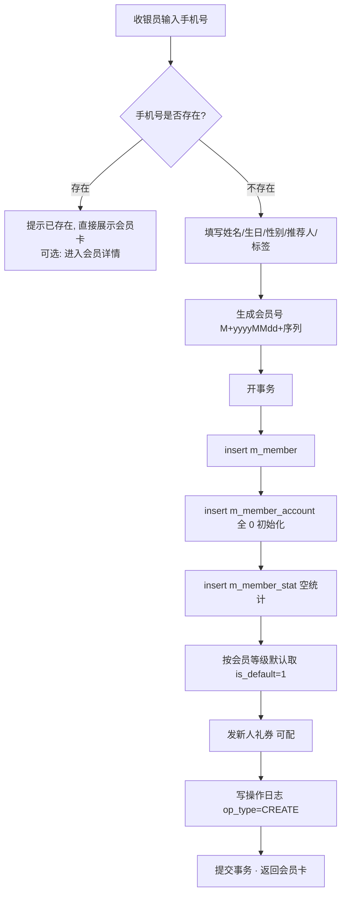

**关键点**

| 项 | 规则 |
|---|---|
| 会员号生成 | `M` + `yyyyMMdd` + 6 位日序列；用 Redis `INCR member:seq:{yyyyMMdd}` 生成，兜底用数据库序列表；日切时 key 设 TTL 2 天 |
| 手机号唯一 | `uk_phone` 唯一索引兜底；应用层先查后插 + 捕获 `DuplicateKeyException` 转业务异常 `20001` |
| 允许无手机号建档 | 允许（微信游客），但涉及充值/发券需先绑定；此时 `phone = NULL`（唯一索引允许多个 NULL） |
| 推荐人绑定 | `referrerPhone` / `referrerId` 解析后写 `m_referral`（`uk_invitee` 保证只绑一次），新会员 `source = 4` |
| 事务边界 | 会员 + 账户 + 统计 + 券 + 日志 必须在**同一事务**，避免"有会员无账户"的脏数据 |

### 1.2 微信小程序注册与手机号绑定

| 步骤 | 说明 |
|---|---|
| 1. 静默登录 | `wx.login` → code → 后端 `code2Session` → 得 `openid`(+`unionid`) → 按 `openid` upsert 会员（新会员 `source=2`，昵称默认"微信用户"） |
| 2. 返回登录态 | `needBindPhone = (phone == null)` |
| 3. 绑定手机号 | 前端 `getPhoneNumber` 得 code → 后端换手机号 → **三态判定**：① 手机号未被占用 → 直接绑定；② 已被占用且 openid 为空 → 绑定到该会员（合并登录态）；③ 已被占用且是另一个有 openid 的会员 → 返回 `20001 需合并`，走 UC-02 |
| 4. 合并申请 | 小程序提交合并申请 → WEB 端「会员合并」页人工审核（对比资产/券/卡/流水），确认后执行合并 |
| 5. 登录日志 | 每次登录写 `m_login_log`（login_type=2） |

> **安全**：`session_key` 只存 Redis（`mp:session:{memberId}`，TTL 7 天），不落库、不返回前端。

### 1.3 会员合并算法（UC-02）

| 步骤 | 处理 |
|---|---|
| 1. 选主账号 | 人工指定「保留账号」（一般取手机号真实、消费多的那个） |
| 2. 前置校验 | 被合并账号：无未完成订单、无挂单、无待审退款单；主账号：状态正常 |
| 3. 资产转移 | 被合并账户的 `balance`/`gift_balance`/`points`/`growth` 累加到主账号；被合并账户清零；**双方各写一条 `biz_type=9 合并` 流水**（一负一正，保证各自流水可重算平账） |
| 4. 券与卡迁移 | `m_member_coupon.member_id`、`m_member_card.member_id`、`m_member_card_item.member_id` 改为主账号；同模板券超限的（`limit_per_member`）多余部分作废并记日志 |
| 5. 积分批次迁移 | `m_point_batch.member_id` 改为主动账号（保持到期时间不变，FIFO 语义不变） |
| 6. 历史数据 | `m_order`/`m_balance_flow`/`m_point_flow` 等历史记录**不改归属**（保持原样，只迁移资产），但写 `m_member_merge_log` 记录映射关系，查询时可按需展示"关联账号" |
| 7. 被合并账号 | `status=3 注销` + `deleted=1` + `phone` 置空（释放唯一索引）+ `remark` 记录"已合并至 Mxxx" |
| 8. 审计 | 写 `m_member_merge_log`（含合并前双份快照 JSON）+ `m_op_log` |

**回滚**：合并过程在单事务内；若失败全部回滚并提示，不留中间态。

---

## 2. 充值流程（含赠送、送券、升级）

### 2.1 主流程

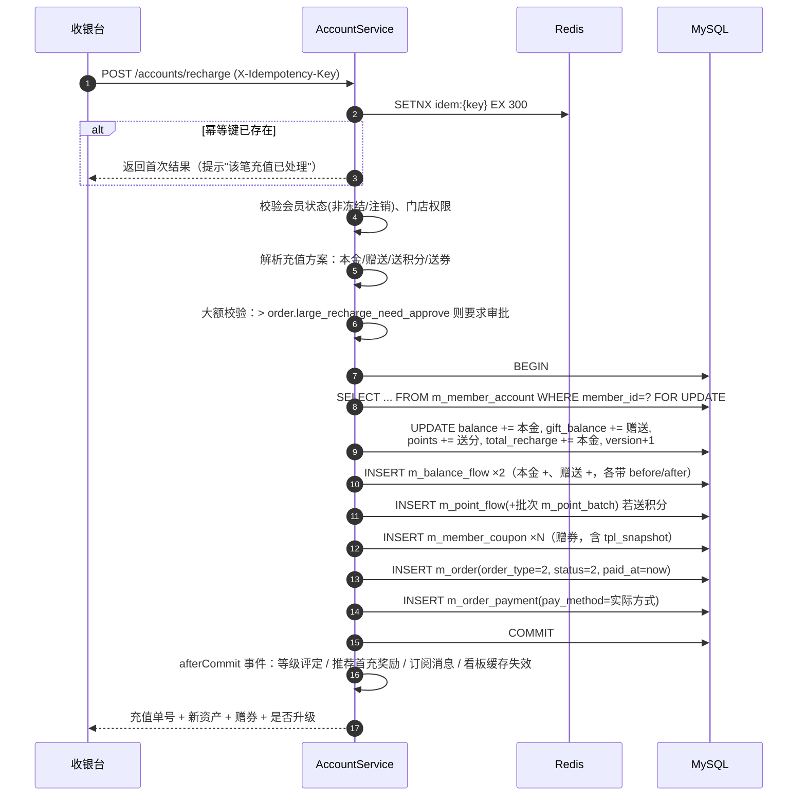

### 2.2 校验与规则表

| 校验 | 规则 | 失败码 |
|---|---|---|
| 会员状态 | `status=1` | `20002`/`20003` |
| 金额 | 本金 > 0，赠送 ≥ 0，均为两位小数 | `30003` |
| 门店权限 | 操作人有该门店数据权限 | `10003` |
| 大额审批 | 本金 ≥ 5000 需店长确认（可配） | `10003` |
| 幂等 | `m_balance_flow.uk_idem` 兜底 | `90003` |
| 余额上限 | 可选配 `account.max_balance`（默认 0 = 不限） | `30006` |
| 赠送上限 | 赠送额 ≤ 本金 × `account.gift_ratio_limit`（默认 1.00，防配置错误） | `10001` |

### 2.3 充值撤销 / 退款

| 场景 | 允许条件 | 处理 |
|---|---|---|
| 当日撤销 | 充值单当日、账户自充值后**无任何消费**、赠送未被使用 | 反向冲正：扣回本金 + 扣回赠送 + 扣回赠分 + **作废未使用的赠券**；写 `biz_type=3 退款` 流水 |
| 跨日退款 | 需店长审批 | 同上，但可只退部分本金（按剩余赠送比例扣回赠送） |
| 赠送不足扣回 | 会员已花掉赠送余额 | 从本金中补扣（`gift_balance` 不为负原则：先扣赠送到 0，差额扣本金），流水记两笔 |
| 券已使用 | 无法作废 | 按券面额折算从退款中扣除（可配置策略：`refund_deduct_used_coupon=true`） |

### 2.4 幂等实现（伪代码）

```java
@Idempotent(prefix = "recharge", ttl = 300, keyArg = "#cmd.idempotencyKey")
@Transactional(rollbackFor = Exception.class)
public RechargeResult recharge(RechargeCmd cmd) {
    MemberAccount acc = accountMapper.selectForUpdate(cmd.getMemberId()); // FOR UPDATE
    if (acc == null) throw new BizException(ErrorCode.ACCOUNT_NOT_FOUND);

    // 1) 余额与赠送
    BigDecimal newBalance = acc.getBalance().add(cmd.getRechargeAmount());
    BigDecimal newGift    = acc.getGiftBalance().add(cmd.getGiftAmount());
    int rows = accountMapper.updateBalance(acc.getId(), newBalance, newGift,
                    cmd.getRechargeAmount(), cmd.getGiftAmount(),
                    acc.getPoints() + cmd.getGiftPoints(), acc.getVersion());
    if (rows == 0) throw new BizException(ErrorCode.CONCURRENT_MODIFY); // 乐观锁冲突

    // 2) 流水（本金 + 赠送）
    flowService.recordBalance(acc, AccountType.PRINCIPAL, BizType.RECHARGE, cmd.getRechargeAmount(), cmd);
    if (cmd.getGiftAmount().signum() > 0) {
        flowService.recordBalance(acc, AccountType.GIFT, BizType.GIFT, cmd.getGiftAmount(), cmd);
    }
    // 3) 赠分（写流水 + 批次，批次 expire_time = now + points.expire_months）
    // 4) 赠券（couponService.grantBatch）
    // 5) 订单与支付明细
    // 6) 操作日志 @OpLog
    return buildResult(acc, order);
}
```

---

## 3. 消费结算流程（核心）

### 3.1 金额计算链（必须严格按序）

```
① 原价合计 totalAmount        = Σ(item.price × item.qty)
② 会员折扣 discountAmount     = Σ(参与折扣项.total × (1 − 等级折扣率))
   └ 若商品设置 member_price 则优先用会员价，不再叠加等级折扣
③ 券抵扣 couponAmount         = 按券规则（满减/折扣/代金，受 min_amount 与 max_discount 约束）
   └ 券基准金额 = ① − ②（可配置基准是原价还是折后价，默认折后）
④ 积分抵扣 pointDeductAmount  = min(points / exchange_rate, payable × max_deduct_ratio)
⑤ 应收 payableAmount          = ① − ② − ③ − ④ ，且 ≥ 0
⑥ 实收 paidAmount             = Σ payment.amount，必须 == ⑤
⑦ 获得积分 pointsGained       = floor( Σ(参与积分项实付分摊额 × 品类倍率) × 等级积分倍率 )
   └ 实付分摊额按「按比例分摊」：item.actualAmount = item.totalAmount × (payable / (①−②))
⑧ 获得成长值 growthGained     = floor(实付金额中「非赠送余额支付部分」× growth.per_yuan)
```

> **重要**：⑥ 中的「赠送余额抵扣部分」不计积分与成长值（防止"充 1000 送 1000 刷等级"）。若配置允许，可调整，但默认不计。

### 3.2 结算时序（含券锁定）

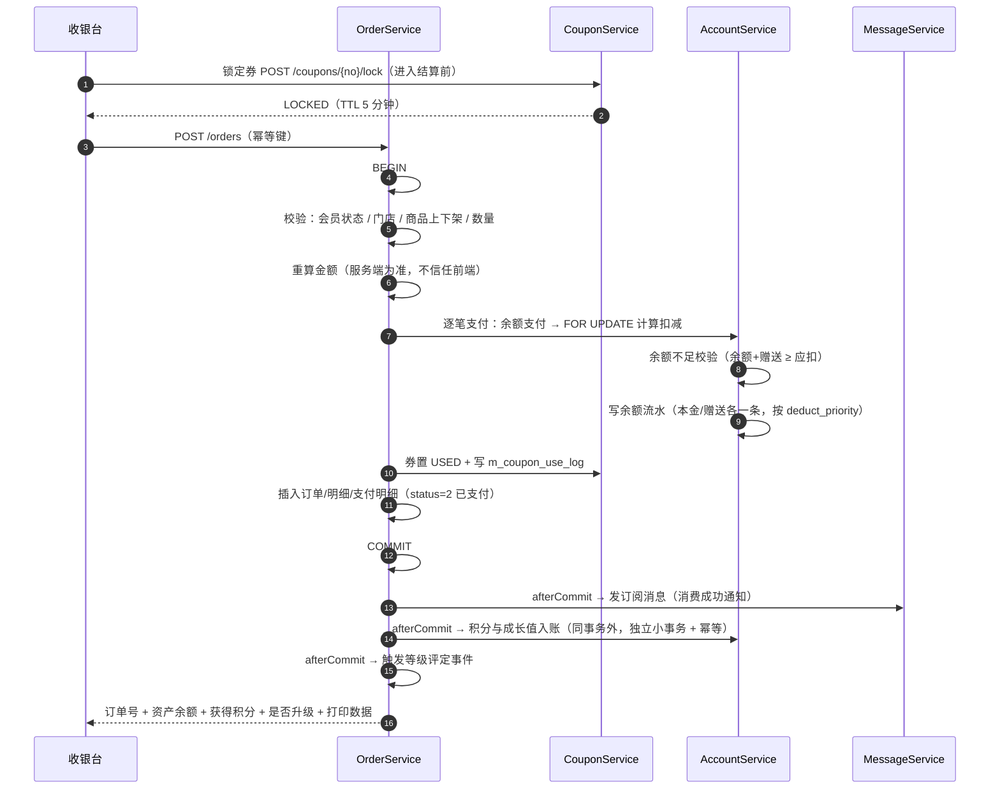

**为什么积分入账放在 afterCommit**：收银主链路尽快返回（店员等待时间敏感）；积分失败不影响订单成立，由事件重试 + 定时补偿（扫描已支付但 `points_gained=0` 的订单）保证最终一致。

### 3.3 余额扣减算法（本金/赠送按优先级）

```java
// 入参：应扣总额 amount，优先级 GIFT_FIRST（默认）
BigDecimal fromGift = BigDecimal.ZERO, fromPrincipal = BigDecimal.ZERO;
if (priority == GIFT_FIRST) {
    fromGift = acc.getGiftBalance().min(amount);
    fromPrincipal = amount.subtract(fromGift);
} else {
    fromPrincipal = acc.getBalance().min(amount);
    fromGift = amount.subtract(fromPrincipal);
}
if (fromPrincipal.compareTo(acc.getBalance()) > 0 || fromGift.compareTo(acc.getGiftBalance()) > 0) {
    throw new BizException(ErrorCode.BALANCE_NOT_ENOUGH, "余额不足，还差 " + shortfall + " 元");
}
// SQL 层双重保险（防并发超扣）
int rows = accountMapper.deduct(id, fromPrincipal, fromGift, version);
// UPDATE m_member_account SET balance = balance - #{p}, gift_balance = gift_balance - #{g},
//        total_consume = total_consume + #{p} + #{g}, total_consume_count = total_consume_count + 1,
//        version = version + 1
//  WHERE id = #{id} AND balance >= #{p} AND gift_balance >= #{g} AND version = #{version}
if (rows == 0) throw new BizException(ErrorCode.CONCURRENT_MODIFY);
```

### 3.4 组合支付校验

| 规则 | 说明 |
|---|---|
| 金额守恒 | `Σ payments.amount == payableAmount`，误差为 0（BigDecimal 精确比较） |
| 余额支付 | 只能一条（本金/赠送在内部拆分），不允许两条余额支付 |
| 现金/线下扫码 | 允许多条（如现金 + 扫码组合） |
| 积分抵扣 | 作为支付方式 4 记账，但**不进入 paidAmount 的现金口径**（报表区分：`payable` 已含抵扣，`paid` = 实收） |
| 支付方式合计校验 | `Σ payments(payMethod != 4) == paidAmount` |

### 3.5 消费测试要点（必须覆盖）

| 用例 | 期望 |
|---|---|
| 正常消费（余额充足） | 余额正确扣减，流水 before/after 正确 |
| 余额不足 | 抛 `30001`，账户无任何变动 |
| 赠送优先扣减 | 先扣赠送再扣本金，两条流水 |
| 券门槛不满足 | 抛 `50003`，订单不成立 |
| 券并发使用（同一张券两个收银台同时提交） | 只有一个成功，另一个 `50005` |
| 并发消费（同一会员两台收银机同时提交） | 串行化，余额不超扣，无负数 |
| 重复提交（相同幂等键） | 第二次返回首次订单，不重复扣款 |
| 商品下架后结算 | 抛业务异常，提示刷新 |
| 折扣与积分倍率取整 | `floor` 取整规则一致，不出现 0.5 积分 |
| 应收为 0（全额券抵扣） | 允许成立，`paidAmount=0`，不产生余额流水 |

---

## 4. 退单冲正流程（UC-07）

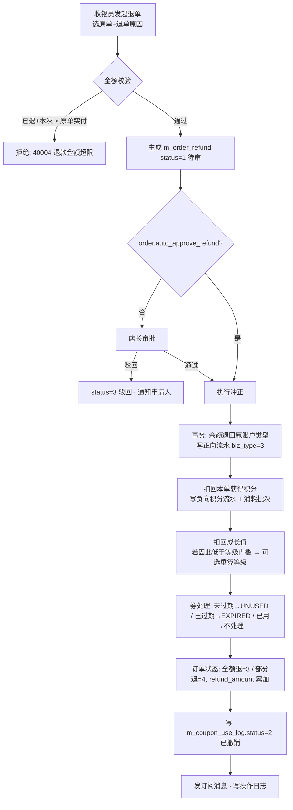

### 4.1 冲正规则细则

| 项 | 规则 |
|---|---|
| 退款金额 | 只退**本金**支出部分；「赠送余额抵扣部分」默认不退（可配 `refund_include_gift=true`） |
| **退款路径按支付来源区分（关键）** | `pay_method=1 储值余额` → 退回会员余额（写正向流水）；`pay_method=2/3 现金/线下扫码` → **只生成退款单记录**，由门店线下退现，财务据此对账；`pay_method=5 微信在线支付` → **调渠道原路退款**（见 §4.5），渠道退款成功后再执行资产冲正 |
| 现金/扫码支付 | 不退钱，只生成退款单记录（注明"线下退款"），财务据此对账 |
| 积分扣回 | 扣回 `points_gained`；若积分已消费（余额不足），账户积分置负，后续获得优先补负 |
| 成长值扣回 | 扣回 `growth_gained`；成长值不允许为负（扣到 0 为止，差额记日志） |
| 券处理 | 默认「退回可再用」（`valid_end` 不变）；若券已过期则置 `EXPIRED` |
| 等级处理 | 默认**不因退单降级**（配置可开启"退单后重算等级"） |
| 部分退 | 按退款比例分摊扣回积分：`deductPoints = floor(order.pointsGained × refundAmount / paidAmount)` |
| 幂等 | 退款单号唯一 + `X-Idempotency-Key` + 校验「原单已退金额 + 本次 ≤ 实付」 |
| 审计 | 退款单 + 操作日志（含审批人、原因、前后资产） |

### 4.5 在线支付退款（预留：微信支付）

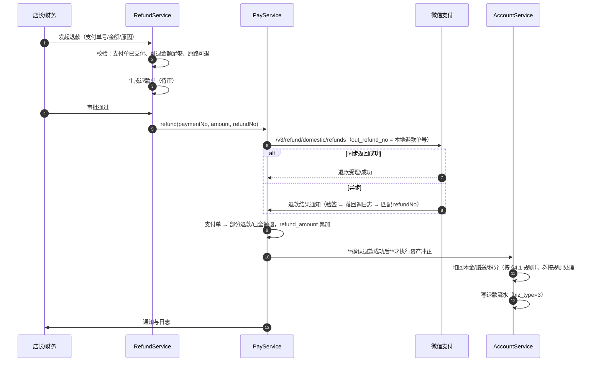

**关键约定**

| 项 | 规则 |
|---|---|
| 顺序 | **先退钱、后冲账**：渠道退款确认成功后才动会员资产，避免"账已冲但钱没退到" |
| 退款单号 | 本地 `RF...` 作为渠道 `out_refund_no`，一一对应，便于对账 |
| 幂等 | 同一退款单号重复提交 → 渠道幂等返回原结果；本地以 `refund_no` 唯一索引兜底 |
| 部分退款 | 允许多次，累计不得超支付单金额；**最后一次退完**才置"已全额退" |
| 充值退款 | 扣回赠送余额、赠分、未使用赠券（券已用则按配置折算扣除） |
| 失败处理 | 渠道退款失败 → 退款单置失败并保留原因，**不执行资产冲正**，人工介入后可重试 |
| 线下支付的退单 | **不走本流程**，走 §4.1（只记退款单，门店线下退现） |
| 对账 | `PayReconcileJob` 每日比对渠道退款记录与本地退款单，差异告警 |

---

## 5. 等级评定流程（UC-11）

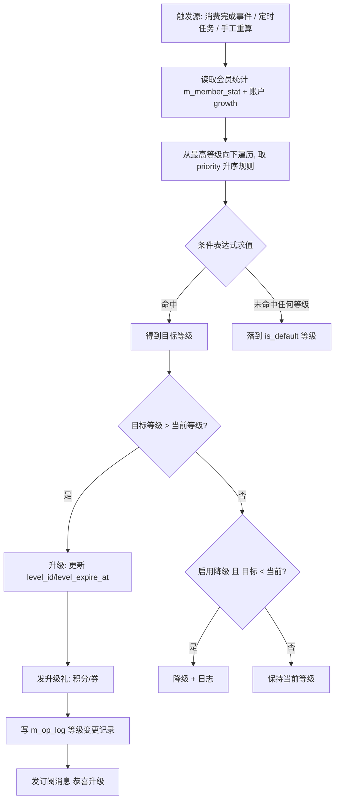

### 5.1 规则表达式求值

**字段白名单**（`LevelFieldEnum`）与取值来源：

| 字段 | 来源 | 说明 |
|---|---|---|
| `growth` | `m_member_account.growth` | 累计成长值 |
| `totalRecharge` | `m_member_account.total_recharge` | 累计充值本金 |
| `totalConsume` | `m_member_account.total_consume` | 累计实付消费 |
| `payAmount30d` / `payAmount90d` / `payAmount12m` | `m_member_stat` | 区间消费额 |
| `orderCount12m` | `m_member_stat` | 近 12 月笔数 |
| `visitDays30d` | `m_member_stat` | 近 30 天到店天数 |

**操作符**：`>=` `>` `<=` `<` `==` `between`；逻辑：同级 `AND`/`OR`（默认 AND）。

**求值实现**：把 `rule_json.items` 转成 SQL `WHERE` 段（推荐，性能好、可批量）或 Java 谓词（灵活）。批量重算时用 SQL 一条语句算出所有会员的目标等级：

```sql
-- 批量等级重算（示例：按成长值定级，可与 m_member_stat 关联扩展）
UPDATE m_member m
JOIN m_member_account a ON a.member_id = m.id
JOIN (
  SELECT lr.level_id, lv.level_value,
         CAST(JSON_UNQUOTE(JSON_EXTRACT(lr.rule_json,'$.items[0].value')) AS SIGNED) AS threshold
    FROM m_level_rule lr JOIN m_member_level lv ON lv.id = lr.level_id
   WHERE lr.rule_type = 1 AND lr.status = 1
) t ON a.growth >= t.threshold
SET m.level_id = t.level_id, m.updated_at = NOW()
WHERE m.status = 1 AND t.level_value = (
  SELECT MAX(t2.level_value) FROM ( ... ) t2 WHERE a.growth >= t2.threshold
);  -- 实际实现用「取满足条件的最高等级」子查询或应用层逐会员判断
```

> 实现建议：**逐会员应用层判断 + 批量分片（每批 500 人）+ 只更新发生变化的记录**，逻辑清晰、可打印差异日志；百万会员全量重算在凌晨任务执行。

### 5.2 保级与有效期

| 配置 | 行为 |
|---|---|
| `level.valid_months = 0`（默认） | 等级永久，只升不降 |
| `level.valid_months > 0` | 升级时写 `level_expire_at = now + valid_months`；定时任务扫描到期会员，按 `keepRule` 判定：满足 → 续期；不满足 → 降级到匹配等级 |
| `level.downgrade_enabled = false`（默认） | 即使不满足保级也不降级，只标记"待观察" |

---

## 6. 积分体系流程（UC-09、UC-10）

### 6.1 积分获得（含批次）

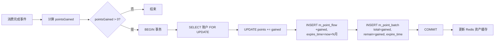

### 6.2 积分消耗（FIFO + 补负）

```java
@Transactional
public void consumePoints(Long memberId, long points, BizContext ctx) {
    MemberAccount acc = accountMapper.selectForUpdate(memberId);
    if (acc.getPoints() < points) throw new BizException(ErrorCode.POINTS_NOT_ENOUGH);
    // 1) 账户扣减
    accountMapper.deductPoints(acc.getId(), points, acc.getVersion());
    // 2) 批次 FIFO 扣减
    List<PointBatch> batches = batchMapper.selectUsableForUpdate(memberId); // ORDER BY expire_time ASC FOR UPDATE
    long remain = points;
    for (PointBatch b : batches) {
        if (remain <= 0) break;
        long use = Math.min(b.getRemainPoints(), remain);
        batchMapper.consume(b.getId(), use);          // remain -= use; status = remain==0 ? 2 : 1
        flowMapper.insert(detailFlow(b, use, ctx));   // 记录批次扣减明细（可选，用于溯源）
        remain -= use;
    }
    // 3) 总流水（一条汇总负向流水）
    flowService.recordPoint(acc, BizType.EXCHANGE_DEDUCT, -points, ctx);
}
```

> **允许账户积分为负的场景**：退单扣回时积分已花掉。后续获得积分先补负：`if (acc.points < 0) { 补负 }`，批次只在正数结余时创建。

### 6.3 积分过期任务（每日 01:00）

```sql
-- 1) 找出已到期且仍有剩余的批次
SELECT id, member_id, remain_points FROM m_point_batch
 WHERE status = 1 AND remain_points > 0 AND expire_time <= NOW()
   AND id > #{lastId} ORDER BY id LIMIT 500;   -- 分片游标，避免长事务

-- 2) 对每个批次（逐会员合并处理）：
--    批次 status=3 已过期, remain_points=0
--    账户 points -= 合计过期积分（不可为负：若账户积分 < 过期量，只扣到 0，差额记日志）
--    写 m_point_flow(biz_type=4 过期, change_points=-X)
```

**提前提醒**：每日 08:00 扫描 `expire_time` 在 7 天内的批次，按会员汇总 → 发订阅消息（`COUPON_EXPIRE` 类似模板）+ 小程序积分页展示"即将过期 X 分"。

### 6.4 积分抵扣现金

| 规则 | 说明 |
|---|---|
| 兑换比例 | `points.exchange_rate`，默认 100 积分 = 1 元 |
| 单笔上限 | `floor(可抵扣基准 × points.max_deduct_ratio)`（默认 30%），且 ≤ 账户积分换算值 |
| 最低保留 | `points.min_keep`（默认 0），即账户必须保留的积分不能用于抵扣 |
| 取整 | 抵扣金额按 0.01 元向下取整，消耗积分 = 抵扣金额 × 比例（整数） |
| 退单 | 抵扣积分全额返还（写正向积分流水 + 新批次，到期时间按原批次或 new+N月，默认沿用原批次到期时间） |

---

## 7. 优惠券全流程（UC-12、UC-13）

### 7.1 发券

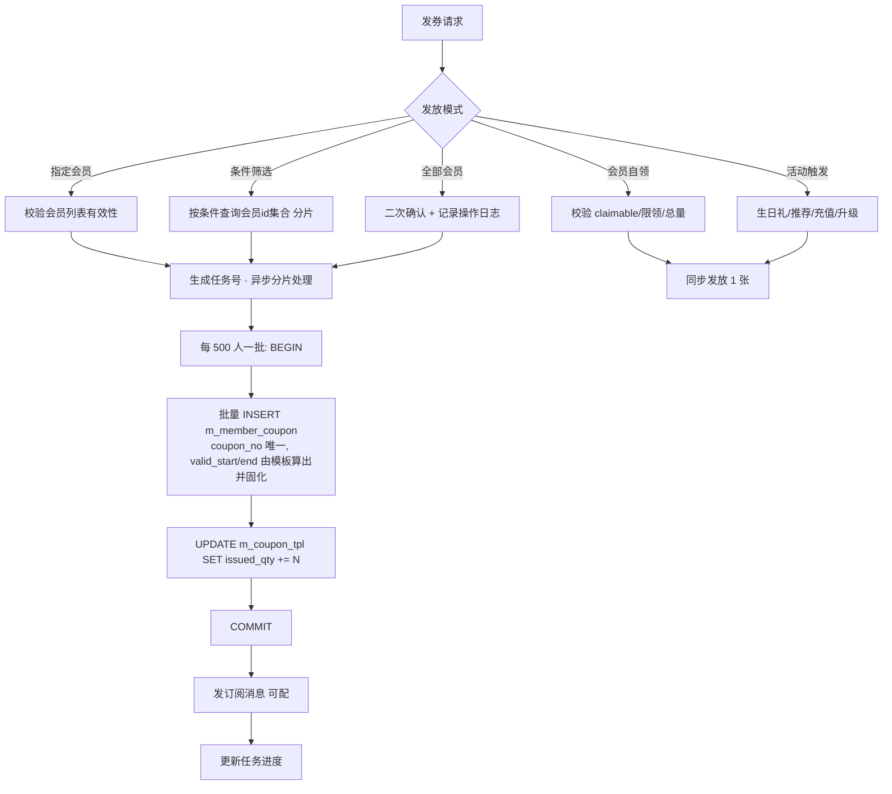

**券码生成**：`CP` + 16 位 Base32（去除 `0O1I` 易混字符），Redis 生成或数据库唯一索引兜底重试；含校验位便于输错检测。

### 7.2 核销校验链（严格按序，任一步失败即拒绝）

| 序 | 校验 | 失败码 |
|---|---|---|
| 1 | 券存在且属于该会员（防串用） | `10004` / `50001` |
| 2 | 状态 = `UNUSED`（`LOCKED` 且锁单号一致则放行） | `50005` |
| 3 | 当前时间在 `[valid_start, valid_end]` 内 | `50002` |
| 4 | 门店在 `scope_store` 内（`-1` 表示全部） | `50004` |
| 5 | 订单商品在 `scope_product` 内且不在 `exclude_product` 内 | `50004` |
| 6 | 订单金额（折后）≥ `min_amount` | `50003` |
| 7 | 叠加规则：同一 `stack_group` 未使用其他券；`allow_stack=false` 时不得与其他券共用 | `50001` |
| 8 | 抵扣额计算：满减=面额；折扣=`min(基准×(1−折扣值), max_discount)`；代金=面额；兑换=商品原价 | — |
| 9 | 抵扣额 ≤ 应付金额（不得为负） | — |
| 10 | 置 `USED` + 写 `m_coupon_use_log`（唯一约束防重复核销） | `50005` |

### 7.3 券撤销（退单联动）

| 情况 | 处理 |
|---|---|
| 券未过期 | `status = UNUSED`，清空 `order_id`/`used_at`；`m_coupon_use_log.status = 2 已撤销` |
| 券已过期 | `status = EXPIRED`，记日志说明"退单时券已过期，不再可用" |
| 券被作废 | 不恢复（作废是管理员行为，优先级最高） |

### 7.4 券锁定的并发处理

- 收银台选券 → 调 `/lock`：`UPDATE m_member_coupon SET status=2, lock_order_no=?, lock_time=NOW() WHERE id=? AND status=1`，`rows=0` 即"券已被占用"。
- 未支付离开 → 前端调 `/unlock` 或 5 分钟后定时任务释放（`status=2 AND lock_time < NOW()-5min` → `UNUSED`）。
- 订单提交时校验 `lock_order_no` 与本单号一致，防止锁的是别人。

---

## 8. 次卡核销流程（UC-14）

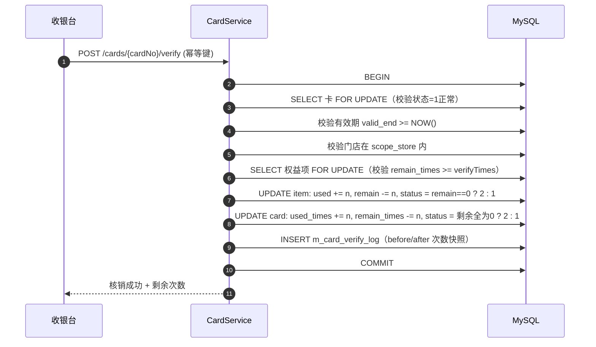

| 校验 | 失败码 |
|---|---|
| 卡不存在 | `10004` |
| 卡状态：已用完/过期/冻结/已退 | `50007` |
| 权益项剩余不足 | `50006` |
| 门店不适用 | `50004` |
| 已过有效期 | `50007` |
| 重复提交（同幂等键） | 返回首次结果 |

**退卡折算**（可选功能）：`应退 = 实付金额 × (剩余次数 / 总次数) − 已享优惠差额`，生成退款单走审批；退卡后卡状态置 5。

---

## 9. 推荐有礼流程（UC-15）

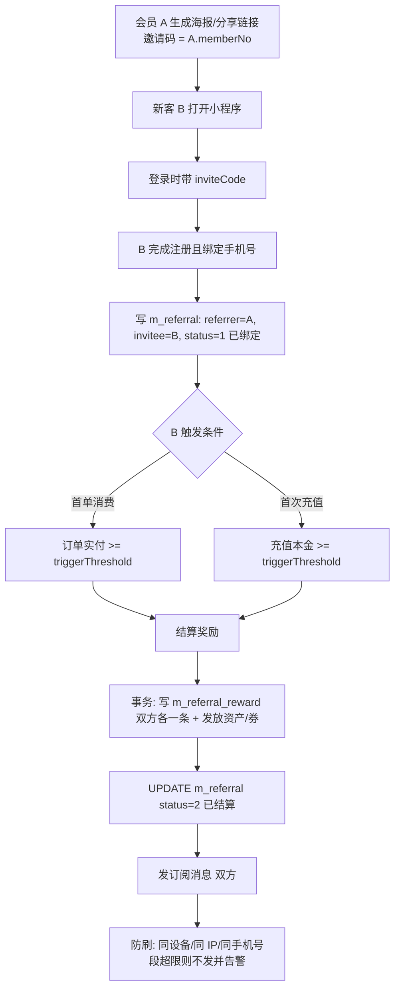

| 规则 | 默认值 | 说明 |
|---|---|---|
| 触发条件 | 首单实付 ≥ 50 元 | 可配 `FIRST_CONSUME` / `FIRST_RECHARGE` / `REGISTER`（注册即奖风险高，默认关闭） |
| 推荐人奖励 | 券（30 元）+ 100 积分 | 可配 |
| 被推荐人奖励 | 券（新人 20 元） | 可配 |
| 奖励上限 | 每人最多 20 次 | 防刷 |
| 有效期 | 绑定后 60 天内完成首单，过期失效（定时任务置 `status=3`） | — |
| 绑定唯一性 | `m_referral.uk_invitee`：一人只能被推荐一次；已是老会员（有历史订单）不可被推荐 | — |
| 防刷 | 同一手机号段/设备/IP 异常高频（1 小时 > 5 单）→ 奖励转为"待人工审核" | — |
| 层级 | 仅一级 | 明确不做二级分销（合规风险） |

---

## 10. 生日礼流程（UC-16）

| 步骤 | 说明 |
|---|---|
| 1. 扫描 | 每日 08:00 查 `birthday` 月日 = 今日（或提前 N 天）且 `status=1` 的会员，游标分片 |
| 2. 幂等 | 以 `(member_id, 年份, 'BIRTHDAY')` 作为幂等键，写 `m_message_record.idempotency_key`；已发放则跳过 |
| 3. 发放 | 按等级取 `birthday_coupon_tpl_id` 发券 + 可选送积分 |
| 4. 通知 | 发订阅消息（`BIRTHDAY_GIFT`）；会员未授权订阅则只落站内消息 |
| 5. 统计 | 记录发放数量，看板展示生日礼核销率 |

---

## 11. 交接班与日结对账（UC-17）

### 11.1 交班流程

```
收银员点击"交班" → 后端按 shift_no（或时间区间）汇总：
  ├ 订单数、消费额、退款额
  ├ 分支付方式：现金 / 线下扫码 / 储值余额（本金+赠送拆分）
  ├ 充值笔数与金额、赠送金额
  ├ 售卡数量与金额、次卡核销次数
  ├ 券核销数量与抵扣额
  ├ 新增会员数
  └ 期初/期末现金（如需盘点：录入实际现金，系统算差异）
→ 生成交班单（可打印）→ 写操作日志 → 收银员状态置"已交班"
```

**差异处理**：`实际现金 − 系统现金 = 长短款`，强制填写说明；差异记入 `m_op_log`（`op_type=SHIFT_CLOSE`，`amount=差异额`）。

### 11.2 T+1 对账任务（每日 05:00）

| # | 校验 | SQL 思路 | 差异处理 |
|---|---|---|---|
| 1 | 本金余额 vs 流水 | `a.balance <> IFNULL(SUM(f.change_amount),0)`（`account_type=1`） | 写差异清单，告警 |
| 2 | 赠送余额 vs 流水 | 同上（`account_type=2`） | 同上 |
| 3 | 积分 vs 流水 | `a.points <> IFNULL(SUM(pf.change_points),0)` | 同上 |
| 4 | 积分 vs 批次 | `a.points <> IFNULL(SUM(pb.remain_points),0)`（`status=1`） | 同上 |
| 5 | 成长值 vs 流水 | `a.growth <> IFNULL(SUM(gf.change_growth),0)` | 同上 |
| 6 | 订单金额守恒 | `o.payable_amount <> o.total - o.discount - o.coupon - o.point_deduct` | 告警 |
| 7 | 订单 vs 支付明细 | `o.paid_amount <> IFNULL(SUM(p.amount),0)`（`pay_method != 4`） | 告警 |
| 8 | 券状态一致性 | `USED` 券必有 `m_coupon_use_log`；`m_coupon_use_log` 的券状态必为 3 | 自动修正 + 日志 |
| 9 | 次卡次数一致性 | `card.remain_times <> Σ(item.remain_times)` | 告警 |
| 10 | 日统计复算 | `m_stat_daily` 与实际订单聚合比对（T-1） | 重算并覆盖 |

**告警出口**：对账差异 > 0 → 写 `m_op_log`（`module=reconcile`, `status=0`）+ 企业微信/邮件通知 + 首页待办红点。

---

## 12. 小程序在线支付充值流程（预留：微信支付）

> 目标：**线上支付与线下记账走同一套入账逻辑**，差异只在"钱怎么进来"。

### 13.1 全链路

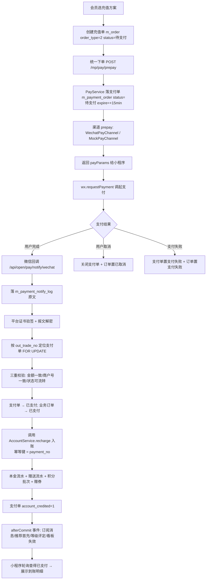

### 13.2 幂等与安全设计（逐道防线）

| # | 环节 | 防线 |
|---|---|---|
| 1 | 创建充值单 | 幂等键 + `m_order.idempotency_key` 唯一；重复请求返回同一订单 |
| 2 | 统一下单 | 幂等键 + `m_payment_order.uk_idem` 唯一；同一业务单已存在未过期支付单 → **直接复用**（不重复下单） |
| 3 | 支付单唯一性 | `uk_biz(biz_type,biz_no)` 保证一个充值单只有一个支付单 |
| 4 | 回调接收 | `m_payment_notify_log.uk_notify_id` 唯一，渠道重推（最多 8 次）只落一条并直接应答成功 |
| 5 | 回调真实性 | 平台证书验签 + APIv3 密钥解密；**验签失败绝不入账**并告警 |
| 6 | 金额篡改 | 回调金额（分）与支付单 `amount_fen` 必须严格相等 |
| 7 | 串单 | 回调商户号/AppID 与支付单记录一致；渠道交易号唯一索引 |
| 8 | 重复入账 | `AccountService` 入账幂等键 = `payment_no` + 支付单 `account_credited` 标记双保险 |
| 9 | 掉单 | `PaySyncJob` 每 30 秒主动查单（最多 5 次），走**同一个** `PayService.handlePaid` 入口 |
| 10 | 超时单 | `PayCloseJob` 每分钟关单，订单置已取消（不产生任何资产变动） |

### 13.3 与线下充值的一致性对照

| 环节 | 线下收银充值 | 小程序在线充值（预留） |
|---|---|---|
| 触发 | 收银员操作 | 会员自助 → 支付回调 |
| 支付方式 | 现金/线下扫码 | `pay_method=5 微信在线支付` |
| 支付单 | 无 | `m_payment_order`（已支付） |
| 入账入口 | `AccountService.recharge` | **同一个** `AccountService.recharge` |
| 赠送/送券/升级 | ✅ 一致 | ✅ 一致 |
| 推荐首充奖励 | ✅ 一致 | ✅ 一致 |
| 订阅消息 | ✅ 一致 | ✅ 一致 |
| 对账 | T+1 余额对账 | T+1 余额对账 **+ 支付对账（渠道 vs 本地）** |

> 结论：业务侧只多了一个"支付单"和一条"支付对账"，**会员资产逻辑零分支**——这是把支付做成独立执行器的收益。

### 13.4 支付相关测试要点（预留阶段执行）

| 用例 | 期望 |
|---|---|
| 正常在线充值 | 支付单已支付 → 资产到账 → 支付单 `account_credited=1` → 收到通知 |
| 回调重复推送 8 次 | 只入账一次，日志 1 条成功 + N 条"重复已忽略" |
| 伪造回调（错误签名） | 拒绝，`sign_verified=0`，告警，资产不变 |
| 篡改金额的回调 | 拒绝，支付单不变，告警 |
| 回调丢失（模拟渠道不推送） | 30 秒内被 `PaySyncJob` 查到并补入账 |
| 用户取消支付 | 支付单已关闭，充值单已取消，无资产变动 |
| 超时不支付 | 15 分钟后自动关单，券锁被释放（如占用） |
| 支付成功后重复下单同一充值单 | 返回 `70006`，不产生第二个支付单 |
| 在线支付订单退款 | 渠道退款成功 → 扣回赠送/积分/券 → 支付单部分退款/已全额退 |
| 充值退款时赠券已被使用 | 按配置折算扣除或拒绝退款，提示明确 |

---

## 13. 异常与补偿设计

| 异常场景 | 处理策略 |
|---|---|
| 收银提交后网络超时（实际已成功） | 幂等键保证重试返回首次结果；前端展示"该单已结算，订单号 X" |
| 积分入账事件失败 | 事件表/日志记录 + 补偿任务：扫描 5 分钟内 `status=2 AND points_gained=0` 的消费订单重试（最多 3 次），仍失败则告警 |
| 订阅消息发送失败 | `m_message_record.status=3` + `next_retry_at` 指数退避，`MessageRetryJob` 每 10 分钟重试，3 次后置失败并统计 |
| 微信接口超时 | 重试 2 次（间隔 200ms）→ 失败降级（登录失败提示重试；消息失败入队） |
| 定时任务多实例重复执行 | ShedLock（Redis 实现）保证同一任务同一时刻只有一个实例执行 |
| 批量发券中途失败 | 任务分批提交，失败批次记录错误明细，支持"重试失败批次" |
| 数据库死锁 | 统一加锁顺序（先账户后券后订单）；捕获 `DeadlockLoserDataAccessException` 自动重试 2 次 |
| 长事务风险 | 事务内禁止远程调用（微信/消息），统一 afterCommit 处理 |

---

## 14. 流程测试清单（验收用）

| # | 场景 | 预期 |
|---|---|---|
| T01 | 建档 → 充值 500 送 50 → 消费 88 元 | 余额 462，赠送 0（先扣赠送 50 再扣本金 38），积分按 38 元计（赠送抵扣不计分） |
| T02 | 消费用券 + 积分抵扣 + 余额不足部分现金 | 三方式组合成功，账实相符，小票金额与系统一致 |
| T03 | 同一会员两台收银机同时结算 | 后提交者余额不足或串行成功，绝不超扣 |
| T04 | 退单（券未过期） | 余额退回、积分扣回、券恢复可用、订单状态 3 或 4 |
| T05 | 退单（券已过期） | 券置过期，不可再用，日志留痕 |
| T06 | 充值后当日撤销（未消费） | 本金与赠送全额扣回，赠券作废 |
| T07 | 消费后升级 | 等级更新、升级礼发放、订阅消息、日志齐全 |
| T08 | 积分过期任务 | 批次置过期，账户积分扣减，流水记录，提醒消息发出 |
| T09 | 券并发核销 | 一成功一失败，`m_coupon_use_log` 唯一约束生效 |
| T10 | 次卡核销 3 次后剩余 7 次 | 卡与权益项次数同步，核销记录 before/after 正确 |
| T11 | 推荐新客首单 | 双方奖励到账，`m_referral.status=2` |
| T12 | 对账任务 | 无差异；人为改库构造差异后能被检出并告警 |
| T13 | 会员合并 | 资产累加、券卡迁移、被合并账号注销、日志含双份快照 |
| T14 | 生日礼 | 仅发放一次（幂等），消息发送成功或入重试队列 |
| T15 | 交班 | 汇总与当日订单逐笔可核对，长短款差异可记录 |
| T16 | 在线充值（Mock 渠道） | 下单→调起→回调→入账全链路通，资产到账且支付单 `account_credited=1` |
| T17 | 支付回调重放 | 只入账一次，重复通知被识别并应答成功 |
| T18 | 回调丢失 | 主动查单在 30 秒内补入账 |
| T19 | 伪造/篡改回调 | 拒绝且告警，资产零变动 |
| T20 | 在线支付退款 | 渠道退款成功后才冲账，退款单与支付单状态一致 |
