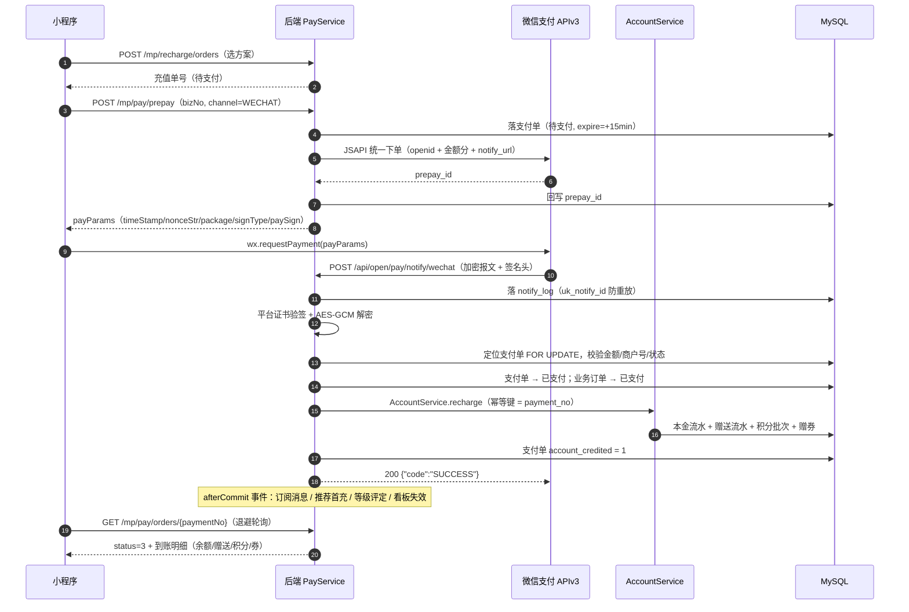

# 会员管理系统 · 支付接口预留与启用方案

> 配套文档：[01-系统架构设计 §6](./01-系统架构设计.md) ｜ [02-数据库设计 §3.3/§4.7](./02-数据库设计.md) ｜ [03-接口设计 §11.3/§12](./03-接口设计.md) ｜ [05-核心业务流程 §12](./05-核心业务流程.md)
>
> 版本 v1.0 ｜ 状态：**已设计并预留，待商户资质齐备后启用**

---

## 1. 需求与结论

**需求**：小程序端需要预留支付接口（后续接入微信支付实现在线充值/购卡）。

**方案结论**：

| 项 | 结论 |
|---|---|
| 本期是否实现在线支付 | ❌ 不实现真实渠道（无商户资质），但**接口、表结构、前端流程、回调协议全部落地** |
| 用 `MockPayChannel` 能否跑通全流程 | ✅ 可以：下单 → 调起 → 回调 → 验签（Mock 用本地密钥模拟） → 入账 → 通知，全链路可验收 |
| 切真实微信支付要改多少代码 | **只新增一个类**：`WechatPayChannel implements IPayChannel`（约 300~400 行）+ 配置；**业务代码、数据库、前端零改动** |
| 预计接入工作量 | 3~4 人日（P8，含真机联调与 0.01 元实测） |
| 启用开关 | 数据库参数 `pay.enabled`（总开关）+ `pay.mock-enabled`（渠道切换），**不需要发版** |

---

## 2. 预留的三层接口

### 2.1 后端抽象层（`IPayChannel`）

```java
public interface IPayChannel {
    String  channelCode();                      // MOCK / WECHAT / ALIPAY
    boolean isReady();                          // 商户参数是否齐备（未就绪则前端不可选）
    PrepayResult      prepay(PayOrder payOrder, PrepayRequest request);   // 统一下单
    PayQueryResult    query(String paymentNo, String channelOrderNo);     // 查单（掉单补偿）
    void              close(String paymentNo, String channelOrderNo);     // 关单
    RefundResult      refund(PayRefundCommand command);                   // 退款
    RefundQueryResult queryRefund(String refundNo, String channelOrderNo); // 退款查询
    PayNotifyEvent    parseNotify(String rawBody, Map<String,String> headers);  // 解析回调
    boolean           verifyNotify(PayNotifyEvent event, Map<String,String> headers); // 验签
}
```

| 实现类 | 状态 | 说明 |
|---|---|---|
| `MockPayChannel` | ✅ 实现 | 返回模拟 `payParams`；提供 `mock-success` 接口或按 `pay.mock-auto-success-seconds` 自动置成功；生产环境不注册 |
| `WechatPayChannel` | 🟡 预留 | APIv3 JSAPI 下单（`/v3/pay/transactions/jsapi`）、查单、关单、退款（`/v3/refund/domestic/refunds`）、平台证书验签、AES-GCM 解密 |
| `AlipayChannel` | ⬜ 占位 | 接口已定义，未实现（未来接入支付宝只需再加一个类） |

**查找方式**：`PayChannelRegistry` 按 `pay.channels` 配置从 Spring 容器（`Map<String, IPayChannel>`）中筛选；未实现的渠道代码不编译进来、`isReady()` 恒 false，因此**不存在"配错就崩"**的风险。

### 2.2 数据层（已建表，47 张中的第 22、23 张）

| 表 | 作用 |
|---|---|
| `m_payment_order` | 支付单：统一下单、渠道流水、状态机、超时、退款累计、**入账幂等标记 `account_credited`** |
| `m_payment_notify_log` | 回调日志：原文、请求头、验签结果、处理状态与耗时（`uk_notify_id` 防重放） |

`m_order` / `m_order_payment` 已预留 `payment_no`、`channel_order_no`、`trade_no`、`pay_time`、`expire_time`、`pay_method=5`（微信在线支付）等字段。

### 2.3 接口层（已定义，共 22 个）

| 分组 | 数量 | 是否免鉴权 |
|---|---|---|
| 小程序端在线支付（`/api/mp/pay/**`、`/api/mp/recharge/orders`） | 9 | 需会员登录 |
| 管理端支付中心（`/api/admin/payments/**`） | 12 | 需权限码 `payment:*` |
| 支付结果回调（`/api/open/pay/notify/{channel}`） | 1 | **免登录 + 渠道验签** |
| 开发调试（`/api/mock/pay/**`） | — | 仅 `pay.mock-enabled=true` 且非生产环境注册 |

完整清单与请求/响应示例见 [03-接口设计 §11.3、§12、§11.5](./03-接口设计.md)。

### 2.4 前端层（已设计）

| 端 | 内容 |
|---|---|
| 小程序 | 在线充值页、支付结果页（成功/处理中/失败）、待支付订单页、`utils/pay.ts` 支付编排（下单→`requestPayment`→退避轮询→结果）、充值记录区分"到店/在线"来源 |
| WEB 管理端 | 支付单管理（列表/详情/回调日志时间轴）、手动同步支付结果、支付对账页、支付渠道配置页（敏感项只写不回显） |

页面细节见 [04-前端页面与路由设计 §6.6](./04-前端页面与路由设计.md)。

---

## 3. 全链路时序（启用后）



---

## 4. 幂等与安全（十条防线）

| # | 环节 | 防线 |
|---|---|---|
| 1 | 创建订单 | 幂等键 + `m_order.idempotency_key` 唯一 |
| 2 | 统一下单 | 幂等键 + `m_payment_order.uk_idem` 唯一；已有未过期支付单则复用 |
| 3 | 业务单唯一 | `uk_biz(biz_type, biz_no)` —— 一个充值单只有一个支付单 |
| 4 | 回调去重 | `m_payment_notify_log.uk_notify_id` 唯一，渠道重推最多 8 次只处理一次 |
| 5 | 回调真实性 | 平台证书验签 + AES-GCM 解密；**验签失败绝不入账**并告警 |
| 6 | 金额篡改 | 回调金额（分）必须严格等于支付单 `amount_fen` |
| 7 | 串单 | 校验商户号/AppID 一致 + 渠道交易号唯一索引 |
| 8 | 重复入账 | 入账幂等键 = `payment_no` **且** 支付单 `account_credited=1` 双保险 |
| 9 | 掉单 | `PaySyncJob` 每 30 秒主动查单，走**同一个** `PayService.handlePaid` 入口 |
| 10 | 超时单 | `PayCloseJob` 每分钟关单，订单置已取消，不产生任何资产变动 |

> **排障口诀**：钱到了账没到 → 先看 `m_payment_notify_log.raw_body` 与 `sign_verified`，再看 `m_payment_order.status` 与 `account_credited`，最后看 `m_balance_flow`。

---

## 5. 启用清单（P8 逐步执行）

### 5.1 资质与密钥准备（业务侧）

- [ ] 微信支付**商户号**已开通，且与小程序 AppID 完成绑定
- [ ] 小程序已完成**微信认证**（未认证无法调起支付）
- [ ] 生成 **APIv3 密钥**（32 位）
- [ ] 生成**商户 API 证书**（`apiclient_cert.pem` / `apiclient_key.pem`）并记录**证书序列号**
- [ ] 回调地址为**公网 HTTPS** 且域名已备案（如 `https://member.example.com`）
- [ ] 确认结算账户与费率

### 5.2 配置（运维侧，不需要发版）

```ini
# 环境变量（禁止入库出仓）
WXPAY_MCHID=16xxxxxxxx
WXPAY_APPID=wx________________
WXPAY_API_V3_KEY=________________________
WXPAY_PRIVATE_KEY_PATH=/etc/member/cert/apiclient_key.pem
WXPAY_CERT_SERIAL_NO=____________________
WXPAY_PLATFORM_CERT_PATH=/etc/member/cert/wechatpay_platform.pem   # 留空则自动下载
```

```sql
-- 系统参数（管理端"支付渠道配置"页可视化修改）
UPDATE m_sys_config SET config_value='https://member.example.com/api/open/pay/notify/wechat'
 WHERE config_key='pay.notify-url';
UPDATE m_sys_config SET config_value='false' WHERE config_key='pay.mock-enabled';
UPDATE m_sys_config SET config_value='true'  WHERE config_key='pay.enabled';
```

### 5.3 代码（P8 唯一需要写的部分）

- [ ] 新增 `WechatPayChannel implements IPayChannel`（建议引入官方 `wechatpay-java` SDK）
- [ ] 注册到 `PayChannelRegistry`（Spring 自动注入，无需改配置类）
- [ ] `PayNotifyController` 增加渠道分支（已是 `{channel}` 路径变量，通常无需改动）
- [ ] 开启 `PaySyncJob` / `PayCloseJob` / `PayReconcileJob`
- [ ] 支付渠道配置页的 `ready` 检测补上微信渠道的参数校验

### 5.4 验证（必须全绿）

- [ ] **0.01 元真机实测**全链路：下单 → 调起 → 支付 → 回调 → 入账 → 通知
- [ ] 回调重放 8 次：只入账一次
- [ ] 伪造签名回调：拒绝 + 告警 + 资产不变
- [ ] 篡改金额回调：拒绝 + 告警
- [ ] 模拟回调丢失：30 秒内被主动查单补入账
- [ ] 用户取消 / 超时未支付：支付单关闭、订单取消、无资产变动
- [ ] 在线支付退款：渠道退款成功后才冲账，金额与状态一致
- [ ] 支付对账任务：与微信账单逐笔核对无差异

---

## 6. 常见问题（FAQ）

| 问题 | 回答 |
|---|---|
| 没有商户号，前端能先做吗？ | 能。`MockPayChannel` 会返回 `payParams.mock=true`，小程序端弹出模拟支付确认框，点确认即触发与真实回调相同的处理链（验签用 Mock 密钥）。前后端联调与验收不受影响。 |
| 生产环境会不会误把 Mock 渠道放出去？ | 不会。`/api/mock/**` 仅在 `pay.mock-enabled=true` **且非 prod** 时注册；`prod` 环境若误开 mock 开关，启动阶段直接失败退出。 |
| 线上充值与到店充值会不会出现两套账？ | 不会。两条链路最终都调 `AccountService.recharge`，流水、对账、报表口径完全一致；差异只在多了一张支付单与一条支付对账。 |
| 会员在小程序支付成功后 App 没反应怎么办？ | 前端退避轮询 6 次（约 30 秒）；仍未知则提示"到账确认中"，服务端 `PaySyncJob` 兜底，且支付结果会通过订阅消息送达。 |
| 微信支付回调地址能用带参数的 URL 吗？ | **不能**。必须是固定不带参数的地址（`pay.notify-url`），渠道不支持自定义参数透传，业务识别靠 `out_trade_no`（= 支付单号）。 |
| 需要做分账/服务商模式吗？ | 本期预留了 `mch_id` / `channel_appid` 字段，单商户直连即可；分账属后续需求，不阻塞。 |
| 退款必须原路退回吗？ | 线上支付的退款**原路退回**（微信规定）；线下现金/扫码支付的退单仍走"只记退款单、门店线下退现"的既有流程。 |
| 支付接口会影响现有线下收银吗？ | 不会。支付模块是新增的独立包，`m_order_payment` 已有的现金/余额/线下扫码链路一行代码未改。 |
